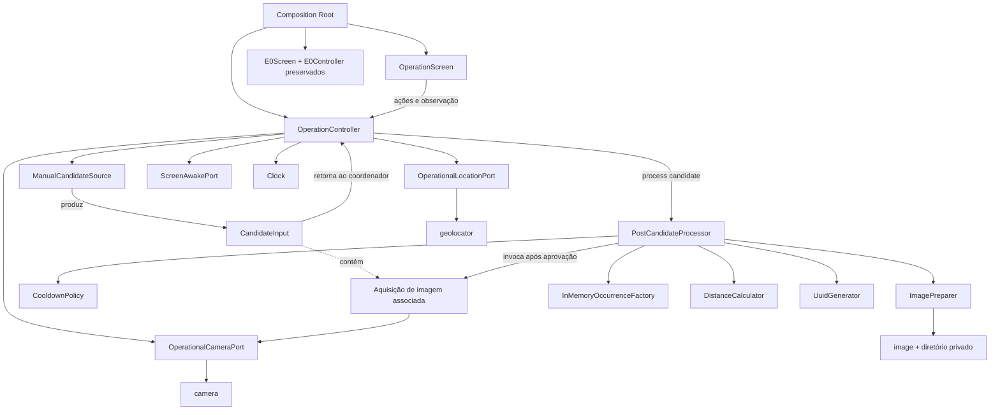
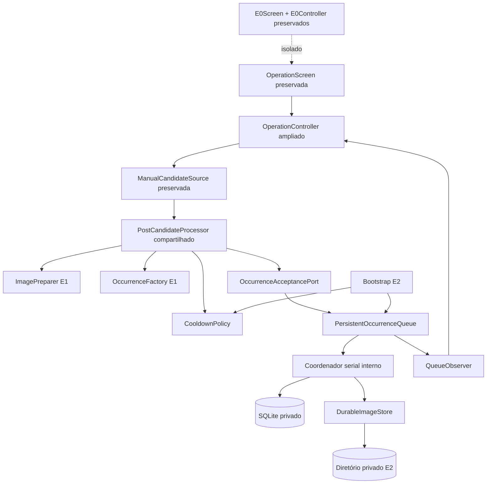
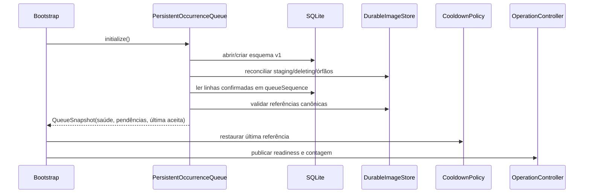
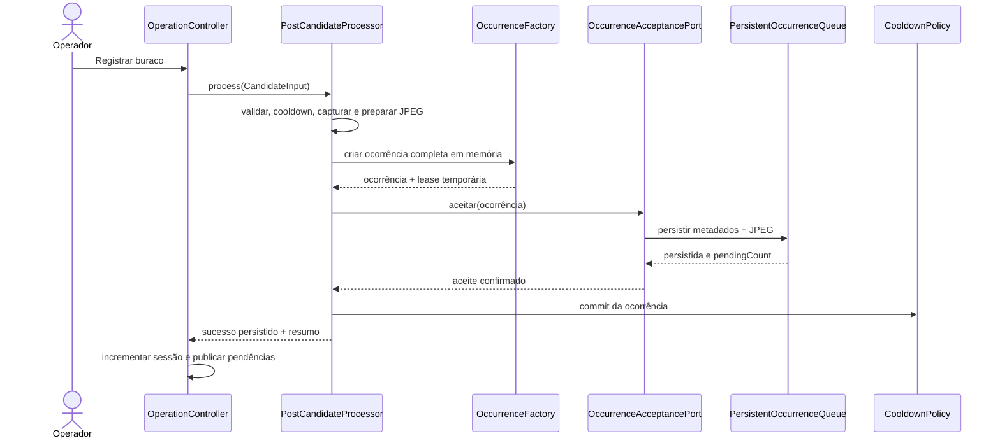

# Design — E0: Smoke test da infraestrutura Android

## 1. Visão geral da E0

A E0 é um incremento diagnóstico mínimo, exclusivo para Android, destinado a reduzir riscos de compilação, instalação, permissões, câmera, localização e comunicação HTTPS no Samsung Galaxy S25+ antes de qualquer funcionalidade de detecção ou de ocorrência.

A entrega futura de E0 será uma única tela Flutter que:

- inicializa e exibe o preview da câmera traseira;
- solicita, de forma básica e serializada, primeiro a permissão de câmera e depois a permissão de localização precisa;
- apresenta o estado do serviço de localização e, quando houver posição, latitude, longitude, precisão e velocidade fornecida pelo provedor;
- executa, sob ação explícita do usuário, uma requisição HTTPS diagnóstica sem corpo e sem credenciais para um destino fictício ou exclusivo de teste;
- apresenta estados claros de inicialização, disponibilidade e indisponibilidade;
- permanece utilizável em diferentes dimensões, densidades e escalas de fonte do Galaxy S25+;
- libera câmera, assinatura de localização e cliente HTTP conforme o ciclo de vida.

A interface aparecerá imediatamente, sem aguardar permissões. A recusa de uma permissão não bloqueará os diagnósticos independentes, e nenhuma solicitação de permissão será apresentada simultaneamente a outra.

O resultado da E0 deverá ser interrompido em seu próprio Validation Gate para validação manual e aprovação explícita. Nenhuma etapa posterior poderá ser iniciada antes dessa aprovação.

## 2. Objetivos técnicos

1. Confirmar que o projeto Flutter Android pode ser compilado, instalado, aberto e executado de modo controlado no Samsung Galaxy S25+.
2. Confirmar que o Android reconhece as declarações de câmera, localização e internet exigidas pelo smoke test.
3. Selecionar a câmera traseira padrão disponível e manter um preview básico responsivo, sem captura de frames para processamento.
4. Solicitar e distinguir os estados básicos das permissões de câmera e localização precisa sem abrir diálogos Android concorrentes.
5. Obter uma posição de alta precisão em primeiro plano e atualizar seus valores diagnósticos sem associá-los a qualquer outro dado.
6. Confirmar comunicação HTTPS básica com um destino explicitamente fornecido para teste.
7. Produzir mensagens compreensíveis quando câmera, GPS, posição, rede ou destino de teste não estiverem disponíveis.
8. Verificar que a aplicação sobrevive a negações de permissão, indisponibilidades e transições de ciclo de vida sem encerramento inesperado.
9. Manter a solução pequena, com integrações de hardware e HTTP separadas dos widgets, mas sem camadas ou interfaces sem necessidade concreta na E0.

## 3. Limites de escopo

### Incluído na E0

- estrutura mínima de um aplicativo Flutter com suporte exclusivamente Android;
- execução no Samsung Galaxy S25+;
- preview da câmera traseira padrão, sem áudio;
- permissão básica de câmera;
- permissão de localização em primeiro plano com exigência de localização precisa;
- leitura diagnóstica de latitude, longitude, precisão em metros e velocidade em metros por segundo quando o provedor fornecer valor utilizável;
- estado básico do diagnóstico de comunicação;
- uma requisição `GET` HTTPS, sem corpo e sem autenticação, acionada manualmente contra URL fictícia ou exclusiva de teste;
- mensagens de indisponibilidade e ações simples de tentar novamente;
- interface adaptável e rolável;
- tratamento de ciclo de vida dos recursos;
- roteiro de validação manual, evidências esperadas e Validation Gate da E0.

### Expressamente excluído da E0

A E0 não conterá biblioteca YOLO, modelo TFLite, inferência, detector real, simulado ou falso, detecção de buracos, FPS de inferência, confiança, cooldown, criação ou representação de ocorrência, preparação definitiva de imagem, UUID de idempotência, fila persistente, API key, armazenamento seguro, multipart ou integração com a API de ocorrências. A requisição diagnóstica não conterá imagem, coordenadas ou qualquer dado de ocorrência e não utilizará o endpoint fixo de ocorrências.

Também ficam excluídos controles de início/parada de captura, processamento ou armazenamento de frames, execução em segundo plano, tela de configurações e experiência completa de recuperação de permissões. Esses itens não são necessários para comprovar a infraestrutura da E0.

## 4. Arquitetura mínima

A arquitetura será composta por uma camada de apresentação, um coordenador de estado e permissões e três componentes concretos de integração:

```text
E0Screen
   │ observa e envia ações
   ▼
E0Controller (ChangeNotifier)
   │ coordena a sequência de permissões
   ├── CameraDiagnostic
   ├── LocationDiagnostic
   └── DiagnosticHttpClient
```

- **Apresentação:** renderiza imediatamente o preview, os indicadores e botões de repetição do diagnóstico. Não acessa permissões, localização ou HTTP diretamente.
- **Coordenação:** mantém um único estado observável da tela, converte resultados técnicos em estados de interface e é a autoridade que autoriza cada etapa capaz de apresentar uma solicitação de permissão.
- **Integrações:** cada componente possui somente a responsabilidade concreta de câmera, localização ou HTTPS. Os componentes não iniciam por conta própria fluxos concorrentes de permissão.

O `E0Controller` manterá uma pequena máquina de estados para permissões: câmera pendente, câmera em resolução, câmera resolvida, localização pendente, localização em resolução e permissões resolvidas. Somente uma transição de solicitação poderá estar ativa. A câmera será resolvida primeiro; apenas após concessão ou recusa poderá começar a solicitação de localização. A recusa da câmera não interromperá a sequência. Concluídas as decisões de permissão, câmera e localização poderão atualizar seus estados independentemente.

Cada ciclo de inicialização terá um identificador de geração. Callbacks de operações assíncronas de gerações anteriores serão ignorados. Uma referência à solicitação de permissão em andamento impedirá que retomadas, reconstruções da tela ou toques repetidos abram diálogos duplicados.

`ChangeNotifier`, `ListenableBuilder`/`AnimatedBuilder` e `setState` são suficientes para a única tela. Não será adicionada biblioteca de gerenciamento de estado. Também não serão criados repositórios, casos de uso, injeção de dependências por framework ou interfaces espelho com uma única implementação. As dependências serão construídas explicitamente no ponto de composição da E0.

A separação proposta impede que regras de permissão, ciclo de vida e classificação de falhas fiquem nos widgets, sem transformar o smoke test em uma arquitetura definitiva para as etapas posteriores.

## 5. Estrutura proposta de diretórios

A estrutura abaixo representa somente os arquivos que seriam necessários durante a implementação futura da E0; este documento não os cria.

```text
lib/
├── main.dart
└── e0/
    ├── e0_screen.dart
    ├── e0_controller.dart
    ├── e0_state.dart
    ├── camera_diagnostic.dart
    ├── location_diagnostic.dart
    └── diagnostic_http_client.dart

android/app/src/main/
└── AndroidManifest.xml
```

Não haverá diretórios de detector, modelo, domínio de ocorrência, persistência, fila, envio, autenticação ou configurações.

### Identidade do projeto

- O repositório atual é exclusivo para o aplicativo mobile.
- O projeto Flutter será criado diretamente na raiz deste repositório; não será criado um subdiretório duplicado para o aplicativo.
- O nome do projeto Flutter será `pavimenta_ai_mobile`.
- O `applicationId` Android será `com.vitor.pavimenta_ai_mobile`.
- Esse identificador é gratuito e será usado para desenvolvimento, instalação local e apresentação do TCC. Não é necessário possuir nem registrar o domínio `vitor.com`; a notação reversa serve como identificador do pacote Android.
- A URL HTTPS funcional do diagnóstico será fornecida somente durante a validação por `--dart-define=E0_DIAGNOSTIC_URL=...`.
- Nenhuma URL funcional de produção será versionada.

O comando a considerar no planejamento futuro das tarefas será equivalente a:

`flutter create --platforms=android --project-name pavimenta_ai_mobile --org com.vitor .`

Esse comando não faz parte da revisão de design e não deverá ser executado nesta fase.

## 6. Componentes e responsabilidades

### `main.dart`

- inicializar os bindings Flutter;
- criar as dependências concretas da E0;
- iniciar um `MaterialApp` Android com `E0Screen` como única rota funcional;
- não carregar configurações, credenciais, modelos ou armazenamento.

### `E0Screen`

- observar `E0Controller`;
- renderizar imediatamente o painel da câmera, o painel de localização e o painel de rede, mesmo enquanto permissões estiverem pendentes;
- encaminhar ações de tentar novamente e executar diagnóstico;
- usar `SafeArea`, restrições de largura e conteúdo rolável para evitar cortes;
- observar o ciclo de vida por meio de `WidgetsBindingObserver` e encaminhar transições ao coordenador.

### `E0Controller`

- iniciar o fluxo serial de permissões sem bloquear a thread da interface;
- autorizar primeiro a operação de câmera que poderá solicitar permissão e aguardar sua conclusão, com concessão ou recusa, antes de autorizar a solicitação de localização;
- garantir que a recusa de câmera não impeça localização e que a recusa de localização não impeça câmera ou rede;
- depois de resolvidas as permissões, permitir que câmera e localização atualizem seus estados independentemente;
- manter um snapshot consolidado em `E0State`;
- serializar ações repetidas do mesmo diagnóstico para evitar inicializações concorrentes;
- impedir solicitações de permissão simultâneas ou duplicadas, inclusive em retomadas do ciclo de vida;
- invalidar e ignorar resultados assíncronos obsoletos após descarte, pausa ou início de uma nova geração;
- traduzir erros dos componentes em mensagens e estados definidos;
- coordenar pausa, retomada e descarte.

### `E0State`

Snapshot imutável e pequeno contendo:

- fase atual da sequência de permissões;
- estado e mensagem da câmera;
- referência somente leitura ao controlador de preview já inicializado, quando disponível;
- estado e mensagem da localização;
- latitude, longitude, precisão e velocidade opcionais;
- estado e mensagem do diagnóstico HTTPS;
- código HTTP opcional da última resposta;
- indicação de operação em andamento para impedir toques duplicados.

Não conterá entidade de ocorrência nem dados derivados para etapas posteriores.

### `CameraDiagnostic`

- consultar as câmeras expostas pelo dispositivo quando autorizado pelo `E0Controller`;
- escolher a primeira câmera com direção traseira;
- criar e possuir o `CameraController` com áudio desabilitado e resolução moderada adequada ao preview;
- inicializar, expor o controlador pronto para `CameraPreview` e classificar o resultado da permissão ou falhas conhecidas;
- nunca iniciar novamente uma solicitação enquanto a operação autorizada estiver em andamento;
- descartar o controlador de forma idempotente;
- não iniciar stream de imagens nem fornecer frames.

### `LocationDiagnostic`

- começar somente após autorização do `E0Controller`, quando a resolução da permissão de câmera já tiver terminado;
- verificar se o serviço de localização está habilitado;
- verificar e solicitar a permissão em primeiro plano;
- confirmar que a precisão concedida não foi reduzida pelo Android;
- obter uma posição inicial e manter uma assinatura de atualizações enquanto a tela estiver ativa;
- expor somente os valores diagnósticos da posição;
- cancelar a assinatura de forma idempotente;
- nunca abrir uma nova solicitação de permissão se já houver uma em andamento.

### `DiagnosticHttpClient`

- validar tecnicamente a configuração do destino antes de abrir conexão;
- aceitar somente URI absoluta, com esquema HTTPS, host presente, sem usuário ou senha embutidos e sem fragmento;
- rejeitar configuração ausente, URI inválida e o caminho `/api/v1/occurrences`;
- realizar uma única requisição `GET`, sem corpo, autenticação, API key, imagem, coordenadas, UUID ou outros dados de ocorrência;
- aplicar timeout finito, não seguir redirecionamentos e não repetir automaticamente;
- não armazenar, interpretar, renderizar nem registrar o corpo da resposta;
- limitar por tempo e volume qualquer leitura necessária para descartar o corpo e cancelar controladamente conexões que excedam esses limites ou não terminem;
- expor ao controlador somente o código HTTP e uma classificação sanitizada;
- classificar resposta recebida, timeout, falha TLS, configuração inválida e falha de conexão;
- encerrar o cliente e a requisição ativa na mudança de ciclo de vida ou no descarte.

O cliente não tentará inferir se um host pertence a produção. Essa garantia será um controle operacional humano do Validation Gate.

## 7. Fluxo de inicialização do aplicativo

1. O Flutter inicia e apresenta imediatamente a estrutura completa da tela com estados “Inicializando”; a renderização não aguarda permissões.
2. O `E0Controller` cria uma nova geração de inicialização e entra na fase de resolução da câmera.
3. Somente o fluxo de câmera recebe autorização para executar a operação que poderá abrir o diálogo Android. A localização permanece visível como “Aguardando conclusão da permissão de câmera”.
4. Quando a solicitação de câmera terminar, seja por concessão ou recusa, o controlador registra a câmera como resolvida e autoriza o fluxo de localização.
5. Somente então a localização verifica serviço e permissão e, se necessário, apresenta sua solicitação Android.
6. A recusa da câmera não impede o diagnóstico de localização. A recusa da localização não interrompe câmera nem rede.
7. Após ambas as permissões estarem resolvidas, câmera e localização atualizam seus próprios estados de forma independente. Uma falha posterior em um fluxo não bloqueia o outro.
8. O destino HTTPS é apenas validado tecnicamente na inicialização; nenhuma requisição é feita automaticamente.
9. O painel de rede permanece em “Não verificado” até o usuário tocar em “Executar diagnóstico HTTPS” e funciona independentemente das permissões.
10. Se uma transição de ciclo de vida ocorrer durante uma operação, a geração anterior é invalidada para publicação de estado. Uma solicitação de permissão Android ainda aberta permanece registrada como em andamento e não é repetida na retomada.
11. Ao retornar a `resumed`, o controlador reconcilia o resultado da solicitação pendente ou consulta o estado já resolvido antes de prosseguir. Nunca inicia duas solicitações simultâneas nem duplica um diálogo por reconstrução ou retomada.

## 8. Fluxo da câmera

1. Exibir “Inicializando câmera” assim que o `E0Controller` iniciar a primeira fase da sequência.
2. Consultar as câmeras disponíveis somente dentro da operação autorizada pelo controlador.
3. Selecionar a primeira cuja direção seja traseira. A seleção de uma lente física específica não faz parte da E0.
4. Criar o controlador com áudio desabilitado e resolução moderada; a E0 precisa validar preview, não qualidade de captura.
5. Durante a inicialização, o plugin poderá solicitar a permissão Android de câmera. Enquanto essa solicitação estiver ativa, o controlador não autorizará a solicitação de localização.
6. Assim que a permissão de câmera for concedida ou recusada, registrar a conclusão da fase para liberar a verificação de localização. A conclusão da inicialização do preview poderá continuar atualizando somente o estado da câmera.
7. Em caso de sucesso, marcar “Câmera traseira disponível” e exibir `CameraPreview` dentro de uma região com proporção preservada e recorte controlado.
8. Em caso de permissão negada, marcar “Permissão de câmera negada” e permitir que o fluxo de localização prossiga. Oferecer “Tentar novamente” sem executar a ação se outra solicitação de permissão estiver ativa.
9. Se a negação for permanente, orientar o usuário a habilitar a permissão nas configurações do Android, sem implementar o fluxo completo reservado a etapa posterior.
10. Se nenhuma câmera traseira existir, se ela estiver em uso por outro aplicativo ou se a inicialização falhar, manter localização e rede operacionais e apresentar uma mensagem específica quando o erro puder ser identificado.
11. Ao sair de `resumed`, descartar o controlador. Ao retomar, o `E0Controller` cria uma nova geração, verifica se já existe solicitação em andamento e somente então autoriza redescoberta e inicialização, sem reutilizar controlador descartado nem abrir diálogo duplicado.

O fluxo não inicia captura lógica, stream de imagens, análise, gravação, persistência ou inferência.

## 9. Fluxo de localização

1. A interface exibe o painel imediatamente como “Aguardando conclusão da permissão de câmera”.
2. Depois que a solicitação de câmera terminar por concessão ou recusa, o `E0Controller` autoriza a localização e o painel passa a “Verificando localização”.
3. Consultar o estado do serviço de localização do Android.
4. Se o serviço estiver desabilitado, apresentar “Serviço de localização desativado”, manter os valores como indisponíveis e oferecer nova verificação. Como nenhuma solicitação de permissão foi aberta, a fase é considerada resolvida sem bloquear câmera ou rede.
5. Se o serviço estiver habilitado, consultar a permissão atual.
6. Se ainda não houver permissão, solicitar localização em primeiro plano, desde que o controlador confirme não existir outra solicitação ativa. Não será solicitada localização em segundo plano.
7. Se negada, apresentar mensagem clara e permitir nova tentativa coordenada. A recusa não interrompe câmera nem rede. Se negada permanentemente, orientar habilitação nas configurações do Android.
8. Após concessão, consultar a precisão autorizada. Se o Android tiver concedido somente localização aproximada, apresentar “Localização precisa não autorizada” e não representar o requisito como atendido.
9. Com localização precisa autorizada, solicitar uma posição atual com alta precisão e iniciar atualizações em primeiro plano com frequência moderada, sem objetivo de rastreamento veicular.
10. A cada posição, exibir:
    - latitude e longitude em graus decimais;
    - precisão horizontal reportada, em metros;
    - velocidade reportada, em metros por segundo, somente se o valor for finito e não negativo; caso contrário, “Não fornecida”.
11. Se a posição ainda não estiver disponível, apresentar “Aguardando posição”. Se ocorrer timeout ou erro do provedor, apresentar “Posição indisponível” sem encerrar o aplicativo.
12. Ao sair de `resumed`, cancelar a assinatura e invalidar callbacks antigos. Ao retomar, o controlador verifica a sequência e qualquer solicitação ainda pendente antes de reavaliar serviço, permissão e precisão; nenhuma solicitação duplicada será aberta.

A E0 não define limiar aceitável de precisão, não usa posição para bloquear outra função e não aplica regras de validade pertencentes a ocorrências.

## 10. Fluxo de diagnóstico de rede

### Configuração

A URL será fornecida em tempo de compilação por uma chave exclusiva da E0, `E0_DIAGNOSTIC_URL`. O valor padrão será fictício e não resolvível, como `https://e0-diagnostic.example.invalid/health`. Para validar sucesso, o responsável deverá fornecer, fora do repositório, uma URL HTTPS pertencente a servidor simulado ou ambiente exclusivo de teste.

O aplicativo executará apenas as seguintes validações técnicas:

- configuração presente e URI sintaticamente válida;
- URI absoluta;
- esquema exatamente `https`;
- host presente;
- ausência de usuário e senha embutidos;
- ausência de fragmento;
- rejeição explícita do caminho `/api/v1/occurrences`;
- ausência de API key, imagem, coordenadas, UUID ou outros dados de ocorrência na requisição.

A aplicação não possui informação suficiente para determinar genericamente se outro endereço pertence a produção. Não haverá domínio funcional inventado, allowlist nem tentativa de classificar automaticamente o ambiente pelo host.

### Execução

1. O painel inicia em “Não verificado”. Isso evita afirmar que existe ou não conectividade sem uma tentativa real.
2. Ao tocar em “Executar diagnóstico HTTPS”, o botão é desabilitado e o estado muda para “Verificando”.
3. O cliente valida a configuração e envia uma única requisição `GET`, sem corpo, headers de autenticação, API key, coordenadas, imagem, UUID ou identificadores.
4. A validação TLS padrão da plataforma é mantida; certificados inválidos não são aceitos.
5. Redirecionamentos permanecem desabilitados. Uma resposta `3xx` é apenas classificada pelo código recebido, evitando seguir silenciosamente para outro destino.
6. O conteúdo da resposta nunca é armazenado, interpretado, renderizado ou registrado.
7. Qualquer leitura necessária para liberar a conexão e descartar o corpo terá timeout e limite finito de bytes. O valor numérico será definido na implementação, deverá ser pequeno e adequado a um diagnóstico que não utiliza conteúdo.
8. Se o corpo exceder o limite, não terminar dentro do prazo ou continuar indefinidamente, a requisição/conexão será cancelada de forma controlada. O estado receberá somente uma classificação sanitizada de resposta excessiva ou incompleta e, se já disponível, o código HTTP.
9. Somente o código HTTP e uma classificação sanitizada poderão chegar ao `E0State`; headers e corpo não serão propagados.
10. Qualquer resposta HTTP comprova que a pilha de rede e o destino responderam. Respostas `2xx` aparecem como “Destino de teste acessível”; outros códigos aparecem como “Destino respondeu com HTTP N”, sem semântica de envio.
11. Timeout de conexão/resposta, falha TLS e URI inválida recebem mensagens próprias.
12. Uma falha de socket ou resolução de nome aparece honestamente como “Rede indisponível ou destino de teste inacessível”, pois uma única requisição não permite distinguir todas as causas com segurança.
13. Ao final, o botão é reabilitado. Não há polling, retry automático ou execução em segundo plano.
14. Ao sair de `resumed` ou no descarte, o cliente e a requisição ativa são encerrados e callbacks antigos não atualizam a tela.

Não será usada biblioteca de conectividade: o resultado da própria requisição é o sinal diagnóstico de rede. Isso reduz dependências e evita declarar “online” sem comprovar acesso ao destino informado.

### Controles operacionais do Validation Gate

As condições que o aplicativo não pode inferir serão verificadas por uma pessoa no gate:

- confirmar que a URL funcional pertence a ambiente simulado ou exclusivo de teste;
- confirmar que nenhuma URL de produção foi fornecida;
- confirmar que a URL funcional foi fornecida fora do repositório por `--dart-define`;
- registrar evidência sanitizada, sem query string, credenciais ou exposição desnecessária do host.

## 11. Estados da interface

A tela será dividida em três cartões, sob o título “E0 — Diagnóstico Android”. Um banner no topo deixará explícito “Smoke test; nenhum dado de ocorrência é criado ou enviado”.

### Painel de câmera

- `inicial`: ainda não iniciado;
- `inicializando`: descoberta/permissão/inicialização em andamento;
- `disponível`: preview traseiro visível;
- `permissão negada`;
- `permissão negada permanentemente`;
- `sem câmera traseira`;
- `indisponível`: câmera ocupada ou falha de inicialização;
- `pausada`: aplicativo fora de primeiro plano.

### Painel de localização

- `aguardando câmera`: a sequência ainda está resolvendo a permissão de câmera;
- `verificando serviço/permissão`;
- `aguardando posição`;
- `disponível`: valores mais recentes visíveis;
- `serviço desativado`;
- `permissão negada`;
- `permissão negada permanentemente`;
- `precisão reduzida`;
- `posição indisponível`;
- `pausada`.

Valores ausentes serão mostrados como “Não disponível”, nunca como zero. A velocidade ausente será mostrada como “Não fornecida”.

### Painel de rede

- `não verificado`;
- `configuração inválida ou ausente`;
- `verificando`;
- `destino acessível` com código HTTP;
- `destino respondeu` com código HTTP não `2xx`;
- `resposta excessiva ou incompleta`;
- `timeout`;
- `falha TLS`;
- `rede ou destino indisponível`;
- `cancelado pelo ciclo de vida`.

### Responsividade visual

- o conteúdo ficará em `SafeArea` e será verticalmente rolável;
- o preview preservará proporção e terá altura limitada, evitando expulsar os diagnósticos da tela;
- textos poderão quebrar linha e não dependerão somente de cor;
- cartões e botões usarão largura disponível e alvos de toque do Material;
- operações assíncronas mostrarão progresso local, sem bloquear os demais cartões;
- no modo paisagem ou em largura ampla, o layout poderá distribuir cartões em colunas por `LayoutBuilder`; em largura reduzida, permanecerá em uma coluna.

## 12. Tratamento de permissões e indisponibilidades

| Situação | Comportamento da E0 |
|---|---|
| Câmera ainda não autorizada | Solicitar primeiro a câmera e manter localização em espera; nenhum outro diálogo de permissão será aberto simultaneamente. |
| Câmera negada | Não exibir preview; mostrar mensagem, liberar a etapa de localização e oferecer nova tentativa coordenada. |
| Câmera negada permanentemente | Informar que a habilitação deve ser feita nas configurações Android; localização e rede continuam disponíveis. |
| Nenhuma câmera traseira | Informar indisponibilidade e manter localização e rede funcionais. |
| Câmera ocupada/erro | Exibir falha controlada e permitir reinicialização. |
| Localização ainda não autorizada | Somente depois de resolvida a câmera, solicitar permissão em primeiro plano. |
| Serviço de localização desativado | Não solicitar posição; orientar ativação do serviço e permitir nova verificação. |
| Localização negada | Não iniciar stream; mostrar mensagem e ação coordenada de nova tentativa; câmera e rede continuam disponíveis. |
| Localização negada permanentemente | Orientar habilitação nas configurações Android. |
| Somente precisão aproximada | Informar que a E0 exige localização precisa e não marcar o diagnóstico como aprovado. |
| Sem posição/timeout | Manter valores indisponíveis e permitir nova tentativa. |
| URL ausente, inválida, não HTTPS, sem host, com credenciais/fragmento ou com caminho proibido | Não abrir conexão; mostrar erro de configuração. |
| Sem rede/destino inalcançável | Mostrar falha de conectividade sem atribuir causa mais específica do que a evidência permite. |
| Certificado TLS inválido | Recusar conexão e mostrar falha TLS; nunca desabilitar validação. |
| Corpo excessivo ou sem término | Cancelar conexão dentro dos limites finitos e mostrar classificação sanitizada. |

A E0 usará somente solicitações básicas e mensagens. Não implementará um fluxo completo de onboarding, abertura automática de configurações, rationale customizado ou política de permissão em segundo plano.

## 13. Ciclo de vida e liberação dos recursos

`E0Screen` observará `AppLifecycleState` e delegará as transições ao controlador:

- **`resumed`:** criar ou continuar uma geração controlada; reconciliar primeiro eventual solicitação de permissão já aberta; consultar os estados resolvidos; reavaliar câmera e localização somente quando não houver operação equivalente em andamento. A retomada nunca autoriza um segundo diálogo simultâneo ou duplicado.
- **`inactive`, `paused` ou `hidden`:** invalidar a publicação de resultados assíncronos da geração anterior, interromper atualizações de localização, descartar a câmera e encerrar a requisição ativa e o cliente HTTP. Uma solicitação de permissão do sistema que já esteja visível permanece registrada como pendente para reconciliação, não para repetição.
- **`detached` e `dispose`:** remover observer, cancelar `StreamSubscription`, descartar `CameraController`, abortar a requisição ativa, fechar `HttpClient`, invalidar callbacks pendentes e descartar `E0Controller`.

Cada operação de liberação será idempotente. Um identificador de geração impedirá que operações antigas de câmera, localização ou HTTP publiquem estado depois de pausa, descarte ou substituição. A referência separada ao fluxo de permissão em andamento impedirá duplicação, pois o diálogo do sistema pode sobreviver a uma transição em que outros recursos já tenham sido invalidados.

A retomada criará uma nova instância da câmera em vez de reutilizar controlador descartado. A assinatura de localização existirá somente em primeiro plano. A E0 não solicitará serviço de primeiro plano, localização em background, wake lock ou execução persistente.

## 14. Dependências Flutter estritamente necessárias

| Dependência | Uso na E0 | Justificativa |
|---|---|---|
| Flutter SDK (`material`) | Aplicativo, widgets, responsividade e estado nativo | Base obrigatória; fornece toda a apresentação e o `ChangeNotifier`, eliminando biblioteca exclusiva de estado. |
| `camera` | Descoberta da câmera traseira, permissão mediada pelo plugin, controlador e preview | É a integração Flutter oficial/convencional mínima para validar a câmera Android sem acessar APIs nativas diretamente. |
| `geolocator` | Estado do serviço, permissão, precisão autorizada, posição e stream | Já está previsto nos requisitos e concentra a integração Android necessária à localização diagnóstica. |
| Bibliotecas Dart `dart:io` e `dart:async` | `HttpClient`, timeout, limites e controle assíncrono | Fazem parte do SDK; são suficientes para uma única requisição diagnóstica simples e não adicionam pacote HTTP. |

As versões de `camera` e `geolocator` deverão ser fixadas no momento da implementação a versões mutuamente compatíveis com a versão Flutter adotada e com o Android do dispositivo-alvo. Não serão adicionados `http`, `dio`, biblioteca de conectividade, biblioteca de permissões, biblioteca de estado, persistência, armazenamento seguro ou qualquer dependência de visão computacional.

## 15. Configurações Android necessárias

### Verificação prévia do ambiente de desenvolvimento

Antes de criar o projeto Flutter, a futura implementação deverá verificar e registrar:

- a versão instalada do Flutter;
- o resultado de `flutter doctor -v`;
- a disponibilidade da toolchain Android;
- a disponibilidade do ADB no ambiente que executará os comandos Flutter;
- o reconhecimento do Samsung Galaxy S25+ pelo mesmo ambiente que executará o Flutter;
- a compatibilidade prática entre WSL, o ADB utilizado e o aparelho conectado ao Windows.

Não se presumirá que um aparelho reconhecido pelo ADB do Windows seja automaticamente reconhecido pelo ADB dentro do WSL. Se o Flutter for executado no WSL, o diagnóstico deverá confirmar que essa instância realmente lista e acessa o Galaxy S25+; se for executado no Windows, as verificações deverão ocorrer nesse mesmo ambiente.

A implementação não instalará, atualizará nem reconfigurará Flutter, Android SDK, drivers USB, WSL ou ADB sem autorização explícita do usuário. Toolchain ausente, incompatibilidade WSL/ADB ou dispositivo não reconhecido será relatado como bloqueio ou convertido em etapa manual, sem alteração autônoma do ambiente.

### Manifesto e plataforma Android

O `AndroidManifest.xml` da aplicação deverá declarar somente:

- `android.permission.CAMERA`;
- `android.permission.ACCESS_FINE_LOCATION`;
- `android.permission.ACCESS_COARSE_LOCATION`, necessário ao modelo moderno de escolha entre localização aproximada e precisa;
- `android.permission.INTERNET`.

A câmera deverá ser declarada como recurso não obrigatório no manifesto (`required=false`) para que a aplicação possa abrir e apresentar a mensagem controlada mesmo se o recurso não estiver exposto. Em execução, a ausência de câmera traseira reprova o respectivo item do smoke test, mas não deve causar encerramento inesperado.

Configurações adicionais:

- manter somente o módulo Android gerado pelo Flutter; não adicionar suporte iOS ao escopo de validação;
- usar o projeto `pavimenta_ai_mobile` e o `applicationId` `com.vitor.pavimenta_ai_mobile` definidos na identidade do projeto;
- usar `minSdk`, `compileSdk` e `targetSdk` compatíveis com as versões fixadas dos plugins e com a toolchain Flutter vigente na implementação, registrando os valores efetivamente usados como evidência do gate;
- manter tráfego em texto claro desabilitado; o diagnóstico aceita apenas HTTPS;
- não adicionar exceção de segurança de rede, certificado permissivo ou bypass TLS;
- não declarar microfone, armazenamento, localização em segundo plano, foreground service ou wake lock;
- manter o rótulo e ícone padrão suficientes para identificar a instalação E0, sem customização não funcional.

## 16. Estratégia para evitar exposição de URLs reais de produção

### Validações executadas pelo aplicativo

1. O código conterá apenas o valor fictício `https://e0-diagnostic.example.invalid/health`, cujo TLD `.invalid` é reservado para exemplos e não resolve publicamente.
2. O cliente exigirá configuração presente, URI válida e absoluta, esquema HTTPS, host, ausência de usuário/senha e ausência de fragmento.
3. O caminho `/api/v1/occurrences` será rejeitado explicitamente.
4. A requisição não conterá API key, cookies configurados pela aplicação, imagem, localização, UUID, identificador do aparelho ou qualquer dado de ocorrência.
5. O corpo de resposta não será armazenado, interpretado, renderizado ou registrado; somente código HTTP e classificação sanitizada serão expostos.
6. Logs e interface não exibirão query string ou credenciais acidentalmente presentes; mostrarão apenas classificação, código HTTP e, quando necessário, host sanitizado.

### Controles operacionais

1. Um destino funcional será fornecido fora do repositório por `--dart-define=E0_DIAGNOSTIC_URL=...` somente durante build/execução de validação.
2. O responsável pelo Validation Gate confirmará que o destino pertence a servidor simulado ou ambiente exclusivo de teste e que nenhuma URL de produção foi fornecida.
3. A URL não será cadastrada em tela, persistida nem tratada como configuração definitiva do aplicativo.
4. A evidência do gate será sanitizada e registrará a natureza de teste do destino sem expor query string, credenciais ou detalhes internos desnecessários.
5. Nenhuma URL funcional de produção ou credencial será versionada em documentação, exemplo ou código.

O aplicativo não detectará automaticamente se uma URL arbitrária pertence a produção e não usará domínio funcional inventado ou allowlist nesta fase.

## 17. Critérios técnicos de validação

A E0 estará tecnicamente pronta para apresentação no Validation Gate somente se todos os critérios abaixo forem demonstrados no Samsung Galaxy S25+:

| Área | Critério de aprovação |
|---|---|
| Ambiente | Versão Flutter, `flutter doctor -v`, toolchain Android, ADB e reconhecimento do Galaxy pelo ambiente executor foram verificados; qualquer bloqueio foi relatado sem reconfiguração não autorizada. |
| Build | Projeto criado na raiz com a identidade definida e build Android concluído sem incluir dependências ou ativos pertencentes às etapas posteriores. |
| Instalação e abertura | Aplicativo instalado, identificado e aberto sem encerramento inesperado; a tela aparece antes da resolução das permissões. |
| Serialização de permissões | Diálogo de câmera ocorre primeiro; localização somente pode ser solicitada após concessão ou recusa da câmera; retomadas não duplicam solicitações. |
| Câmera | Permissão solicitada quando necessária; preview da câmera traseira exibido após concessão. |
| Indisponibilidade da câmera | Negação ou indisponibilidade resulta em mensagem clara e não impede localização ou rede. |
| Localização | Permissão de localização precisa solicitada após a resolução da câmera e precisão concedida confirmada. |
| Dados de posição | Latitude, longitude e precisão reportada são exibidas quando há posição. |
| Velocidade | Valor é exibido quando o provedor o fornece; caso contrário, a ausência é explicitamente indicada e não reprova isoladamente a E0. |
| Indisponibilidade do GPS | Serviço desligado, permissão ausente/reduzida ou posição indisponível produz estado claro sem impedir câmera ou rede. |
| Validação técnica da URL | Configurações ausentes/inválidas, URI não absoluta, esquema não HTTPS, host ausente, credenciais, fragmento e caminho proibido são rejeitados antes da conexão. |
| HTTPS de teste | Uma requisição manual sem corpo, credenciais ou dados de ocorrência alcança um destino HTTPS confirmado humanamente como exclusivo de teste e apresenta o código recebido. |
| Resposta HTTP | Corpo nunca aparece em estado, tela, armazenamento ou logs; excesso ou ausência de término causa cancelamento controlado dentro de limites finitos. |
| Indisponibilidade de rede/destino | Falha é exibida sem travar a interface e sem ser representada como envio de ocorrência. |
| Segurança operacional | Gate confirma URL de teste fornecida fora do repositório, ausência de produção e evidência sanitizada. |
| Responsividade | Rolagem, botões, preview e atualização dos indicadores permanecem utilizáveis durante as operações. |
| Ciclo de vida | Alternar para segundo plano e retornar não mantém recursos inválidos, não duplica streams/diálogos e restaura os diagnósticos sem crash. |
| Limite de escopo | Ausência de detector, modelo, inferência, ocorrência, persistência, autenticação e integração com o contrato de ocorrências. |

Não há meta numérica de precisão, tempo de resposta, temperatura, bateria ou autonomia na E0. A precisão observada será registrada como evidência, não comparada com limite inventado. O limite de descarte do corpo HTTP será pequeno e finito, mas seu valor será escolhido na implementação porque não integra contrato de negócio.

## 18. Roteiro manual no Samsung Galaxy S25+

### Pré-condições de ambiente

1. Verificar a versão instalada do Flutter e registrar o resultado.
2. Executar `flutter doctor -v` e registrar a disponibilidade da toolchain Android.
3. Verificar a disponibilidade do ADB no ambiente que executará o Flutter.
4. Confirmar que o Samsung Galaxy S25+ com depuração USB autorizada é listado e acessível nesse mesmo ambiente.
5. Se o trabalho ocorrer via WSL, validar explicitamente a interoperabilidade entre WSL, ADB e o aparelho conectado ao Windows; não aceitar o reconhecimento apenas pelo ADB do Windows como prova automática de acesso pelo WSL.
6. Se qualquer item estiver ausente, relatar bloqueio ou orientar etapa manual. Não instalar, atualizar ou reconfigurar Flutter, Android SDK, drivers USB, WSL ou ADB sem autorização.

### Demais pré-condições

- Samsung Galaxy S25+ com bateria suficiente;
- aplicativo E0 ainda não instalado, ou dados/permissões removidos para validar a primeira execução;
- URL HTTPS de servidor simulado ou ambiente exclusivo de teste, sem autenticação e sem relação com ocorrências, fornecida fora do repositório;
- confirmação humana de que a URL não pertence a produção;
- mecanismo de captura de evidências definido: logs de comando, capturas de tela e, quando útil, gravação de tela.

### Execução nominal

1. Registrar versões de Flutter, Dart, Android SDK, plugins e identificação do dispositivo.
2. Criar futuramente o projeto diretamente na raiz com nome `pavimenta_ai_mobile`, organização `com.vitor` e somente Android, sem subdiretório duplicado; esta revisão de design não executa essa ação.
3. Executar a análise estática aplicável ao projeto E0 e guardar o resultado como evidência técnica, sem criar testes automatizados para esta etapa.
4. Gerar um build Android de depuração com a URL HTTPS de teste injetada por `--dart-define=E0_DIAGNOSTIC_URL=...` e guardar a saída completa do build.
5. Instalar o artefato no Galaxy S25+ e registrar o sucesso da instalação e o `applicationId` `com.vitor.pavimenta_ai_mobile`.
6. Abrir o aplicativo e confirmar que os três painéis aparecem imediatamente, antes da conclusão das permissões, sem travamento ou encerramento inesperado.
7. Confirmar que a câmera é a primeira solicitação apresentada e que nenhum diálogo de localização aparece simultaneamente.
8. Na solicitação de câmera, conceder acesso. Somente após sua conclusão, confirmar que a solicitação de localização pode aparecer.
9. Confirmar visualmente que o preview usa uma câmera traseira cobrindo a área delimitada.
10. Na solicitação de localização, selecionar uso durante o aplicativo e ativar a opção de localização precisa.
11. Em local com recepção adequada, aguardar a posição. Registrar latitude, longitude e precisão mostradas.
12. Observar a velocidade. Se o provedor não a fornecer, registrar corretamente “Não fornecida”; se houver valor, registrar sua exibição em metros por segundo.
13. Tocar em “Executar diagnóstico HTTPS”. Confirmar progresso, resposta do destino de teste e código HTTP, mantendo a interface utilizável.
14. Confirmar que nenhum conteúdo de resposta aparece na tela ou nos registros e que a evidência mostra apenas código/classificação sanitizados.
15. Aumentar temporariamente a escala de fonte e alternar orientação conforme permitido pelo aplicativo. Confirmar que informações e ações continuam acessíveis por rolagem, sem overflow relevante.
16. Enviar o aplicativo ao segundo plano durante inicialização e após os diagnósticos, depois retornar. Confirmar que não há diálogo duplicado, stream duplicado, tela congelada ou crash e que recursos são restaurados de modo controlado.

### Cenários de indisponibilidade

17. Em instalação limpa, negar a câmera e confirmar que somente depois da recusa a localização pode ser solicitada. Confirmar que GPS e rede continuam funcionais.
18. Negar a localização e confirmar mensagem clara, mantendo câmera e rede funcionais.
19. Revogar a câmera, reabrir/repetir o diagnóstico e confirmar mensagem clara sem impedir GPS e rede. Restaurar a permissão depois do registro.
20. Conceder somente localização aproximada e confirmar que a tela informa a ausência de localização precisa. Em seguida, conceder precisão para continuar.
21. Desativar o serviço de localização e confirmar a mensagem correspondente. Reativar e confirmar recuperação por nova tentativa.
22. Em uma condição sem posição disponível, confirmar “Aguardando posição” ou “Posição indisponível”, sem valores zero artificiais.
23. Ativar modo avião, executar novamente o diagnóstico HTTPS e confirmar a mensagem de rede ou destino indisponível. Desativar modo avião ao final.
24. Repetir o build com o host fictício `.invalid` e confirmar que a falha do destino é controlada. Não usar domínio de produção para esse cenário.
25. Se houver ambiente controlado com certificado inválido, confirmar a recusa TLS. Se não houver, marcar esse cenário como não executado, sem desabilitar TLS para forçar sucesso.
26. Configurar temporariamente cada classe inválida — valor ausente, URI relativa, não HTTPS, sem host, com usuário/senha, com fragmento e com caminho `/api/v1/occurrences` — e confirmar bloqueio antes da conexão.
27. Em servidor exclusivo de teste controlado, produzir corpo maior que o limite ou resposta que não termina e confirmar cancelamento controlado, sem conteúdo na interface ou nos logs. Se o ambiente não permitir o cenário, registrá-lo como não executado; não inventar endpoint funcional.

### Evidências e encerramento

28. Reunir: diagnóstico do ambiente, saída do build, instalação, captura da abertura imediata, ordem das permissões, preview traseiro, decisões de permissão, valores de GPS, resultado HTTPS, mensagens de indisponibilidade e observação do ciclo de vida/responsividade.
29. Registrar de modo sanitizado que a URL pertence a teste, foi fornecida fora do repositório e não é produção, sem expor query string, credencial ou detalhes internos desnecessários.
30. Preencher cada critério da seção 17 como aprovado, reprovado ou não executado, com referência à evidência.
31. Confirmar por inspeção de dependências, assets e interface que nenhum item excluído da E0 foi introduzido.
32. Apresentar o pacote de evidências no Validation Gate E0 e interromper o avanço. Qualquer reprovação autoriza apenas correções dentro da E0; E1 depende de aprovação explícita.

## 19. Riscos e limitações da E0

| Risco ou limitação | Mitigação na E0 |
|---|---|
| Diálogos de câmera e localização podem competir na primeira execução | `E0Controller` serializa a sequência: câmera primeiro, localização somente após concessão ou recusa. |
| Retomadas podem disparar inicializações e diálogos duplicados | Registrar solicitação em andamento, usar geração para invalidar callbacks antigos e reconciliar antes de reiniciar. |
| O Android pode conceder localização aproximada apesar da solicitação de precisão | Consultar a precisão autorizada e manter estado explícito de “precisão reduzida”. |
| GPS pode demorar ou falhar em ambiente interno | Diferenciar “aguardando” de erro e executar a validação nominal em área com recepção adequada. |
| Velocidade pode não ser fornecida ou permanecer zero em repouso | Exibir somente o valor válido reportado e aceitar “Não fornecida” como resultado legítimo. |
| A câmera pode estar ocupada, suspensa ou mudar após retorno do background | Descartar na pausa e redescobrir/reinicializar na retomada. |
| Uma requisição isolada não distingue perfeitamente falta de internet, DNS e host fora do ar | Usar mensagem combinada e não adicionar biblioteca de conectividade que também não comprovaria acesso ao destino. |
| O aplicativo não consegue determinar genericamente se a URL é de produção | Exigir confirmação humana e evidência sanitizada no Validation Gate; não criar allowlist ou domínio funcional. |
| O destino de teste pode estar indisponível durante o gate | Preparar previamente um ambiente exclusivo de teste e manter cenário fictício separado para validar falhas. |
| URL injetada em build pode ser extraída do APK | Usar somente destino de teste não secreto; nunca injetar produção ou credencial. |
| Resposta HTTP pode ser grande, infinita ou conter conteúdo não confiável | Nunca utilizar o conteúdo; aplicar limites finitos de tempo/volume e cancelar a conexão ao excedê-los. |
| Diferentes lentes traseiras podem ser expostas pelo aparelho | Selecionar a primeira câmera marcada como traseira; seleção avançada de lente não é objetivo da E0. |
| ADB do Windows e ADB do WSL podem enxergar dispositivos diferentes | Verificar o aparelho no mesmo ambiente que executará Flutter e relatar incompatibilidade sem reconfiguração não autorizada. |
| Não há metas numéricas de responsividade, precisão ou consumo | Registrar observações qualitativas sem inventar limiares de aprovação. |
| O smoke test não prova comportamento das etapas posteriores | Tratar o gate somente como redução de risco da infraestrutura Android básica. |

## 20. Decisões adiadas para E1 a E5

As etapas E1 a E5 são apenas fronteiras arquiteturais neste design:

- **E1:** integração do limite de detecção local; nenhum componente dessa integração existe na E0.
- **E2:** introdução do limite de criação em memória e dados associados; a E0 não cria nem prepara esses dados.
- **E3:** introdução do limite de persistência; a E0 não possui armazenamento ou fila.
- **E4:** introdução do limite de comunicação com o contrato de ocorrências e proteção de credenciais; o cliente diagnóstico da E0 não será tratado como essa integração.
- **E5:** introdução do limite de configuração e experiência operacional completa; a E0 mantém apenas controles diagnósticos básicos.

Interfaces, bibliotecas, formatos, fluxos e regras dessas etapas não são escolhidos neste documento. O código diagnóstico da E0 poderá ser substituído ou evoluído posteriormente, mas não deverá antecipar contratos futuros.

## 21. Correspondência com RF-00 e requisitos relacionados à E0

| Requisito | Cobertura no design E0 | Evidência prevista |
|---|---|---|
| RF-00.1–2 | Arquitetura e estrutura mínimas, identidade fixa, criação na raiz, Android exclusivo e verificação prévia do ambiente | Diagnóstico da toolchain; saídas de build e instalação; captura da aplicação aberta |
| RF-00.3–4 | Fluxo serial inicia pela câmera traseira, solicitação básica e mensagens de erro | Ordem dos diálogos, preview e cenários de permissão/indisponibilidade |
| RF-00.5–6 | Localização solicitada após a câmera e apresentação dos quatro dados diagnósticos | Captura dos valores e dos estados de permissão/serviço/posição |
| RF-00.7–8 | Requisição HTTPS exclusiva de teste, validações técnicas, controles humanos e estados de falha | Resultado HTTP sanitizado, confirmação do ambiente e cenários sem rede/destino |
| RF-00.9–10 | Limites explícitos e estrutura sem módulos posteriores | Inspeção de dependências, assets, diretórios e interface |
| RF-00.11 | Seções 17 e 18 definem critérios, roteiro e evidências no Galaxy S25+ | Checklist preenchido e evidências associadas |
| RF-00.12 | Interrupção obrigatória no Validation Gate | Registro de aprovação ou reprovação explícita |
| RF-01 | Suporte Android, execução no Galaxy S25+ e falhas controladas | Instalação, abertura e cenários de indisponibilidade sem crash |
| RF-03, parcela E0 | Preview básico traseiro sem inferência e permissão básica | Preview e negação/restauração da câmera |
| RF-05, parcela E0 | Uma tela com somente indicadores diagnósticos pertinentes à E0 | Captura integral da tela |
| RF-06, parcela E0 | Diagnóstico de localização sem criação de ocorrência | Valores de posição e mensagens de indisponibilidade |
| RF-23, parcela E0 | Ordem, escopo fechado, roteiro, evidências e bloqueio no gate | Checklist do gate e decisão explícita antes de E1 |
| RNF-04, parcela E0 | Preview, indicadores e ações assíncronas responsivos | Observação manual durante permissões, câmera, GPS, HTTP e rolagem |
| RNF-07, parcela E0 | Validação integral no Samsung Galaxy S25+ | Pacote de evidências produzido no dispositivo físico |

### Validation Gate da E0

O gate será considerado **aprovável** quando todos os critérios obrigatórios da seção 17 estiverem demonstrados no Samsung Galaxy S25+, as eventuais limitações estiverem registradas e a inspeção confirmar os limites de escopo. A velocidade poderá constar como “Não fornecida” quando esse for o resultado real do provedor; o comportamento deve estar visível e registrado.

A aprovação também exige confirmação humana de que a URL funcional pertence exclusivamente a teste, nenhuma URL de produção foi fornecida, o valor funcional permaneceu fora do repositório e a evidência foi sanitizada. O aplicativo valida apenas propriedades técnicas da URI e rejeita o caminho de ocorrências; ele não classifica ambientes automaticamente.

O gate será **reprovado** se houver falha de build, instalação ou abertura; solicitações simultâneas ou duplicadas; ausência do preview traseiro após autorização; impossibilidade não explicada de solicitar localização precisa ou apresentar posição disponível; ausência do diagnóstico HTTPS; corpo de resposta exposto; recurso não liberado; crash; interface impraticável; exposição de destino de produção/credencial; ou inclusão de qualquer funcionalidade posterior.

Após a apresentação, o trabalho deverá parar. Somente a aprovação explícita do responsável autoriza iniciar E1; em caso de reprovação, serão permitidas apenas correções pertencentes à E0.

---

# Design adicional — E1: Captura manual e ocorrência em memória

> **Status e transição:** este bloco é posterior e separado do registro histórico da E0 acima. A E0 foi implementada, validada fisicamente no Samsung Galaxy S25+ e aprovada. O comportamento, as responsabilidades e as evidências históricas da E0 permanecem preservados. Este bloco projeta somente a E1; não reinterpreta retroativamente a E0 e não inicia implementação.

## Overview

### E1.1 Visão geral

A E1 introduz uma tela operacional Android para registrar manualmente um buraco observado antes da disponibilidade de detecção automática. O operador vê o preview da câmera traseira, a localização corrente e um banner inequívoco de modo manual; quando câmera, localização, rota e ciclo de vida estão aptos, o botão **“Registrar buraco”** entrega uma ação a uma fonte manual substituível.

Um acionamento permitido produz uma única ocorrência completa em memória com imagem JPEG privada, `detectedAt` fixado no instante do aceite, coordenadas válidas, velocidade opcional em km/h, `confidence = 1.0`, `defectClass = pothole` e UUID v4. Cooldown, preparação de imagem e criação da ocorrência são regras isoladas e testáveis. A E1 não possui persistência, fila, cliente de ocorrências, credencial, envio ou detecção automática.

## E1.2 Relação com a E0 aprovada

A E1 adiciona **Operação** como rota inicial e mantém **Diagnóstico** como rota para a `E0Screen`. Integrações mínimas podem mover arquivos ou extrair comportamento comum estritamente necessário, mas devem preservar no Diagnóstico aprovado: câmera traseira, GPS, ordem e mensagens de permissões, HTTPS diagnóstico, estados de indisponibilidade e ciclo de vida.

O `E0Controller` continua dono do fluxo do Diagnóstico. Seu `DiagnosticHttpClient` continua exclusivo da E0, não é reutilizado, generalizado nem transformado em cliente de ocorrências. A E1 não altera evidências históricas. Qualquer regressão introduzida pela navegação ou por extração de código deve ser corrigida e reverificada no Gate E1.

Operação e Diagnóstico nunca possuirão simultaneamente câmera ou stream de localização. A transição de rota aplicará o protocolo definido em E1.19 e E1.22, inclusive porque um `push` não altera necessariamente o `AppLifecycleState`.

## E1.3 Objetivos e limites

### Objetivos da E1

1. Exibir nova tela operacional com identidade visual aprovada, preview traseiro e estado de GPS.
2. Tornar inequívoco que a fonte atual é confirmação humana temporária.
3. Isolar a fonte manual atrás de um contrato substituível e entregar candidatos ao pós-candidato compartilhado.
4. Criar uma ocorrência completa somente em memória, com horário, localização, velocidade opcional, classe, confirmação manual, UUID e JPEG válidos.
5. Bloquear concorrência e evitar imagem ou UUID quando o cooldown rejeitar a ação.
6. Manter imagens somente em diretórios privados, com ownership explícito e limpeza determinística.
7. Preservar a E0 pela navegação e pela exclusão mútua de recursos.
8. Manter a tela ligada somente enquanto a Operação estiver efetivamente ativa.
9. Permitir testes automatizados das regras sem câmera, GPS ou relógio reais.
10. Encerrar a entrega no Validation Gate E1.

### Limite implementável exclusivo

A E1 contém apenas tela Operação, navegação ao Diagnóstico E0, captura manual, ocorrência em memória, arquivos temporários, permissões operacionais, ciclo de vida, tela ligada e testes correspondentes.

Não pertencem à E1: fila ou banco local; persistência de ocorrência; cliente ou contrato de API; multipart; credencial; armazenamento seguro; backoff; envio; modelo; inferência; processamento contínuo de frames; indicador de FPS; ou qualquer funcionalidade planejada para etapas posteriores. Nenhum componente da E1 deve simular essas capacidades.

## Architecture

### E1.4 Arquitetura



A divisão é intencionalmente pequena:

- **Apresentação Flutter:** `OperationScreen` renderiza estado e delega ações; não decide cooldown, não prepara imagem, não cria ocorrência e não conhece arquivo, UUID ou payload.
- **Aplicação:** `OperationController` coordena readiness, single-flight, recursos, lifecycle, navegação e publicação de estado; captura o instante e o snapshot antes de solicitar o candidato, mas não avalia cooldown nem cria ocorrência. `PostCandidateProcessor` recebe qualquer `CandidateInput` normalizado e é a autoridade da sequência compartilhada de validação, cooldown, aquisição de imagem, preparação, UUID, criação e commit.
- **Domínio Dart puro:** candidato, snapshot, cooldown, cálculo de distância, ocorrência e validações não importam Flutter nem widgets.
- **Infraestrutura:** câmera, geolocalização, imagem, relógio do sistema, UUID, diretório privado e wake lock implementam portas pequenas e concretamente necessárias.
- **Diagnóstico:** permanece um fluxo independente, com seu controlador e seu cliente HTTPS próprios.

As dependências são construídas explicitamente no composition root. `ChangeNotifier` e `AnimatedBuilder`/`ListenableBuilder` bastam para a tela. Não serão introduzidos frameworks de DI, gerenciamento de estado ou mocks. Portas existem somente nos limites que precisam ser substituídos em teste, que encapsulam plugin/IO, ou que viabilizam a futura troca da fonte.

## E1.5 Estrutura proposta de diretórios

A estrutura é conceitual e orienta implementação futura; nenhum arquivo é criado por este design.

```text
lib/
├── main.dart                         # composition root e rotas
├── e0/                               # implementação aprovada preservada
├── operation/
│   ├── operation_screen.dart
│   ├── operation_controller.dart
│   ├── operation_state.dart
│   └── operation_theme.dart
├── candidate/
│   ├── occurrence_candidate_source.dart
│   └── manual_candidate_source.dart
├── application/
│   └── post_candidate_processor.dart
├── domain/
│   ├── location_snapshot.dart
│   ├── cooldown_policy.dart
│   ├── distance_calculator.dart
│   └── in_memory_occurrence.dart
└── infrastructure/
    ├── operational_camera.dart
    ├── operational_location.dart
    ├── image_preparer.dart
    ├── private_image_store.dart
    ├── system_clock.dart
    ├── uuid_v4_generator.dart
    └── screen_awake.dart

test/
├── candidate/
├── application/
├── domain/
├── infrastructure/
└── operation/
```

Arquivos podem ser agrupados se a implementação mostrar que um arquivo separado não reduz complexidade. Não haverá diretório de fila, banco, rede de ocorrências, configuração segura ou detector.

## Components and Interfaces

### E1.6 Componentes e interfaces conceituais

As assinaturas abaixo são contratos de design em Dart ilustrativo, não código pronto.

```dart
abstract interface class OperationalCameraPort {
  Future<void> acquirePreview();
  Object? get previewHandle; // adaptado para a apresentação no limite Flutter
  Future<TemporaryCapture> takePicture();
  Future<void> release();
}

abstract interface class OperationalLocationPort {
  LocationSnapshot? get latestValidSnapshot;
  Future<void> acquireForegroundUpdates();
  Future<void> release();
}

abstract interface class Clock {
  DateTime now();
}

abstract interface class UuidGenerator {
  String newV4();
}

abstract interface class DistanceCalculator {
  double metersBetween(GeoPoint from, GeoPoint to);
}

abstract interface class ImagePreparer {
  Future<OwnedPreparedImage> prepare(TemporaryCapture capture);
}

abstract interface class ScreenAwakePort {
  Future<void> setEnabled(bool enabled);
}
```

`Object?` no preview indica apenas que o domínio não conhece `CameraController`; a adaptação tipada permanece na camada Flutter/infraestrutura. A implementação deve preferir um tipo de apresentação específico em vez de propagar `dynamic` pelo sistema.

### Responsabilidades

- `OperationController`: estado observável, readiness, single-flight, lifecycle, rota corrente, wake lock, coordenação de câmera/GPS, captura de `attemptedAt` e snapshot síncrono, solicitação à fonte e feedback; não avalia cooldown nem cria ocorrência.
- `ManualCandidateSource`: produz `CandidateInput` normalizado para a confirmação humana, com aquisição de imagem diferida; não chama câmera ao produzir o candidato, não processa cooldown, não cria UUID nem prepara imagem.
- `PostCandidateProcessor`: recebe candidato sem conhecer a origem e fixa a sequência compartilhada de validação, cooldown, aquisição de imagem, preparação, UUID, criação e commit.
- `CooldownPolicy`: decisão pura e referência da última ocorrência criada.
- `ImagePreparer`/`PrivateImageStore`: orientação, resize, JPEG e ownership.
- `InMemoryOccurrenceFactory`: valida invariantes e cria o objeto imutável.
- portas de câmera/GPS: escondem plugins e não contêm regras de ocorrência.

## E1.7 Abstração da fonte e candidato normalizado

```dart
typedef CandidateImageAcquisition = Future<TemporaryCapture> Function();

final class CandidateSeed {
  final DateTime observedAt;
  final LocationSnapshot location;
  final CandidateImageAcquisition acquireImage;
}

final class CandidateInput {
  final DateTime observedAt;
  final LocationSnapshot location;
  final String defectClass;
  final double confidence;
  final CandidateImageAcquisition acquireImage;
}

abstract interface class OccurrenceCandidateSource {
  Future<CandidateInput> requestCandidate(CandidateSeed seed);
}
```

`CandidateSeed` transporta para uma fonte os dados já associados a uma observação, sem executar aquisição. `CandidateInput` é a única entrada normalizada do pós-candidato: instante observado/aceito, snapshot imutável de localização, classe, confiança e uma aquisição diferida da imagem exata associada. O callback é um valor opaco para a fonte; somente o `PostCandidateProcessor` tem autoridade para invocá-lo depois da validação e da aprovação do cooldown.

O contrato representa a produção do candidato, não a ocorrência final. A fonte manual é a única implementação E1. Uma fonte YOLO futura poderá produzir o mesmo `CandidateInput` com classe, confiança, instante e uma aquisição que materialize o frame associado, sem mudar cooldown, preparação, fábrica ou `PostCandidateProcessor`; nenhuma fonte YOLO, frame ou inferência pertence à E1.

A abstração não contém API, persistência, widget nem campo de rede `source`. Se algum dia a identificação interna do tipo de fonte for necessária para telemetria ou UI, ela será tratada fora do contrato da ocorrência e fora do `CandidateInput` normativo; a E1 não adiciona esse dado sem necessidade. `CandidateResult` distingue criação, bloqueio por cooldown, pré-condição inválida, cancelamento de lifecycle e falha controlada.

## E1.8 Fonte manual

`ManualCandidateSource` recebe um `CandidateSeed` somente depois de o controlador adquirir single-flight e confirmar readiness. A fonte:

1. preserva `observedAt` — o `attemptedAt` capturado no toque — e o snapshot recebidos;
2. atribui sem ambiguidade `defectClass = pothole` e `confidence = 1.0` como confirmação humana;
3. devolve um `CandidateInput` sem chamar câmera, cooldown, preparador, UUID ou fábrica;
4. encapsula em `acquireImage` a aquisição diferida que chama a captura operacional associada àquele toque;
5. garante que a primeira invocação do callback pelo `PostCandidateProcessor`, após aprovação do cooldown, inicia `takePicture()` imediatamente;
6. nunca afirma confiança de modelo ou detecção automática;
7. não mantém estado persistente.

O single-flight continua sob autoridade do controlador. O banner permanente e o texto auxiliar do botão explicam que tocar equivale a confirmar manualmente um buraco observado.

## E1.9 Pós-candidato compartilhado

O `PostCandidateProcessor` é o único fluxo de aplicação que transforma qualquer candidato normalizado em ocorrência, sem método ou ramo dependente da origem. Sua única interface conceitual é:

```dart
abstract interface class PostCandidateProcessor {
  Future<CandidateResult> process(CandidateInput candidate);
}
```

Precondições do coordenador: rota Operação corrente, lifecycle `resumed`, single-flight adquirido e candidato produzido a partir do instante/snapshot daquele acionamento. Ao receber o candidato, o processor executa obrigatoriamente:

1. validar os campos do `CandidateInput` e o snapshot, sem adquirir imagem;
2. avaliar `CooldownPolicy` com `candidate.observedAt` e `candidate.location`;
3. se bloqueado, retornar feedback de cooldown sem invocar `candidate.acquireImage`, sem gerar UUID e sem criar ocorrência;
4. se permitido, invocar imediatamente `candidate.acquireImage()` uma única vez, iniciando a captura operacional no caso manual;
5. preparar e validar o JPEG;
6. gerar um único UUID v4;
7. criar a ocorrência com `detectedAt = candidate.observedAt`, localização, classe e confiança do candidato;
8. somente depois da criação válida, fazer commit do cooldown e devolver sucesso.

Pós-condições: ou existe uma ocorrência completa com ownership da imagem transferido, ou não existe ocorrência/UUID/imagem definitiva e todo temporário criado foi limpo. Falha de captura, compressão, UUID, lifecycle ou validação mantém a referência anterior. O widget, o controlador e a fonte não executam etapas parciais dessa sequência compartilhada.

## Data Models

### E1.10 Modelo da ocorrência em memória

```dart
final class InMemoryOccurrence {
  final String idempotencyKey;      // UUID v4
  final DateTime detectedAt;        // instante aceito, com offset na serialização futura
  final double latitude;            // [-90, 90]
  final double longitude;           // [-180, 180]
  final double? accuracyMeters;     // informativa quando fornecida
  final double? speedKmh;            // null ou [0, 300]
  final double confidence;           // exatamente 1.0 na E1
  final String defectClass;          // exatamente "pothole"
  final OwnedPreparedImage image;    // JPEG privado <= 2 MiB e <= 1280x720
}
```

O objeto é imutável e só pode existir após validação integral. `accuracyMeters` é informativa e não estabelece limiar de aceite; se o provedor não oferecer precisão utilizável para exibição, o snapshot ainda segue as regras normativas de latitude/longitude e permissão precisa, sem inventar limite. A representação de `detectedAt` deve preservar informação de fuso ao produzir ISO 8601, embora não exista payload na E1.

A E1 mantém no máximo a ocorrência corrente necessária para validar/apresentar o resultado e o contador da sessão. Substituir ou limpar a ocorrência libera sua imagem. O contador incrementa somente após criação válida e reinicia com nova execução do aplicativo.

## E1.11 Fluxo manual e ordem normativa

```mermaid
sequenceDiagram
    actor U as Operador
    participant W as OperationScreen
    participant C as OperationController
    participant K as Clock
    participant L as LocationPort
    participant M as ManualCandidateSource
    participant PP as PostCandidateProcessor
    participant P as CooldownPolicy
    participant A as CandidateImageAcquisition
    participant Cam as CameraPort
    participant I as ImagePreparer
    participant G as UuidGenerator
    participant F as OccurrenceFactory

    U->>W: toca Registrar buraco
    W->>C: registerManualPothole()
    C->>C: adquirir single-flight e validar readiness
    C->>K: now()
    K-->>C: attemptedAt
    C->>L: latestValidSnapshot (síncrono)
    L-->>C: snapshot
    C->>M: requestCandidate(CandidateSeed)
    M-->>C: CandidateInput(pothole, 1.0, attemptedAt, snapshot, acquireImage)
    C->>PP: process(candidate)
    PP->>PP: validar candidato e snapshot
    PP->>P: evaluate(candidate.observedAt, candidate.location)
    alt bloqueado por tempo E distância
      P-->>PP: blocked
      PP-->>C: blocked sem invocar aquisição/UUID
      C-->>W: feedback explícito; liberar single-flight
    else permitido
      P-->>PP: allowed
      PP->>A: acquireImage() imediatamente
      A->>Cam: takePicture()
      Cam-->>A: temporário privado
      A-->>PP: temporário associado
      PP->>I: prepare(temporário)
      I-->>PP: JPEG preparado com ownership
      PP->>G: newV4()
      G-->>PP: UUID
      PP->>F: create(candidate, JPEG, UUID)
      F-->>PP: ocorrência válida em memória
      PP->>P: commit(ocorrência criada)
      PP-->>C: created
      C-->>W: estado, contador e feedback
    end
```

A ordem obrigatória é:

1. o widget delega a ação;
2. o controlador adquire single-flight e valida câmera, GPS, rota e lifecycle;
3. o `Clock` captura `attemptedAt` antes de qualquer operação assíncrona;
4. o controlador lê o snapshot válido mais recente de localização de modo síncrono;
5. o controlador cria o `CandidateSeed`, solicita à fonte manual e recebe `CandidateInput` com `pothole`, `1.0`, o mesmo instante/snapshot e aquisição de imagem ainda não invocada;
6. o controlador entrega o candidato ao `PostCandidateProcessor`, que valida candidato e snapshot;
7. o processor avalia cooldown antes de adquirir imagem e antes do UUID;
8. se bloqueado, retorna resultado para feedback de **tempo e distância** abaixo dos mínimos; não invoca a aquisição e não há captura, imagem definitiva, UUID ou ocorrência;
9. se permitido, o processor invoca a aquisição fornecida uma única vez e essa primeira invocação inicia `takePicture()` imediatamente; o mesmo `attemptedAt` permanece como `detectedAt`;
10. o processor prepara a imagem como JPEG;
11. o UUID é gerado depois da imagem válida para evitar identificador sem ocorrência; essa ordem jamais altera `detectedAt`;
12. a fábrica cria a ocorrência completa em memória com os dados normalizados do candidato;
13. somente então o processor faz commit do cooldown e o controlador incrementa o contador ao receber sucesso.

GPS, compressão e UUID não substituem o horário original. O design associa candidato, ação, imagem e horário pela mesma operação, sem afirmar coincidência de milissegundo com o sensor da câmera.

## E1.12 Horário e `detectedAt`

`SystemClock` encapsula `DateTime.now()` e `FakeClock` escrito à mão controla testes. No início da ação, antes de `await`, o controlador chama `clock.now()` uma vez. Esse valor é `attemptedAt`, atravessa `CandidateSeed` e `CandidateInput` como `observedAt` e, após aprovação do cooldown pelo `PostCandidateProcessor`, torna-se o mesmo `detectedAt`.

A implementação preservará o offset retornado pelo relógio e produzirá ISO 8601 com informação de fuso quando a ocorrência for inspecionada. Captura, leitura posterior do GPS, preparação da imagem e UUID não podem recalcular o campo. Callback assíncrono obsoleto não cria ocorrência com esse horário.

## E1.13 Captura e ownership da imagem

`OperationalCameraPort.takePicture()` encapsula `camera.takePicture()` ou operação equivalente. O arquivo originado pelo plugin e o destino preparado permanecem em área privada do aplicativo, nunca na galeria. `PrivateImageStore`, baseado no diretório temporário privado obtido por `path_provider`, atribui nome opaco e não expõe caminho na interface ou em logs.

Ownership conceitual:

```text
plugin/captura temporária
  -> lease da operação em andamento
  -> JPEG preparado sob lease
  -> ocorrência em memória (transferência confirmada)
  -> limpeza ao substituir/descartar/finalizar sessão
```

Antes da criação da ocorrência, um escopo `try/finally` mantém a lease da operação. Rejeição, erro, cancelamento, callback obsoleto ou falha de validação remove captura e derivados. Após criação, a ocorrência em memória torna-se a única dona do JPEG; o temporário original é removido. Substituição da ocorrência corrente remove a imagem anterior antes ou durante a troca controlada, sem janela órfã. Encerramento de sessão, `dispose` ou descarte explícito remove a imagem.

A limpeza é idempotente. Falha de limpeza gera registro técnico sanitizado com tipo da operação e erro, sem path sensível, bytes, conteúdo, coordenadas ou segredo. Na inicialização, uma varredura restrita ao namespace temporário E1 pode remover arquivos órfãos reconhecíveis deixados por encerramento abrupto; não percorre arquivos alheios.

O contrato de ownership deixa um futuro ponto de transferência atômica: somente após confirmação externa de responsabilidade a ocorrência em memória deixaria de ser dona. A E1 não implementa destino, fila, rollback persistente ou essa transferência.

## E1.14 Preparação JPEG

O `ImagePreparer` executa:

1. ler a captura privada dentro de limite controlado;
2. decodificar formato suportado;
3. aplicar correção/bake de orientação quando metadados EXIF indicarem rotação ou espelhamento;
4. normalizar para dimensões que caibam em `1280x720`, preservando proporção e sem ampliar imagem menor;
5. codificar **sempre** JPEG com qualidade exatamente `85`;
6. se o resultado exceder `2 MiB` (`2 * 1024 * 1024` bytes), reduzir monotonicamente apenas largura/altura e recodificar novamente com qualidade `85`;
7. terminar com sucesso quando tamanho e dimensões cumprirem os limites ou rejeitar explicitamente.

A redução usa fator fixo menor que 1 (por exemplo, 0,85), arredondamento que garante ao menos uma dimensão estritamente menor e cálculo da outra pela proporção original. O laço termina porque cada iteração reduz dimensões inteiras e existe limite inferior de `1x1`; também haverá limite de iterações derivado das dimensões iniciais. Se até o limite inferior o JPEG exceder `2 MiB` ou não puder ser codificado, a ocorrência é rejeitada. Qualidade nunca é reduzida.

```dart
while (jpegBytes.length > twoMiB && (width > 1 || height > 1)) {
  final next = dimensionsStrictlySmallerKeepingAspectRatio(width, height);
  image = resize(image, next);
  jpegBytes = encodeJpg(image, quality: 85);
}
if (jpegBytes.length > twoMiB) rejectAndCleanup();
```

O pseudocódigo é conceitual. Testes devem verificar orientação, proporção dentro de tolerância de arredondamento, dimensões, tamanho, qualidade solicitada em todas as tentativas, monotonicidade, terminação, rejeição e limpeza.

## E1.15 Localização e velocidade

A Operação reutiliza com segurança regras já comprovadas na E0 ou extrai o mínimo de um adaptador Geolocator comum, sem mudar resultados do Diagnóstico. Cada tela mantém controlador e sessão próprios; não compartilha `StreamSubscription` ativa. A Operação solicita localização precisa em primeiro plano, conserva o snapshot mais recente e o invalida ao perder permissão, serviço, precisão autorizada, foreground ou rota corrente.

Um `LocationSnapshot` é válido quando a permissão precisa está concedida, latitude é finita em `[-90, 90]` e longitude é finita em `[-180, 180]`. A precisão reportada é exibida, mas nenhum limiar ou idade máxima é inventado. O snapshot vigente no instante do toque é copiado de forma imutável; se não houver snapshot válido, o botão está desabilitado e nenhuma ocorrência pode ser criada.

Conversão de velocidade:

```dart
double? toSpeedKmh(double? metersPerSecond) {
  if (metersPerSecond == null || !metersPerSecond.isFinite || metersPerSecond < 0) {
    return null;
  }
  final kmh = metersPerSecond * 3.6;
  return kmh >= 0 && kmh <= 300 ? kmh : null;
}
```

Velocidade ausente, negativa, não finita ou convertida acima de 300 km/h vira `null` e é omitida do modelo opcional. Zero é válido. A falta de velocidade não bloqueia a ocorrência.

## E1.16 Cooldown por tempo OU distância

`CooldownPolicy` mantém em memória somente a referência da última ocorrência criada: `detectedAt` e ponto geográfico. Defaults E1: 5 segundos e 15 metros.

```dart
CooldownDecision evaluate(DateTime attemptedAt, GeoPoint point) {
  if (lastCreated == null) return allowed;
  final elapsed = attemptedAt.difference(lastCreated.detectedAt);
  final distance = distanceCalculator.metersBetween(lastCreated.point, point);
  return elapsed >= fiveSeconds || distance >= fifteenMeters
      ? allowed
      : blocked(elapsed: elapsed, distance: distance);
}
```

A primeira candidata elegível é permitida. Depois, permite-se nova ocorrência se `elapsed >= 5 s` **OU** `distance >= 15 m`. Rejeita-se somente quando `elapsed < 5 s` **E** `distance < 15 m`. Valores exatamente no limite permitem. Diferença temporal negativa causada por relógio regressivo é tratada como abaixo do limiar temporal, sem impedir que a distância permita.

A distância usa Haversine em Dart puro: é suficiente para dois pontos geográficos e evita depender do plugin no domínio. `DistanceCalculator` é injetável para testes determinísticos.

Decisão visual: cooldown não desabilita preventivamente o botão. Quando câmera, GPS, rota, lifecycle e single-flight estão aptos, o botão permanece acionável; o toque solicita o candidato e o `PostCandidateProcessor` avalia o cooldown. Se bloqueado, o controlador apresenta o feedback breve “Registro ignorado: tempo e distância ainda abaixo dos mínimos”, podendo incluir valores sanitizados. Assim há feedback explícito sem invocar a aquisição de imagem nem criar arquivo ou UUID. Um indicador visual de cooldown pode complementar, mas não substituir, o feedback. Durante processamento o botão fica desabilitado.

O próprio `PostCandidateProcessor` executa `commit` apenas após ocorrência criada. Falhas e rejeições não avançam a referência.

## E1.17 UUID e identidade

`UuidV4Generator` encapsula `uuid` e produz um UUID versão 4 com fonte aleatória criptograficamente segura oferecida pelo pacote/plataforma. Não se usa contador, timestamp ou RNG previsível. A fábrica valida sintaxe e versão antes de aceitar o identificador.

Um único UUID é criado por ocorrência, depois de JPEG válido e antes da construção final. O valor permanece estável enquanto a ocorrência existir em memória. Falha posterior à geração, mas anterior à criação, descarta o valor e limpa a imagem; retry é nova operação e recebe novo UUID. Não existe reenvio na E1.

## E1.18 Estado da tela

`OperationState` é snapshot imutável com:

- visibilidade e condição de rota corrente;
- `AppLifecycleState` relevante;
- status da câmera e handle de preview pronto;
- status de permissão e mensagem da câmera;
- status do serviço/permissão/precisão de localização;
- latitude, longitude, precisão e velocidade apresentáveis;
- `isBusy` e etapa local do processamento;
- readiness calculado para o botão;
- feedback de cooldown ou erro;
- última ocorrência válida resumida, sem bytes na UI;
- contador de ocorrências criadas na sessão;
- estado do wake lock.

`canRegister` é verdadeiro somente quando rota Operação está corrente, app está `resumed`, câmera está pronta, snapshot de localização é válido, não há single-flight e o controlador não está descartado. Cooldown não participa de `canRegister`, pela decisão de feedback da seção E1.16.

Estados de processamento: ocioso, validando, capturando, preparando imagem, criando ocorrência, sucesso, bloqueado por cooldown, cancelado e falha controlada. A UI não armazena `CameraController`, subscription ou arquivo como estado de negócio; handles de preview ficam em limite somente leitura apropriado.

## E1.19 Navegação

O `MaterialApp` terá duas rotas funcionais: Operação como home e Diagnóstico E0. O acesso “Diagnóstico” estará na app bar ou ação claramente rotulada.

Protocolo determinístico ao abrir Diagnóstico:

1. bloquear novas ações e marcar Operação como não corrente;
2. desabilitar wake lock da Operação;
3. invalidar geração e callbacks operacionais;
4. cancelar/ignorar captura em andamento e aguardar sua limpeza;
5. cancelar stream GPS operacional e liberar câmera;
6. somente após a liberação, executar `Navigator.push` e criar/adquirir os recursos próprios da E0;
7. ao `pop`, aguardar o `dispose` completo da E0;
8. marcar Operação como corrente e, se o app estiver `resumed`, readquirir GPS/câmera e wake lock nessa ordem controlada.

A solução simples escolhida é **suspensão explícita antes do `push` e retomada após o `Future` do `push` concluir**. Não é necessário `RouteObserver` para esse único fluxo controlado; se navegação futura puder cobrir a tela por outros caminhos, `RouteAware` poderá complementar sem substituir a suspensão explícita.

A E0 conserva seu `WidgetsBindingObserver` e lifecycle próprios. O composition root cria uma nova sessão/controlador E0 por entrada ou garante dispose completo da instância de rota; não mantém recursos E0 vivos atrás da Operação.

## E1.20 Coordenação de câmera e GPS

Na entrada da rota Operação em `resumed`, o controlador inicia uma geração:

1. reconcilia limpeza anterior;
2. adquire câmera operacional e publica preview quando pronto;
3. adquire localização precisa em primeiro plano;
4. atualiza readiness conforme resultados independentes;
5. habilita o wake lock assim que a condição de Operação ativa (visível, `resumed` e rota corrente) for satisfeita, independentemente do readiness de câmera/GPS.

Câmera e GPS são portas distintas e podem apresentar falha independente. A falta de um desabilita registro, mas a tela e o outro indicador continuam responsivos. Operações equivalentes são single-flight; reconstrução de widget não reinicializa plugin. Callbacks carregam geração e são ignorados quando obsoletos.

O adaptador de câmera seleciona a primeira câmera traseira disponível, sem stream de imagens. Preview e `takePicture()` usam o mesmo controlador operacional enquanto válido. Não há captura contínua.

## E1.21 Permissões

A E1 preserva as declarações Android já necessárias para câmera e localização precisa. Não adiciona biblioteca genérica de permissões. A câmera usa o comportamento do plugin e a localização usa Geolocator, com coordenação do controlador para evitar solicitações concorrentes.

Na primeira entrada operacional, câmera é resolvida primeiro e localização depois, reaproveitando a estratégia segura da E0 sem compartilhar sessão. Recusa temporária mostra explicação e mantém registro desabilitado. Recusa permanente orienta abertura manual das configurações Android. Localização aproximada é insuficiente e produz mensagem “Localização precisa necessária”. Serviço desligado ou posição indisponível produz estado controlado.

Retomadas reconciliam uma solicitação pendente antes de abrir outra. Navegar ao Diagnóstico só ocorre após a Operação deixar de ser autoridade de permissões. A E1 não solicita localização em background, armazenamento, galeria, microfone ou internet adicional.

## E1.22 Ciclo de vida e callbacks obsoletos

**Operacional ativa** significa simultaneamente: tela Operação visível, aplicativo em primeiro plano, `AppLifecycleState.resumed` e rota Operação corrente.

O controlador usa geração monotônica. Ao receber `inactive`, `paused`, `hidden`, `detached`, iniciar navegação ou executar `dispose`:

- marca a Operação como inativa e bloqueia registros;
- incrementa geração antes de aguardar recursos;
- desabilita wake lock em `try/finally` idempotente;
- cancela o stream de localização;
- libera a câmera;
- se uma captura estiver em andamento, não tenta concluir a ocorrência: o resultado assíncrono é ignorado, toda captura/derivado produzido é limpo e o single-flight é liberado;
- limpa ocorrência/imagem em memória quando a sessão termina ou a tela é descartada.

Plugins podem não cancelar fisicamente uma operação já entregue ao sistema; por isso cancelamento lógico por geração é obrigatório. Nenhum callback obsoleto pode publicar estado, incrementar contador, fazer commit de cooldown ou transferir ownership à ocorrência.

Em `resumed`, recursos são readquiridos somente se a rota estiver corrente e após limpeza anterior. Não existe botão Iniciar/Parar no modo manual.

## E1.23 Tela ligada

`ScreenAwakePort` encapsula `wakelock_plus`. O controlador calcula `shouldKeepAwake = visible && foreground && resumed && currentRoute` e aplica somente mudanças de valor.

- habilitar ao completar entrada em Operação ativa;
- desabilitar antes de navegar, e em `inactive`, `paused`, `hidden`, `detached` e `dispose`;
- repetir enable/disable é idempotente;
- falha do plugin gera estado técnico controlado sem tornar captura insegura;
- caminhos de erro usam `finally` para tentar desabilitar;
- Diagnóstico não herda o wake lock da Operação.

Testes verificam sequência e balanceamento das chamadas. O wake lock mantém apenas a tela; não cria execução em background.

## Error Handling

### E1.24 Tratamento de erros

| Condição | Resposta E1 | Limpeza/estado |
|---|---|---|
| câmera sem permissão ou indisponível | mensagem específica; botão desabilitado | GPS e navegação continuam |
| localização sem precisão, serviço ou snapshot válido | mensagem específica; botão desabilitado | câmera/preview continuam |
| ação repetida durante single-flight | ignorar além da operação ativa | nenhuma segunda captura |
| cooldown bloqueado | feedback explícito de tempo e distância abaixo dos mínimos | nenhum arquivo, UUID ou ocorrência |
| `takePicture` falha | mensagem de captura indisponível | limpar eventual temporário |
| decode/orientação/JPEG falha | mensagem de preparação | limpar fonte e derivados |
| JPEG não atinge 2 MiB | rejeitar ocorrência | limpar todos os arquivos |
| UUID inválido/falha | rejeitar criação | limpar JPEG preparado |
| dado obrigatório inválido | rejeitar criação | sem commit de cooldown/contador |
| lifecycle/rota muda durante operação | cancelar logicamente e ignorar callback | limpeza determinística e recursos liberados |
| limpeza falha | registrar erro sanitizado | não expor path ou conteúdo |
| wake lock falha | informar erro técnico não bloqueante | manter lifecycle como autoridade |
| regressão E0 após integração | corrigir dentro da E1 | reverificar no Gate E1 |

Mensagens de UI não exibem stack trace, path privado ou bytes. Logs técnicos não contêm conteúdo da imagem nem coordenadas desnecessárias.

## E1.25 Visual e acessibilidade

A tela usa:

- fundo principal `#111827`;
- cartões/painéis `#1F2937`;
- ação e destaque `#F59E0B`, com texto/ícone `#111827`;
- sucesso `#22C55E` e erro `#EF4444` preferencialmente como ícone, borda ou detalhe acompanhado de texto;
- texto principal `#F9FAFB` sobre fundos escuros;
- foreground de fundos verde/vermelho escolhido após verificação de contraste, sem presumir branco.

Conteúdo previsto: app bar com acesso a Diagnóstico; banner permanente **“Modo manual — YOLO ainda não configurado”** ou equivalente inequívoco aprovado; preview traseiro; cartão GPS; precisão e velocidade quando disponíveis; contador da sessão; status de processamento; botão principal **“Registrar buraco”** com texto auxiliar “Confirmação manual”; feedback transitório de cooldown e erros.

A UI usa `SafeArea`, conteúdo rolável, `LayoutBuilder`, quebra de texto, suporte a escala de fonte e orientação, alvos de toque Material e labels semânticos. Nenhum estado depende só de cor. Preview tem proporção preservada e altura limitada. Indicadores atualizam sem bloquear a thread de UI durante captura/preparação. Não há alegação de detecção automática.

## E1.26 Dependências propostas — somente design

Nenhuma dependência é adicionada por este documento. As versões abaixo são pins exatos candidatos para Flutter 3.24.3/Dart 3.5.3; a implementação deverá confirmar resolução e build Android antes de adotá-las.

| Categoria | Dependência exata | Uso E1 | Justificativa |
|---|---|---|---|
| existente | Flutter SDK / Dart 3.5.3 | UI, `ChangeNotifier`, async, IO e matemática | Base atual; evita state management, DI e utilitários extras. |
| existente | `camera: 0.11.0+2` | preview traseiro e `takePicture()` | Pin já resolvido e validado na E0; a E1 adiciona uso operacional sem captura contínua. |
| existente | `geolocator: 13.0.2` | permissão precisa, snapshot, precisão e velocidade | Pin já resolvido e validado na E0. |
| nova proposta direta | [`image: 4.2.0`](https://pub.dev/packages/image/versions/4.2.0) | decode, bake de orientação, resize e JPEG 85 | Dart puro e suficiente para a transformação; declara SDK `<4.0.0` compatível com Dart 3.5.3. |
| nova proposta direta | [`uuid: 4.6.0`](https://pub.dev/packages/uuid/versions/4.6.0) | UUID v4 | Já aparece transitivamente no lock atual e é compatível com Dart 3; deve virar dependência direta se importada. |
| nova proposta direta | [`wakelock_plus: 1.2.8`](https://pub.dev/packages/wakelock_plus/versions/1.2.8) | manter tela ligada só na Operação ativa | Requer Dart >=3.3 e Flutter >=3.19, compatível com 3.5.3/3.24.3. |
| nova proposta direta | [`path_provider: 2.1.4`](https://pub.dev/packages/path_provider/versions/2.1.4) | diretório temporário privado do app | Requer Dart ^3.2 e Flutter >=3.16, compatível com o ambiente-alvo. |
| SDK Dart | `dart:io`, `dart:async`, `dart:math` | arquivos, coordenação e Haversine | Sem pacote adicional. |

`image` é necessário porque o plugin de câmera não garante sozinho bake de EXIF, resize e recodificação controlada. `uuid` explicita uma dependência usada diretamente. `wakelock_plus` encapsula a API de tela ligada sem código nativo próprio. `path_provider` evita paths manuais e seleciona diretório privado.

Não se propõem pacotes de permissões, HTTP, banco, armazenamento seguro, detecção, estado, DI ou mocks. Metadados de compatibilidade foram resumidos das páginas oficiais do pub.dev; conteúdo reescrito para conformidade com restrições de licenciamento.

## Correctness Properties

As propriedades abaixo cobrem apenas lógica executável da E1. Testes de plugin, aparência, build e dispositivo permanecem exemplos, integração ou smoke tests conforme E1.27–E1.29.

### Property 1: Single-flight de registro manual

Para toda sequência de toques concorrentes ou repetidos enquanto uma captura estiver em processamento, no máximo uma operação de captura e no máximo uma ocorrência serão produzidas.

**Validates: Requirements 03.8, 03.10, 09.11**

**Also validates: Requirement RNF-04.3**

### Property 2: Horário original do acionamento

Para todo acionamento manual permitido e quaisquer atrasos assíncronos posteriores, `detectedAt` será exatamente o único instante lido antes das operações assíncronas, e a imagem pertencerá à operação iniciada por esse mesmo acionamento.

**Validates: Requirements 03.5, 03.13, 07.12, 07.13, 08.2, 08.6, 08.7, 08.9**

### Property 3: Validade e completude da ocorrência manual

Para todo candidato manual, uma ocorrência será criada se e somente se imagem, horário, cooldown e localização obrigatórios forem válidos; toda ocorrência criada terá latitude e longitude no domínio, UUID v4, `confidence = 1.0`, `defectClass = pothole` e somente velocidade válida opcional.

**Validates: Requirements 06.2, 06.3, 07.2, 07.3, 07.5, 07.6, 07.7, 07.8, 08.3, 11.1, 11.5**

### Property 4: Conversão e omissão de velocidade

Para toda velocidade do provedor, valores finitos e não negativos cuja conversão `m/s * 3.6` esteja em `[0, 300]` produzirão esse valor em `speedKmh`; qualquer ausência, valor negativo, não finito ou resultado acima de 300 produzirá `null`.

**Validates: Requirements 06.6, 06.7, 06.8**

### Property 5: Decisão OR do cooldown

Para toda referência anterior criada e todo novo par de instante/ponto, o cooldown permitirá a candidata quando o tempo for pelo menos 5 segundos ou a distância for pelo menos 15 metros, e rejeitará somente quando ambos forem inferiores aos respectivos limites; sem referência anterior, permitirá a primeira candidata elegível.

**Validates: Requirements 09.1, 09.2, 09.3, 09.4, 09.5, 09.6, 09.8**

### Property 6: Processor sem efeitos antes do sucesso

Para todo `CandidateInput` bloqueado ou operação que falhe antes da criação válida, o `PostCandidateProcessor` não invocará a aquisição de imagem no bloqueio e não haverá imagem definitiva, UUID, ocorrência, incremento de contador ou alteração da referência da última ocorrência; somente criação válida fará commit.

**Validates: Requirements 03.14, 03.15, 09.7, 09.9, 09.10**

### Property 7: Contrato da imagem JPEG

Para toda captura decodificável aceita, o preparador produzirá JPEG orientado corretamente, com proporção preservada dentro do arredondamento, dimensões máximas `1280x720`, qualidade solicitada exatamente 85 em todas as codificações e tamanho máximo de 2 MiB, ou rejeitará explicitamente.

**Validates: Requirements 10.1, 10.2, 10.3, 10.4, 10.5, 10.6, 10.7, 10.8**

### Property 8: Redução monotônica e terminação

Para toda imagem inicialmente acima de 2 MiB, cada nova tentativa reduzirá estritamente somente as dimensões inteiras, manterá proporção e qualidade 85 e terminará em número finito de passos com imagem válida ou rejeição.

**Validates: Requirements 10.4, 10.5, 10.8**

### Property 9: Ownership e limpeza de temporários

Para todo resultado de captura — sucesso, rejeição, falha, cancelamento, substituição ou fim de sessão — cada arquivo será propriedade de exatamente uma lease/operação ou ocorrência em memória e será removido quando essa responsabilidade terminar, sem gravação na galeria.

**Validates: Requirements 10.11, 10.12, 10.13, 10.14, 11.6, 11.7**

**Also validates: Requirements RNF-06.6, RNF-06.7, RNF-06.8, RNF-06.12**

### Property 10: Callback obsoleto não produz efeito

Para toda operação assíncrona cuja geração deixe de ser corrente por lifecycle, navegação ou dispose, qualquer conclusão posterior não publicará ocorrência, contador, cooldown ou ownership e limpará os temporários produzidos.

**Validates: Requirements 21.2, 21.3, 21.4, 21.5**

**Also validates: Requirement RNF-06.7**

### Property 11: Wake lock acompanha Operação ativa

Para toda sequência de visibilidade, foreground, lifecycle e rota, o wake lock estará habilitado somente quando todas as condições de Operação ativa forem verdadeiras e será desabilitado em qualquer outra combinação.

**Validates: Requirements 21.1, 21.2, 21.7**

### Property 12: Exclusão mútua de recursos entre rotas

Para toda transição Operação–Diagnóstico–Operação, a rota de destino só adquirirá câmera e localização depois de a rota de origem liberar completamente esses recursos.

**Validates: Requirements 00.4, 00.20, 03.11, 21.6**

## Testing Strategy

### E1.27 Estratégia de testes planejados

Todos os testes executam com `flutter test`. Fakes Dart escritos à mão substituem portas; nenhum framework de mocks é necessário. Fixtures de imagem são geradas durante o teste em sandbox temporário privado e removidas no teardown; o design não exige asset novo.

### Testes de domínio e aplicação

- `ManualCandidateSource`: para cada ação aceita, produz um `CandidateInput` com `confidence = 1.0`, `defectClass = pothole`, preserva `attemptedAt`/snapshot e encapsula a aquisição diferida sem invocá-la.
- `PostCandidateProcessor`: aceita candidatos normalizados sem ramo de origem, valida candidato/snapshot, avalia cooldown antes da aquisição, não invoca aquisição nem UUID quando bloqueado e, quando permitido, executa aquisição -> JPEG -> UUID -> fábrica -> commit nessa ordem.
- aquisição diferida: a primeira e única invocação pelo processor após aprovação inicia `takePicture()` imediatamente; produzir o candidato manual não chama câmera.
- single-flight: toques concorrentes/repetidos resultam em no máximo uma captura e uma ocorrência.
- `Clock`: `detectedAt` é lido uma vez pelo controlador antes do primeiro async, atravessa `CandidateSeed`/`CandidateInput` e permanece igual após atrasos de câmera, GPS já snapshotado, compressão e UUID.
- UUID/modelo: UUID v4 válido, coordenadas obrigatórias, classe/confiança exatas, campos excluídos ausentes e contador somente no sucesso.
- localização: lat/lon nos limites são aceitos; não finitos ou fora do domínio são rejeitados.
- velocidade: valores m/s finitos não negativos convertem por `* 3.6`; 0 e 300 km/h são incluídos; ausência, negativo, não finito e >300 são omitidos.
- cooldown: primeira permitida; tempo no/above 5 s permite; distância no/above 15 m permite; regra OR; somente ambos abaixo rejeitam; falha não atualiza referência; Clock e distância fakes tornam limites determinísticos.

### Testes de imagem e ownership

- qualidade 85 é passada a toda codificação inicial e repetida;
- orientação EXIF é baked quando aplicável;
- proporção é preservada dentro do arredondamento e resultado cabe em 1280x720;
- arquivo final tem até 2 MiB;
- tentativas reduzem somente dimensões, de modo estritamente monotônico, sem baixar qualidade;
- laço termina em sucesso ou rejeição explícita;
- falha/rejeição/cancelamento remove captura e derivados;
- ocorrência assume ownership apenas após criação; substituição, descarte e dispose limpam o JPEG;
- falha de limpeza produz log sanitizado sem path/conteúdo.

### Testes de controlador e widgets

- estados de câmera/GPS/processamento e readiness;
- banner manual permanente, rótulo “Registrar buraco”, confirmação manual e ausência de alegação automática;
- botão desabilitado por câmera, GPS, lifecycle ou busy;
- botão habilitado quando essas precondições passam, mesmo se cooldown puder bloquear;
- toque bloqueado mostra feedback explícito e não chama câmera/UUID;
- callback de geração obsoleta não publica ocorrência, contador ou commit;
- wake lock habilita somente na rota Operação ativa e desabilita em navegação/lifecycle/dispose, inclusive em falha;
- navegação verifica ordem `suspender Operação -> liberar câmera/GPS -> abrir E0 -> dispor E0 -> retomar Operação`;
- regressão E0: câmera, GPS, permissões, HTTPS diagnóstico, mensagens e lifecycle continuam acessíveis pela rota Diagnóstico.

Testes unitários cobrem exemplos e erros específicos. Testes gerativos podem percorrer coordenadas, velocidades, tempos, distâncias e dimensões com loops/dados gerados à mão, sem adicionar biblioteca. Integrações de plugin permanecem no roteiro físico do gate.

## E1.28 Roteiro manual no Samsung Galaxy S25+

### Preparação

1. Executar `flutter test` e `flutter analyze` e guardar saídas da E1.
2. Resolver dependências candidatas e confirmar compatibilidade com Flutter 3.24.3/Dart 3.5.3 antes de qualquer adoção.
3. Gerar build Android debug e instalar no Galaxy S25+ sem adicionar itens fora da E1.
4. Limpar permissões/dados quando necessário, sem alterar evidências históricas E0.

### Fluxo nominal

5. Abrir o app e confirmar Operação como tela principal, paleta aprovada e banner manual permanente.
6. Confirmar preview da câmera traseira, GPS, latitude, longitude, precisão e velocidade quando válida.
7. Confirmar que o botão explica a confirmação manual e está habilitado somente com câmera, GPS, rota, lifecycle e single-flight aptos.
8. Tocar “Registrar buraco”; registrar que uma única captura começa imediatamente após o aceite e que a UI permanece responsiva.
9. Inspecionar a ocorrência em memória: UUID v4, `detectedAt` do toque, coordenadas, `confidence = 1.0`, `defectClass = pothole`, velocidade opcional e JPEG privado.
10. Confirmar dimensões máximas 1280x720, proporção/orientação, qualidade configurada 85 e arquivo até 2 MiB por evidência técnica sanitizada.
11. Confirmar incremento do contador da sessão somente após criação válida.

### Bloqueios e ciclo

12. Repetir toques durante processamento e confirmar uma única operação.
13. Tentar novamente dentro de menos de 5 s e menos de 15 m; confirmar feedback explícito e ausência de nova captura, UUID ou ocorrência.
14. Aguardar pelo menos 5 s sem atingir 15 m e confirmar permissão por tempo.
15. Em cenário seguro, atingir pelo menos 15 m antes de 5 s ou simular somente em teste automatizado; confirmar regra OR sem condução insegura.
16. Revogar/recusar câmera e confirmar mensagem e botão desabilitado.
17. Revogar localização precisa, conceder apenas aproximada e desligar serviço; confirmar mensagens e botão desabilitado em cada caso.
18. Enviar app a `inactive/paused`, retornar e confirmar bloqueio fora de `resumed`, limpeza de captura interrompida, ausência de callback obsoleto e recuperação controlada.
19. Confirmar que a tela fica ligada somente enquanto Operação está visível, `resumed` e corrente; navegar ou pausar deve liberar.

### Navegação e preservação E0

20. Abrir Diagnóstico e confirmar que Operação libera câmera/GPS antes da aquisição E0.
21. Reexecutar roteiro regressivo essencial E0: preview, GPS, permissões, HTTPS diagnóstico, indisponibilidades e lifecycle.
22. Voltar e confirmar dispose completo da E0 antes de a Operação readquirir câmera/GPS.
23. Alternar repetidamente as rotas e confirmar ausência de duas câmeras, streams duplicados, diálogos duplicados ou crash.
24. Aumentar escala de fonte e alternar orientação; confirmar rolagem, labels, alvos de toque, contraste e ausência de informação somente por cor.

### Limpeza e escopo

25. Criar, substituir e descartar ocorrência em memória; confirmar remoção dos arquivos temporários privados.
26. Interromper captura/preparação e confirmar que não sobra arquivo órfão reconhecível.
27. Inspecionar dependências, diretórios, UI e tráfego para confirmar ausência dos itens adiados.
28. Reunir evidências E1 sem modificar o pacote histórico E0.

## E1.29 Validation Gate E1

A E1 é aprovável somente com:

- `flutter test` e `flutter analyze` aprovados;
- build debug, instalação e abertura no Samsung Galaxy S25+;
- preview traseiro, banner manual, botão e indicadores corretos;
- bloqueios por câmera, GPS, lifecycle e concorrência;
- captura única, `detectedAt` original, localização, velocidade opcional, UUID, classe e confirmação manual;
- cooldown de 5 s OU 15 m e rejeição somente com ambos abaixo, com feedback e sem captura/UUID;
- JPEG com orientação, proporção, máximo 1280x720, qualidade 85 e até 2 MiB ou rejeição controlada;
- ocorrência completa somente em memória, contador correto e limpeza de temporários;
- wake lock restrito à Operação ativa;
- navegação com exclusão mútua de recursos e regressão E0 verificada;
- responsividade, acessibilidade e identidade visual no dispositivo;
- inspeção demonstrando ausência de fila, banco, API de ocorrências, multipart, credencial, armazenamento seguro, backoff, envio, modelo, inferência e FPS;
- roteiro preenchido e evidências E1 associadas;
- aprovação explícita do responsável.

O trabalho para ao apresentar o Gate E1. Se reprovado, somente correções pertencentes à E1 podem ser executadas. Etapa posterior não pode começar sem aprovação explícita. As evidências históricas E0 permanecem intactas; a verificação regressiva E0 do Gate E1 gera evidência nova da integração, não reescreve o passado.

## E1.30 Rastreabilidade da E1

| Requisito aprovado | Decisão de design E1 | Evidência planejada |
|---|---|---|
| RF-00 | E1.2 e E1.19 preservam Diagnóstico, responsabilidades, cliente HTTPS separado e evidências | regressão E0 e ordem de recursos no Gate E1 |
| RF-01 | Android e Galaxy S25+ permanecem plataforma/dispositivo-alvo | build, instalação e roteiro físico |
| RF-03 | E1.1, E1.8, E1.11, E1.18 e E1.19 definem preview, banner, botão, captura, bloqueios e Diagnóstico | widgets, single-flight e fluxo manual |
| RF-05 | E1.18 e E1.25 definem indicadores, GPS, processamento e contador | testes de widget e capturas de tela |
| RF-06 | E1.15 define snapshot válido, coordenadas, precisão e velocidade opcional | testes de limites/conversão e roteiro GPS |
| RF-07 | E1.7–E1.11 definem `CandidateSeed`/`CandidateInput`, fonte manual substituível, processor genérico, classe, confirmação e ocorrência | testes da fonte, processor e fábrica e inspeção do modelo |
| RF-08 | E1.12 e E1.17 fixam horário antes de async e UUID único | FakeClock, delays e validação UUID v4 |
| RF-09 | E1.16 define primeira ocorrência, OR, defaults, feedback e commit no sucesso | testes de limites de tempo/distância |
| RF-10 | E1.13–E1.14 definem captura associada, JPEG 85, resize, 2 MiB e limpeza | fixtures geradas e inspeção técnica |
| RF-11 | E1.10 e E1.13 limitam ocorrência/arquivo à memória e sessão | teste de ownership e ausência de persistência |
| RF-20 | E1.20–E1.21 coordenam permissões e indisponibilidades | testes de estado e cenários no Galaxy |
| RF-21 | E1.19, E1.22 e E1.23 definem rota corrente, lifecycle, single-flight e tela ligada | fakes de lifecycle/wake lock e roteiro |
| RF-23 | E1.3 e E1.29 fecham escopo e interrupção no Gate E1 | inspeção de escopo e aprovação explícita |
| RNF-01 | E1.4–E1.9 separam widgets, controlador, domínio, portas, fonte substituível e `PostCandidateProcessor.process(CandidateInput)` | análise de imports e testes por porta |
| RNF-03 | E1.27 prevê `flutter test` com fakes para regras críticas | saída completa dos testes |
| RNF-04 | E1.18, E1.20 e E1.25 preservam preview/UI responsivos e evitam acúmulo | testes de estado e observação física |
| RNF-06 | E1.13–E1.14 definem armazenamento privado, ownership e limpeza | testes de filesystem temporário |
| RNF-07 | E1.28–E1.29 definem roteiro e gate no Galaxy S25+ | pacote de evidências E1 |
| RNF-08 | E1.25 fixa paleta, banner, semântica e contraste | testes de widget e inspeção visual |

RF-02 e RF-04 não geram componente E1: servem somente para confirmar que modelo, carregamento, inferência, frames e FPS permanecem ausentes.

## E1.31 Adiamentos para E2–E5

Este design não especifica solução implementável para etapas posteriores. Permanecem apenas as fronteiras normativas já aprovadas:

- responsabilidade da imagem pertence à ocorrência em memória durante a E1; uma transferência futura só poderá ocorrer após confirmação atômica do novo responsável;
- `OccurrenceCandidateSource` produz `CandidateInput` e `PostCandidateProcessor.process(candidate)` é o ponto genérico compartilhado; a E1 possui somente fonte manual, e a identidade do tipo de fonte não integra ocorrência nem contrato normalizado;
- uma fonte futura poderá fornecer classe, confiança, instante, localização e materialização da imagem associada sem mudar cooldown, preparação, UUID ou fábrica, mas nenhuma fonte automática é implementada na E1;
- ocorrência, cooldown, imagem e UUID não dependem de rede, armazenamento ou origem automática;
- nenhuma escolha de banco, cliente de rede, credencial, protocolo de retry, modelo ou runtime é feita neste bloco;
- iniciar qualquer etapa posterior depende da aprovação explícita do Gate E1.

Assim, a E1 termina com ocorrência válida em memória e imagem temporária privada sob ownership explícito. Não há código pendente ou simulado de etapas posteriores dentro do escopo E1.

---

# Design adicional — E2: Fila local persistente

> **Status e reconciliação normativa:** a E1 foi implementada, validada no Samsung Galaxy S25+ e aprovada explicitamente pelo usuário, conforme a evidência consolidada `evidence/task-34.6-validation-gate.md`. O texto anterior que apresenta a E1 como projeto futuro permanece como registro do momento em que aquele design foi aprovado, não como descrição do estado atual. Da mesma forma, a nomenclatura histórica da seção 20 do design E0 foi superada pela sequência normativa vigente em `requirements.md`: E1 corresponde à captura manual e ocorrência em memória; E2 corresponde à fila local persistente. Esta seção E2 e os requisitos aprovados são as referências vigentes para a próxima etapa. Nenhuma implementação E2 é iniciada por este documento.

## E2.1 Visão geral

A E2 preserva integralmente os fluxos aprovados de Diagnóstico E0 e Operação E1 e acrescenta um único limite funcional: toda ocorrência manual válida passa a ser persistida localmente, com seu JPEG associado, antes de ser considerada aceita pela aplicação. A fila deve sobreviver ao fechamento, force-stop e reabertura do aplicativo, reconstruir os mesmos dados da ocorrência e apresentar na tela Operação a quantidade de pendências.

A E2 continua sem integração real com a API. Não há `BASE_URL`, API key, implementação ou acesso E2 a armazenamento seguro de credencial, multipart, tentativa de envio, classificação HTTP, retry, backoff, worker em segundo plano, YOLO, TFLite ou inferência. A declaração posterior, em E3, de uma dependência segura pinada não cria fluxo, store, credencial ou responsabilidade de armazenamento seguro na E2. A palavra “fila” nesta etapa significa armazenamento durável de ocorrências pendentes; não significa fila de rede em execução.

O ponto de aceite muda de forma controlada em relação à E1: a ocorrência continua sendo criada completa em memória pelo pós-candidato compartilhado, mas o resultado de sucesso só é publicado depois que metadados e imagem tiverem sido confirmados pelo armazenamento persistente. Se a persistência falhar, não há aceite, incremento do contador da sessão nem avanço da referência de cooldown.

## E2.2 Escopo positivo

A E2 implementará somente:

1. banco local privado para registros completos de ocorrências pendentes;
2. diretório privado durável para os JPEGs associados, distinto do namespace temporário E1;
3. operação transacional recuperável para promover imagem, inserir metadados e transferir ownership;
4. recuperação da fila e reconciliação de arquivos após reabertura ou interrupção;
5. reconstrução determinística dos dados necessários a um envio futuro, sem realizar o envio;
6. contagem observável de pendências na tela Operação;
7. remoção interna consistente de registro e imagem, sem criar tela de histórico ou gestão manual de fila;
8. restauração da última referência de cooldown a partir da ordem de aceite persistida;
9. estados controlados de inicialização, disponibilidade, degradação e falha da fila;
10. testes automatizados e roteiro físico próprios da E2;
11. Validation Gate E2 no Samsung Galaxy S25+.

## E2.3 Escopo negativo

Permanecem expressamente fora da E2:

- tela de configurações, `BASE_URL`, API key, armazenamento seguro e validações de configuração;
- cliente HTTP de ocorrências, endpoint, headers, multipart ou qualquer tráfego de ocorrência;
- envio automático ou manual, conectividade para envio, classificação de respostas e exclusão motivada por resposta HTTP;
- tentativas, contador de tentativas, `nextAttemptAt`, backoff, pausa por autenticação, retomada de envio ou worker Android;
- execução em segundo plano, foreground service, WorkManager ou nova permissão Android;
- lista, mapa, histórico, detalhe, revisão ou exclusão manual de ocorrências pelo operador;
- alteração dos campos do contrato futuro, incluindo adição de `source`, `highway` ou `km`;
- detector, modelo, TFLite, YOLO, inferência, stream de frames ou FPS;
- criptografia de banco inventada, sincronização em nuvem, exportação, galeria ou armazenamento compartilhado;
- migração destrutiva ou importação de arquivos temporários E1 como se fossem ocorrências persistidas.

O `DiagnosticHttpClient` da E0 continua sendo o único cliente HTTP existente e permanece isolado do domínio de ocorrência. A permissão `INTERNET` já existente serve ao Diagnóstico E0 e não autoriza nem evidencia integração de ocorrências na E2.

## E2.4 Decisões técnicas

### Persistência escolhida

A E2 usará **SQLite por meio de `sqflite`**, em vez de Hive. A escolha decorre dos requisitos de unicidade da `idempotencyKey`, transações para metadados, versão explícita de esquema, consultas determinísticas de contagem/ordem e testes de integridade. O banco armazenará somente metadados; bytes JPEG permanecerão como arquivos privados.

`sqflite` e o pacote Dart `crypto` serão dependências diretas com versões exatas compatíveis com Flutter 3.24.3/Dart 3.5.3, confirmadas antes da implementação. `crypto` será usado somente para SHA-256 por streaming; não introduz criptografia de banco nem segredo. Testes de integração do repositório usarão um backend SQLite temporário compatível com a API escolhida, também com versão de desenvolvimento exata. A seleção dos números exatos das versões é uma verificação de compatibilidade da implementação, não uma decisão funcional pendente.

### Local dos dados

- o banco terá nome estável próprio da E2, `e2_occurrence_queue_v1.db`, no diretório privado de bancos gerenciado por `sqflite`;
- JPEGs persistidos ficarão em um namespace durável privado, `e2_queue_images_v1`, sob diretório de suporte da aplicação obtido por `path_provider`;
- capturas e derivados ainda não aceitos continuarão no namespace temporário E1;
- caminhos absolutos não serão persistidos; o banco guardará somente nome/identificador relativo validado pelo armazenamento E2;
- arquivos não serão gravados na galeria nem em armazenamento compartilhado;
- nenhum novo acesso de armazenamento será solicitado ao Android.

O diretório temporário não pode ser o proprietário final da fila, pois o sistema operacional pode removê-lo. O diretório durável e o temporário devem estar sob controle privado da aplicação, mas possuem ciclos de vida distintos.

### Exclusão de backup e transferência Android

O `AndroidManifest.xml` atual não declara `android:fullBackupContent`, `android:dataExtractionRules` nem outra política de backup. O sandbox, isoladamente, não impede Android Auto Backup ou transferência entre dispositivos. A implementação E2 deverá acrescentar regras explícitas e versionadas, sem nova permissão:

- `android:fullBackupContent` apontará para regras legadas com exclusões no domínio `database` para `e2_occurrence_queue_v1.db` e seus sidecars reconhecidos (`-journal`, `-wal` e `-shm`), e no domínio `file` para `e2_queue_images_v1/`;
- `android:dataExtractionRules` apontará para regras Android 12+ com as mesmas exclusões de domínio/path tanto em `cloud-backup` quanto em `device-transfer`;
- os paths das regras serão confrontados com os paths relativos efetivamente produzidos por `sqflite` e `path_provider`; divergência impedirá o gate;
- banco e imagens serão excluídos em conjunto, evitando restauração parcial que associe linhas sem JPEG ou JPEGs sem linhas.

A escolha é proporcional ao MVP: exclui somente os artefatos sensíveis e inseparáveis da fila E2, em vez de desabilitar indiscriminadamente todo backup do aplicativo. E0/E1 permanecem sem alteração de comportamento. Backup, restauração ou sincronização da fila não se tornam funcionalidades da E2.

## E2.5 Arquitetura



As fronteiras permanecem:

- **Apresentação:** mostra quantidade e saúde da fila; não conhece SQLite, path, transação ou formato de registro.
- **Aplicação:** coordena o processamento do candidato e considera sucesso somente após `OccurrenceAcceptancePort` confirmar persistência.
- **Domínio:** preserva candidato, ocorrência, validações, cooldown e cálculo de distância sem imports de banco ou widgets.
- **Infraestrutura:** implementa SQLite, promoção de arquivo, recuperação, observação da contagem e uma única região crítica assíncrona para mutações da fila.
- **Diagnóstico:** permanece independente, com recursos e HTTP próprios.

Não será criado um “serviço de envio vazio”. A fila expõe operações de persistir, listar/reconstruir, contar, remover e observar mudanças; nenhum consumidor de rede existe na E2.

## E2.6 Componentes e contratos

| Componente/contrato | Responsabilidade E2 | Proibições |
|---|---|---|
| `OccurrenceAcceptancePort` | Receber uma ocorrência completa em memória e concluir somente após a fila assumir responsabilidade pelos dados e pelo JPEG. | Não montar payload, não enviar e não decidir resposta HTTP. |
| `PersistentOccurrenceQueue` | Inicializar esquema, persistir, reconstruir, contar, remover e reconciliar registros/imagens. | Não importar Flutter UI, câmera, GPS ou fonte de candidato. |
| Coordenador serial interno da fila | Serializar bootstrap, recuperação, persistência e remoção na mesma região crítica assíncrona durante toda mutação de SQLite e filesystem. | Não criar isolate, worker, fila de envio, paralelismo interno nem API pública adicional. |
| `QueueRecordMapper` | Converter ocorrência validada para registro canônico e reconstruir uma projeção persistida sem perda. | Não recalcular horário, velocidade, classe, confiança, UUID ou digest. |
| `DurableImageStore` | Promover uma lease preparada para arquivo E2 durável, calcular e validar SHA-256 por streaming, publicar sem substituir arquivo existente, restaurar/excluir marcadores e limpar órfãos reconhecíveis. | Não percorrer diretórios externos, galeria ou arquivos não reconhecidos. |
| `QueueObserver` | Publicar snapshot imutável com disponibilidade, estado de recuperação e quantidade de pendências após mudanças confirmadas. | Não publicar registros completos, paths, coordenadas ou bytes. |
| `QueueBootstrap` | Abrir banco, aplicar criação/migração permitida, reconciliar filesystem, validar registros e restaurar contagem/referência de cooldown antes de habilitar registros. | Não apagar banco em caso de versão/erro e não bloquear o acesso ao Diagnóstico. |
| `OperationController` ampliado | Incorporar readiness da fila, encaminhar sucesso persistido, manter contador de sessão e observar pendências. | Não executar SQL, mover arquivo ou reter ownership do JPEG persistido. |
| `PostCandidateProcessor` compartilhado | Preservar a ordem E1 e inserir o aceite persistente entre criação completa em memória e commit de cooldown. | Não conter ramo por origem, banco concreto, UI ou rede. |

### Contratos comportamentais

**Persistir ocorrência** recebe exatamente uma ocorrência completa com lease ativa. Retorna um resultado tipado: `persistida`, `já persistida e equivalente`, `conflito de identidade`, `armazenamento indisponível`, `dados inválidos`, `falha de imagem` ou `falha transacional`. Os dois primeiros resultados confirmam que os dados já estão duráveis, mas somente `persistida` representa novo aceite da execução e pode incrementar o contador da sessão. `Já persistida e equivalente` não altera linha, JPEG, contagem persistente ou contador da sessão; a referência de cooldown permanece ou é reconciliada com a pendência existente.

Equivalência exige igualdade de todos os campos canônicos da ocorrência e dos metadados da imagem, incluindo `imageByteLength`, dimensões, qualidade, MIME e `imageSha256`. Igualdade apenas de `idempotencyKey`, nome ou tamanho não prova equivalência. Qualquer divergência produz `conflito de identidade` e preserva integralmente a primeira pendência.

**Reconstruir pendências** retorna registros em ordem crescente de aceite local. Cada registro contém metadados canônicos e uma referência privada validada ao JPEG. Reconstrução não abre nem envia o arquivo.

**Contar pendências** considera somente linhas confirmadas do conjunto principal. Registros cuja integridade não possa ser confirmada permanecem preservados, tornam a fila degradada e são incluídos na contagem total com indicação sanitizada de atenção; não são apagados silenciosamente.

**Remover ocorrência** é um contrato interno por `idempotencyKey`, exigido para consistência da fila e testes. A composição de produção E2 não possui chamador que remova uma pendência: sem envio e sem descarte explícito do operador, RF-12.11/RNF-06.10 exigem retenção. O contrato é exercitado na suíte E2 e somente poderá receber um chamador funcional em etapa futura após design que forneça motivo autorizado de sucesso ou descarte. A E2 não expõe ação de remoção ao operador.

## E2.7 Modelo persistido e esquema v1

O banco terá versão inicial `1` e uma tabela principal de pendências. Nomes concretos podem seguir convenção Dart/SQLite, mas os campos semânticos abaixo são obrigatórios:

| Campo | Tipo lógico | Regras |
|---|---|---|
| `queueSequence` | inteiro monotônico local | chave de ordenação de aceite atribuída pelo SQLite; não integra contrato HTTP. |
| `idempotencyKey` | texto | UUID v4, `UNIQUE` e não nulo. |
| `detectedAtIso8601` | texto | representação canônica persistida uma vez, com `Z` ou offset; nunca recalculada na leitura. |
| `latitude` | real | finita em `[-90, 90]`. |
| `longitude` | real | finita em `[-180, 180]`. |
| `accuracyMeters` | real anulável | valor informativo preservado quando disponível e válido. |
| `speedKmh` | real anulável | nulo ou finito em `[0, 300]`. |
| `confidence` | real | exatamente `1.0` para ocorrências manuais E2. |
| `defectClass` | texto | exatamente `pothole`. |
| `imageRelativeName` | texto | nome opaco validado, único, sem separador de diretório. |
| `imageMimeType` | texto | exatamente `image/jpeg`. |
| `imageByteLength` | inteiro | entre 1 e `2 MiB`. |
| `imageSha256` | texto | digest SHA-256 interno, 64 caracteres hexadecimais minúsculos, calculado por streaming sobre os bytes exatos do JPEG durável. |
| `imageWidth` | inteiro | entre 1 e 1280. |
| `imageHeight` | inteiro | entre 1 e 720. |
| `imageQuality` | inteiro | exatamente 85. |

`source`, `highway`, `km`, URL, API key, estado HTTP, contador de tentativas e agendamento de retry não existirão no esquema v1. Também não será armazenado path absoluto. `imageSha256` é metadado interno de integridade da fila e não acrescenta campo ao contrato futuro, ao multipart ou à interface.

A fila possui apenas a condição funcional **pendente** nesta etapa. Marcadores transitórios de arquivo (`.staging` e `.deleting`) pertencem ao protocolo interno de recuperação e não representam status de envio.

## E2.8 Invariantes

1. Cada linha confirmada possui exatamente uma `idempotencyKey` UUID v4, referencia um único JPEG durável reconhecível e registra o SHA-256 dos bytes desse JPEG.
2. Cada JPEG canônico E2 referencia no máximo uma linha confirmada; publicação, restauração e remoção jamais substituem um arquivo de destino já existente.
3. Uma ocorrência só é publicada como aceita depois do commit do registro e da confirmação do arquivo durável.
4. Uma falha antes do aceite deixa contador da sessão, cooldown e contagem de pendências inalterados.
5. `detectedAtIso8601`, coordenadas, velocidade opcional, confiança, classe, UUID e digest lidos são iguais aos valores persistidos; nenhum valor é obtido novamente de relógio, GPS, fábrica ou imagem diferente.
6. A mesma `idempotencyKey` nunca cria duas pendências.
7. Repetir uma persistência equivalente produz no máximo a confirmação da pendência existente, sem novo incremento de sessão; repetir a chave com qualquer metadado ou SHA-256 divergente retorna conflito e preserva linha e JPEG originais.
8. O contador persistente é derivado da fila, não de incremento otimista da UI.
9. O contador da sessão incrementa uma vez somente para um novo aceite da execução corrente; recuperação e confirmação idempotente de registros existentes não incrementam esse contador.
10. Somente a fila possui o JPEG depois do aceite. O controlador guarda apenas resumo sem lease/path.
11. Fechar tela, navegar ao Diagnóstico ou pausar o app não remove ocorrências persistidas.
12. Remoção confirmada termina sem linha e sem JPEG canônico; interrupções intermediárias são reconciliáveis.
13. Bootstrap, recuperação, persistência e remoção são mutuamente exclusivos na instância da fila; nenhum reconciliador observa ou remove staging de uma mutação em andamento.
14. Recuperação e limpeza são idempotentes: executá-las repetidamente produz o mesmo conjunto confirmado.
15. Nenhuma operação E2 realiza chamada de rede.

## E2.9 Protocolo de persistência e transferência de ownership

SQLite e filesystem não oferecem uma transação única entre si. A E2 usará um protocolo recuperável restrito ao namespace E2. Bootstrap, recuperação, persistência e remoção entram pelo mesmo coordenador serial interno; enquanto uma mutação estiver na região crítica, nenhuma outra mutação ou varredura de órfãos será iniciada.

Para persistir:

1. entrar na região crítica e confirmar que bootstrap/recuperação terminaram;
2. validar novamente ocorrência, metadados JPEG e lease ativa;
3. consultar a `idempotencyKey` antes de criar ou publicar qualquer arquivo E2;
4. se a chave já existir, calcular por streaming o SHA-256 do JPEG preparado e do JPEG canônico existente, exigir que o canônico corresponda ao digest da linha e comparar todos os campos canônicos, metadados e digest; retornar `já persistida e equivalente` somente se as três visões coincidirem, ou `conflito de identidade`/fila degradada sem tocar na linha nem no JPEG canônico;
5. se a chave não existir, criar com exclusividade um `.staging` de nome opaco e único por operação no diretório E2, sem reutilizar ou truncar arquivo preexistente;
6. copiar o JPEG preparado, executar flush, calcular por streaming o SHA-256 dos bytes efetivamente gravados e validar tamanho, dimensões, MIME e qualidade;
7. abrir uma transação SQLite e reconsultar a `idempotencyKey`; se a chave tiver surgido, encerrar sem publicação canônica, remover somente o staging desta operação e resolver equivalência ou conflito como no preflight;
8. ainda sob coordenação e transação, escolher um nome canônico opaco, confirmar que o destino não existe e publicar o staging por rename no mesmo diretório; a abstração recusará destino existente e jamais invocará rename com semântica de substituição;
9. inserir a linha com `idempotencyKey`, referência relativa, metadados e `imageSha256`, e confirmar a transação;
10. declarar a fila como proprietária lógica do JPEG e retirar idempotentemente a lease temporária E1;
11. publicar snapshot e nova contagem;
12. somente para resultado `persistida`, permitir commit do cooldown, incremento da sessão e feedback de novo salvamento. Para `já persistida e equivalente`, reconciliar a referência sem novo incremento.

A consulta antecipada evita alterar o arquivo de uma chave existente; a reconsulta transacional e a constraint `UNIQUE` são defesas finais. A serialização é local à única instância/processo Android da fila E2 e elimina a corrida entre teste de existência e rename sem introduzir isolate, lock de arquivo ou serviço. Se uma futura etapa adotar múltiplos processos, a estratégia deverá ser redesenhada naquela etapa, não antecipada aqui.

Se insert ou commit falhar depois da publicação canônica, a transação é revertida e somente o arquivo criado pela operação corrente é removido; se essa compensação falhar, o arquivo permanece como órfão reconhecível para a próxima recuperação. Um destino canônico inesperadamente existente nunca é sobrescrito nem removido pelo caminho de persistência: a fila falha de forma controlada e exige reconciliação sob o mesmo coordenador. A lease E1 continua sob responsabilidade do fluxo até o resultado e é limpa pelo caminho de falha. Se a transação for confirmada e a remoção do temporário falhar, a fila continua proprietária do canônico; o duplicado temporário é registrado de forma sanitizada e removido pela varredura restrita E1.

Não haverá cópia “best effort” seguida de sucesso otimista. O resultado de aceite exige linha confirmada, JPEG canônico e SHA-256 correspondente. A consistência declarada cobre fechamento, force-stop e interrupção do processo entre etapas recuperáveis. Perda abrupta de energia ou falha física do armazenamento permanece sujeita às garantias do filesystem/SQLite do aparelho e não recebe garantia adicional por plugin nativo, journal próprio ou replicação fora do escopo do MVP.

### Ponto de não retorno e lifecycle

Antes da promoção persistente, invalidação de geração cancela o fluxo conforme E1 e limpa temporários. Depois que a operação de commit durável entra na sua seção final, ela deve concluir em sucesso ou rollback mesmo se a rota/lifecycle mudar. Se o commit for confirmado durante a saída da tela, os dados permanecem na fila conforme RF-21.5; nenhuma UI obsoleta é publicada. Cooldown e total da sessão são conciliados internamente e o snapshot visível é atualizado na próxima ativação. Esse comportamento amplia a E1 apenas no ponto necessário para preservar uma ocorrência já aceita; callbacks anteriores ao aceite continuam sem efeitos.

## E2.10 Protocolo de remoção consistente

Embora não exista botão de exclusão E2, o repositório implementará remoção segura. A operação usa o mesmo coordenador serial do bootstrap, recuperação e persistência:

1. entrar na região crítica, localizar novamente a linha e validar a referência ao JPEG canônico;
2. escolher um marcador `.deleting` reconhecível que codifique de forma opaca e reversível o nome canônico e inclua token único da operação, e confirmar que esse destino não existe;
3. renomear o JPEG canônico para esse marcador `.deleting` sem substituir arquivo existente;
4. em transação SQLite, revalidar que a linha ainda referencia o mesmo nome e SHA-256 e remover a linha correspondente;
5. após commit, apagar o marcador `.deleting` criado por essa operação;
6. publicar a contagem confirmada.

Na recuperação, também sob o coordenador exclusivo:

- marcador `.deleting` com linha ainda existente é restaurado ao nome canônico somente se o destino estiver livre; colisão preserva ambos os artefatos reconhecidos e degrada a fila, sem substituição;
- marcador `.deleting` sem linha é excluído;
- linha sem JPEG canônico nem marcador é preservada e sinalizada como violação de integridade, nunca descartada silenciosamente.

Assim, uma interrupção não converte uma pendência íntegra em remoção parcial invisível, e persistência/recuperação não podem observar ou apagar o marcador de uma remoção ainda em andamento.

## E2.11 Inicialização, recuperação e reabertura



A inicialização ocorre antes de habilitar “Registrar buraco”, mas uma falha de fila não impede o aplicativo de abrir nem o acesso ao Diagnóstico. Enquanto a fila inicializa, a Operação mostra “Preparando fila local” e mantém registro desabilitado. Em sucesso, a quantidade recuperada aparece. Em falha, mostra “Fila local indisponível; registros desabilitados” e permite nova tentativa controlada sem reinicializar câmera/GPS.

A recuperação inteira mantém a região crítica desde antes de abrir/revalidar os recursos até publicar o snapshot:

1. abrir o banco sem fallback destrutivo;
2. criar esquema v1 somente se ainda não existir;
3. recusar versão futura/desconhecida sem apagar dados;
4. ler as linhas necessárias para interpretar marcadores;
5. reconciliar `.deleting` segundo a existência da linha, sempre sem substituir destino;
6. remover `.staging` não confirmado, pois nenhuma persistência pode estar em andamento sob a mesma coordenação;
7. remover JPEG canônico reconhecido sem linha somente depois da leitura confirmada do banco;
8. validar nome, tamanho e SHA-256 de cada referência de linha por streaming, sem carregar todas as imagens em memória; mismatch preserva linha e arquivo, marca a fila degradada e bloqueia alegação de reconstrução íntegra;
9. produzir snapshot de saúde e contagem;
10. restaurar no cooldown a ocorrência de maior `queueSequence`;
11. liberar a região crítica e habilitar novos aceites somente se o repositório estiver operacional.

Chamadas concorrentes de inicialização/retry compartilham ou aguardam a mesma execução; não abrem bancos nem reconciliadores paralelos. O repositório não é fechado enquanto houver mutação adquirida. Leituras públicas aguardam inicialização e recebem snapshots confirmados, nunca estado intermediário de filesystem/SQLite.

Arquivos temporários E1 não são importados: a E1 não possuía compromisso persistente. Apenas órfãos reconhecíveis do namespace temporário continuam sujeitos à limpeza E1 já aprovada e ao ownership de suas leases; a recuperação E2 não percorre nem remove arquivos E1.

### Aceite local e interpretação de RNF-05.3

Na E2 existem somente **aceite local** e confirmação de durabilidade local. O aceite local ocorre no commit SQLite que referencia o JPEG canônico já publicado e validado. Não existe confirmação remota, tentativa de envio ou resposta HTTP nesta etapa.

A expressão “antes da confirmação” de RNF-05.3 é interpretada no ciclo completo E2–E4 como confirmação futura do resultado de envio. Em E2, a consequência aplicável é: se o processo cair depois do commit local e antes de a aplicação publicar o callback de sucesso, a reabertura recupera a linha e o mesmo `idempotencyKey`; se cair antes do commit local, a ocorrência não foi aceita e a recuperação remove apenas staging/canônico órfão reconhecível. Em E4, ainda sujeita a design próprio, a pendência aceita deverá permanecer até sucesso remoto ou descarte explícito. A E2 não cria ack, status, tentativa ou campo HTTP para antecipar essa fase.

### Justificativa da restauração do cooldown

Restaurar a referência pela maior `queueSequence` é uma inferência conservadora dos requisitos RF-09 preservados em E2: a regra usa a “ocorrência anterior” e não limita essa referência à sessão, enquanto RF-21.5 exige preservar ocorrências aceitas. A restauração evita que force-stop/reabertura contorne o cooldown e não cria tabela, preferência ou estado persistido adicional; reutiliza `detectedAt` e localização da última pendência aceita. O contador da sessão continua reiniciando, pois possui requisito explícito distinto.

Essa decisão vale somente enquanto E2 mantém todas as ocorrências aceitas como pendentes. Quando E4 puder remover a última pendência por confirmação remota ou descarte, o design E4 deverá decidir como preservar ou encerrar a referência sem reservar campos agora. Se o relógio civil regredir, a avaliação permanece conservadora e a alternativa por distância continua aplicável; nenhuma garantia nova de relógio monotônico entre processos é alegada.

## E2.12 Fluxo nominal de uma captura



Bloqueio por cooldown continua antes da captura. UUID continua depois do JPEG válido. A E2 acrescenta persistência depois da ocorrência completa em memória e antes do commit final. A ordem de câmera, GPS, horário, imagem, classe e confiança não muda.

## E2.13 Reconstrução exata

O mapper persistirá a representação canônica já validada, não valores recomputados. Na leitura:

- `idempotencyKey` é validada como UUID v4, mas não regenerada;
- `detectedAtIso8601` é preservado textualmente e também pode ser parseado para validação;
- `confidence` e `defectClass` são conferidos contra o contrato manual;
- velocidade nula permanece ausente e velocidade zero permanece zero;
- referência do JPEG resolve somente dentro do namespace E2 após validação contra traversal e symlink;
- `imageSha256` é validado como hexadecimal minúsculo de 256 bits e comparado ao SHA-256 recalculado por streaming sobre o JPEG na recuperação e antes de declarar uma reconstrução íntegra;
- tamanho, dimensões, MIME e qualidade persistidos são confrontados com o arquivo; digest, bytes e imagem não são carregados integralmente em memória;
- ordem da fila deriva de `queueSequence`, não do relógio, que pode regredir.

Uma futura camada de integração poderá receber essa projeção, mas nenhum serializer multipart é criado na E2.

## E2.14 Estado e interface da Operação

`OperationState` será ampliado somente com:

- estado da fila: inicializando, pronta, degradada ou indisponível;
- quantidade persistida de pendências;
- indicação de operação de persistência durante o processamento;
- mensagem sanitizada de recuperação ou falha.

`canRegister` passa a exigir fila pronta além das condições E1. O indicador deve mostrar “Pendências: N” e manter significado por texto, não somente cor. Estado degradado usa mensagem de atenção sem revelar registro, UUID, path, coordenadas ou conteúdo. Não haverá lista de pendências, detalhe nem ação manual de exclusão.

O feedback de sucesso muda de “Buraco registrado em memória” para texto inequívoco como “Buraco salvo na fila local”. Banner manual, preview, GPS, contador da sessão, cooldown, tema, permissões, ações de configurações Android e navegação ao Diagnóstico permanecem como aprovados.

A persistência não reinicializa câmera/GPS e não bloqueia a thread de UI. Copy, hashing e validação de arquivo usam APIs assíncronas e streaming em blocos, sem `readAsBytesSync`, decodificação simultânea da fila inteira ou acúmulo de operações. O JPEG já está limitado a `2 MiB`, e o coordenador executa uma mutação por vez. Durante uma operação single-flight, o botão permanece desabilitado como na E1. O contador de pendências é atualizado somente a partir de snapshot confirmado do repositório.

## E2.15 Tratamento de erros e recuperação

| Condição | Resposta E2 | Integridade/limpeza |
|---|---|---|
| banco inicializando | indicador local e registro desabilitado | câmera, GPS e Diagnóstico continuam disponíveis |
| banco indisponível, bloqueado ou incompatível | falha controlada e retry da fila | nenhum reset/apagamento automático |
| disco sem espaço ou escrita/flush falha | ocorrência rejeitada | remover staging/derivados e manter contadores/cooldown |
| JPEG temporário inválido/inativo | ocorrência rejeitada | não criar linha; limpar artefatos sob ownership do fluxo |
| rename/publicação sem substituição falha | ocorrência rejeitada | remover somente staging desta operação; preservar qualquer destino existente e degradar/reconciliar |
| transação falha | ocorrência rejeitada | rollback SQLite e remoção somente do canônico criado pela operação; registrar órfão se compensação falhar |
| chave já existe com campos e SHA-256 equivalentes | confirmação idempotente sem novo aceite da sessão | retirar temporário novo e não alterar linha, JPEG ou pendências |
| chave já existe com campo, metadado ou SHA-256 divergente | erro de integridade | preservar linha e JPEG originais; limpar somente artefatos da nova tentativa |
| digest persistido diverge do JPEG | fila degradada | preservar linha e arquivo para diagnóstico; bloquear reconstrução íntegra e novo aceite até recuperação controlada |
| linha referencia JPEG ausente | fila degradada | preservar linha, bloquear alegação de reconstrução íntegra e registrar evento sanitizado |
| JPEG reconhecido sem linha | órfão | remover somente em recuperação exclusiva, nunca durante outra mutação |
| operação concorrente de fila | aguardar o coordenador serial | não observar nem limpar estado intermediário |
| remoção interrompida | recuperar pelo marcador `.deleting` | restaurar ou concluir conforme existência da linha |
| limpeza falha | manter estado consistente possível e registrar tipo de erro | nunca logar path, bytes ou conteúdo |
| lifecycle muda antes do commit | cancelar e limpar | nenhum aceite |
| lifecycle muda durante commit final | concluir ou fazer rollback | se confirmado, preservar na fila sem publicar callback obsoleto |

Erros da fila não são convertidos em envio e não acionam conectividade. Não haverá retry automático agressivo; inicialização pode ser repetida por ação controlada ou nova abertura.

## E2.16 Segurança, privacidade e observabilidade

### Segurança e privacidade

- banco e imagens permanecem em sandbox privado Android e são excluídos conjuntamente de cloud backup e transferência de dispositivo pelas duas gerações de regras Android;
- nenhum segredo é introduzido ou persistido;
- nenhum path absoluto ou conteúdo JPEG chega à UI, banco ou logs; o banco contém apenas referência relativa e digest interno;
- nomes de arquivo são opacos e não contêm coordenadas, data legível ou classe;
- resolução de referência rejeita separadores, `..`, symlink e escape do namespace;
- SQL usa parâmetros e esquema fixo, sem concatenação de entrada;
- varreduras não seguem links, não percorrem subdiretórios arbitrários e só tocam nomes reconhecíveis no namespace E2; limpeza E1 permanece no mecanismo E1;
- uma imagem persistida existe somente para uma pendência ou para um marcador transitório recuperável;
- SHA-256 serve apenas para integridade/equivalência local, não para autenticação, deduplicação entre ocorrências ou identificação externa;
- não se declara criptografia em repouso além das garantias do sandbox, pois esse requisito não foi aprovado.

### Observabilidade sanitizada

Eventos técnicos podem registrar somente código de evento, estágio, contagens agregadas e tipo do erro, por exemplo:

- `E2_QUEUE_INIT_OK pending_count=N`;
- `E2_QUEUE_INIT_FAILED error=<tipo>`;
- `E2_QUEUE_PERSIST_FAILED stage=<estágio> error=<tipo>`;
- `E2_QUEUE_RECOVERY_DONE orphan_count=N degraded_count=N`;
- `E2_QUEUE_REMOVE_FAILED stage=<estágio> error=<tipo>`.

São proibidos: API key, URL real, UUID completo, path, nome real de arquivo, coordenadas, horário da ocorrência, `imageSha256` completo ou parcial, stack trace na UI, bytes, conteúdo ou representação codificada da imagem. O digest não pode ser usado como identificador em logs, mensagens, telemetria ou interface. Logs não constituem mecanismo de auditoria da ocorrência.

## E2.17 Compatibilidade Android e dependências

A E2 mantém Android como única plataforma e o `applicationId` aprovado. Não altera permissões do manifesto. Acrescenta apenas os atributos de política de backup no elemento `<application>` e os XMLs de exclusão correspondentes. Não requer internet adicional, armazenamento externo, câmera adicional, localização em background, foreground service, wake lock adicional ou configuração de cleartext.

Dependências diretas previstas:

- manter os seis pins E1 aprovados (`camera`, `geolocator`, `image`, `uuid`, `wakelock_plus`, `path_provider`);
- adicionar somente `sqflite` e `crypto` como dependências diretas com pins exatos compatíveis; `crypto` calcula SHA-256 por streaming sem reter o JPEG inteiro em memória;
- adicionar, se necessário para SQLite real em testes host, somente o adaptador de desenvolvimento compatível e com pin exato;
- usar `glados` como biblioteca de property-based testing, com pin de desenvolvimento exato compatível, sem criar gerador PBT próprio;
- não adicionar Hive, ORM, gerador de código, biblioteca de rede, secure storage, worker, estado, DI ou mocks.

A implementação deverá confirmar resolução com a toolchain aprovada, build Android e funcionamento no Galaxy S25+, sem atualizar globalmente Flutter, Android SDK, Gradle, Java ou ADB sem autorização. O aviso NDK histórico deve ser reavaliado somente se bloquear a nova dependência; não será alterado preventivamente.

## E2.18 Estratégia de migração e composição

A passagem E1 → E2 será incremental:

1. preservar integralmente `lib/e0/` e seu composition/lifecycle;
2. preservar fonte manual, validações, câmera/GPS, preparador JPEG, UUID, cooldown e fábrica E1;
3. evoluir a lease preparada com a capacidade mínima necessária à leitura por streaming e promoção durável, sem expor `File` a widgets ou domínio;
4. introduzir `OccurrenceAcceptancePort` no pós-candidato;
5. compor a implementação persistente E2 nesse porto e manter bootstrap, recuperação, persistência e remoção sob um coordenador serial interno;
6. acrescentar SHA-256 ao esquema/mapper e às decisões de equivalência, sem expor o digest;
7. mover o ownership final do JPEG do controlador para a fila;
8. substituir no controlador a ocorrência com lease por um resumo sem recurso descartável;
9. inserir o aceite persistente antes do commit de cooldown e do resultado de sucesso;
10. inicializar a fila e restaurar contagem/cooldown antes de habilitar captura;
11. adicionar regras Android legadas e Android 12+ que excluam conjuntamente banco, sidecars e diretório de imagens E2 de backup e transferência;
12. manter a navegação Operação–Diagnóstico e exclusão mútua de câmera/GPS inalteradas.

Não existe migração de dados de E1: a E1, por definição aprovada, não possuía fila. Atualizar o APK sem limpar dados deve criar o banco v1 e o namespace E2, sem interpretar temporários E1 como pendências. Evidências históricas E0/E1 não são alteradas.

Migrações futuras de esquema deverão ser incrementais e testadas, mas nenhum campo de E3–E5 será reservado agora. Banco com versão superior à suportada produz falha controlada, nunca `drop` automático.

## E2.19 Correctness Properties

As propriedades E1 continuam aplicáveis às etapas anteriores ao aceite. As propriedades abaixo cobrem apenas a extensão persistente E2.

### Property 13: Aceite somente após persistência íntegra

Para toda ocorrência completa cuja `idempotencyKey` ainda não exista, um novo aceite será publicado se e somente se a operação produzir uma linha confirmada equivalente e um JPEG canônico cujo SHA-256 corresponda ao digest persistido; em qualquer falha anterior, cooldown, contador da sessão e pendências permanecerão inalterados.

**Validates: Requirements RF-12.1, RF-12.2, RF-12.7, RF-12.10, RF-12.11, RNF-05.1, RNF-05.2**

### Property 14: Round-trip da fila

Para toda ocorrência válida persistida, fechar e reabrir o repositório e reconstruir a pendência produzirá os mesmos valores canônicos de UUID, `detectedAt`, localização, precisão opcional, velocidade opcional, confiança, classe, metadados e referência ao JPEG cujo SHA-256 corresponda ao valor persistido.

**Validates: Requirements RF-08.4, RF-12.2, RF-12.3, RF-12.4, RNF-03.5, RNF-05.3**

### Property 15: Unicidade idempotente

Para toda `idempotencyKey` e qualquer sequência serializada ou concorrente de solicitações, persistências com campos e SHA-256 equivalentes produzirão no máximo uma linha, um JPEG canônico e um incremento de novo aceite; qualquer solicitação conflitante ou destino preexistente preservará sem substituição os bytes e metadados da primeira pendência.

**Validates: Requirements RF-08.3, RF-08.4, RF-12.4, RNF-05.3**

### Property 16: Contagem derivada da fila

Para todo estado íntegro da fila, a quantidade publicada será igual ao número de linhas confirmadas; um novo aceite aumenta esse total em um e uma remoção confirmada reduz esse total em um, sem alteração por falha ou recuperação repetida.

**Validates: Requirements RF-05.5, RF-12.5, RF-12.9, RNF-05.4**

### Property 17: Ownership exclusivo após aceite

Para toda ocorrência aceita, a fila será a única proprietária lógica do JPEG canônico e a lease temporária anterior estará retirada ou marcada para limpeza restrita; para toda ocorrência rejeitada, nenhum JPEG E2 permanecerá referenciado.

**Validates: Requirements RF-11.8, RF-12.2, RF-12.10, RF-12.11, RNF-06.3, RNF-06.9, RNF-06.10**

### Property 18: Remoção consistente

Para toda pendência removida, após a operação ou qualquer recuperação subsequente não existirá linha confirmada nem JPEG canônico associado; se a remoção for interrompida antes do commit, a recuperação restaurará a pendência íntegra.

**Validates: Requirements RF-12.9, RNF-05.4, RNF-06.2, RNF-06.10**

### Property 19: Recuperação idempotente

Para todo conjunto alcançável de linhas, arquivos canônicos e marcadores reconhecíveis produzido por interrupção em qualquer etapa de persistência ou remoção, executar recuperação uma ou mais vezes sob o mesmo coordenador produzirá o mesmo conjunto confirmado, sem apagar artefato de operação em andamento, sem apagar linhas corrompidas silenciosamente e sem tocar arquivos externos ao namespace.

**Validates: Requirements RF-12.3, RF-12.8, RNF-05.3, RNF-06.3, RNF-06.11**

### Property 20: Restauração da referência de cooldown

Para toda fila não vazia recuperada, a referência de cooldown restaurada será a ocorrência de maior `queueSequence`; para fila vazia, nenhuma referência será restaurada.

**Validates: Requirements RF-09.1, RF-09.2, RF-09.3, RF-09.4, RF-12.3**

## E2.20 Estratégia de testes automatizados

Todos os testes serão executáveis com `flutter test`, sem modo watch. Fakes Dart simples permanecem preferidos nas portas; o repositório SQLite terá também testes com banco temporário real e filesystem em sandbox. As propriedades 13–20 usarão `glados`, no mínimo 100 casos por propriedade e um único teste por propriedade, identificado por comentário no formato `Feature: mvp-app-flutter, Property N: <texto da propriedade>`.

### Domínio e aplicação

- regressão integral das propriedades e testes E1;
- ordem `fábrica -> persistência -> cooldown -> sucesso`;
- ausência de commit, contador e feedback de sucesso quando persistência falha;
- sucesso publicado e contador da sessão incrementado uma vez somente para persistência nova;
- confirmação equivalente sem segunda linha, segunda imagem ou incremento da sessão;
- conflito para mesma chave com campo, metadado ou SHA-256 divergente;
- lifecycle antes e durante o ponto de commit;
- restauração da referência de cooldown pela ordem de aceite;
- controlador guarda somente resumo e não descarta imagem persistida ao navegar, pausar ou finalizar.

### Repositório e mapper

- criação de esquema v1 e reabertura;
- constraints de UUID, domínios numéricos, classe, confiança, JPEG, dimensões, qualidade, SHA-256 e unicidade;
- round-trip de todos os campos, incluindo `null` versus zero para velocidade e digest do JPEG;
- equivalência somente com todos os campos e digest iguais, inclusive imagens diferentes de mesmo tamanho;
- preservação textual de `detectedAtIso8601` com `Z` e offsets válidos;
- ordenação por `queueSequence` mesmo com relógio regressivo;
- contagem após persistir, reabrir e remover;
- banco com versão futura, linha inválida e imagem ausente sem reset destrutivo.

### Filesystem, falhas e recuperação

Falhas serão injetadas em cada fronteira: preflight, criação exclusiva de staging, copy, flush, cálculo/validação do digest, rechecagem transacional, verificação de destino, rename sem substituição, insert, commit, retirada da lease, rename de remoção e delete. Para cada ponto, os testes verificam rollback ou estado recuperável, ausência de contador otimista, preservação de arquivo preexistente e logs sanitizados.

Serão gerados estados de crash com `.staging`, `.deleting`, JPEG órfão, linha íntegra, linha sem imagem, digest divergente, destino canônico preexistente e arquivos não reconhecidos. Recuperação deve ser idempotente e nunca tocar arquivo externo, subdiretório ou symlink. Um executor/fake controlado disparará bootstrap/retry, persistências e remoções concorrentes para provar ordem serial observável e que a recuperação não remove staging em andamento. Exemplos específicos cobrirão corrupção e falhas de IO; propriedades 13–20 seguirão a configuração de PBT acima.

### Widget e composição

- indicador “Pendências: N” em inicialização, zero, múltiplas pendências, degradada e indisponível;
- botão bloqueado enquanto fila não está pronta e habilitado sem reinicializar câmera/GPS quando a fila se recupera;
- feedback de sucesso persistido e falha sanitizada;
- contador da sessão separado do contador persistente;
- reentrada do Diagnóstico sem mudança da fila;
- ausência de lista, exclusão manual, configuração, envio ou indicação automática;
- regressão dos fluxos físicos corrigidos no Gate E1 para negação/retry independente de câmera e GPS.

### Inspeção negativa automatizada

A suíte/inspeção confirmará ausência de cliente de ocorrência, endpoint, multipart, API key, secure storage, retry, backoff, worker, YOLO, TFLite e dependências correspondentes. O cliente HTTPS E0 permanece permitido apenas em `lib/e0/`.

### Política Android de backup

Testes estáticos validarão que o manifesto mesclado referencia as regras legada e Android 12+, que ambas excluem o nome real do banco, sidecars e diretório real de JPEGs, e que `cloud-backup` e `device-transfer` possuem exclusões simétricas. Um teste de integração confrontará os paths relativos efetivos de `sqflite`/`path_provider` com os declarados nos XMLs. Quando a toolchain/dispositivo permitir um ciclo controlado de backup/transferência, o gate registrará que nenhum artefato E2 foi restaurado; indisponibilidade dessa automação será registrada e não será substituída por alegação sem evidência.

## E2.21 Roteiro físico no Samsung Galaxy S25+

### Preparação

1. Preservar o pacote de evidências E0/E1 e instalar o APK E2 como atualização quando possível, sem limpar dados antes do cenário de migração.
2. Executar e registrar `flutter analyze`, `flutter test` e build debug.
3. Registrar versão da toolchain, dependências diretas, hash do APK e identidade Android.
4. Confirmar que nenhuma URL/API key de ocorrências foi fornecida.

### Fluxo nominal e recuperação

5. Abrir a atualização e confirmar criação/inicialização da fila sem regressão de preview, GPS, banner e permissões E1.
6. Confirmar indicador inicial de zero pendências em instalação sem fila E2.
7. Registrar uma ocorrência válida e confirmar feedback de salvamento local, contador da sessão `+1` e pendências `+1`.
8. Registrar ocorrências adicionais respeitando cooldown e confirmar contagem acumulada.
9. Enviar o aplicativo ao segundo plano e retornar; confirmar que pendências permanecem e câmera/GPS/lifecycle se recuperam conforme E1.
10. Fechar/force-stop e reabrir; confirmar a mesma contagem recuperada antes de novo registro.
11. Confirmar que o contador da sessão reinicia na nova execução sem zerar pendências.
12. Com teste instrumentado e evidência sanitizada, confirmar que os registros recuperados preservam UUID, horário, coordenadas, velocidade opcional, classe, confiança, digest e associação ao JPEG, sem imprimir esses valores, path, digest ou imagem.
13. Confirmar que JPEGs persistidos permanecem em armazenamento privado, não aparecem na galeria e cumprem o contrato E1.

### Falhas e regressões

14. Inspecionar o manifesto mesclado e os XMLs de backup para confirmar exclusão simétrica do banco, sidecars e diretório E2 em backup legado, cloud backup e transferência; executar ciclo controlado de backup/transferência somente se suportado pela toolchain e registrar eventual indisponibilidade.
15. Simular armazenamento indisponível de forma controlada somente se houver mecanismo de teste seguro; confirmar registro desabilitado ou falha sem aceite, sem alterar cooldown/contagens. Se não houver cenário físico seguro, usar evidência automatizada e marcar o físico como não executado.
16. Navegar ao Diagnóstico e voltar; confirmar que a contagem não muda e a exclusão mútua de câmera/GPS permanece.
17. Reexecutar regressão essencial E0: preview, GPS, permissões, HTTPS diagnóstico, mensagens e lifecycle.
18. Reexecutar regressão E1: modo manual, retry independente de câmera/GPS, cooldown, captura única, lifecycle, wake lock, JPEG e contador.
19. Inspecionar tráfego e interface para confirmar ausência de envio ou tentativa de rede de ocorrência.
20. Inspecionar dependências, manifesto e artefato para confirmar ausência de E3–E5.
21. Reunir evidências, classificar itens como aprovado/reprovado/não executado e parar no Gate E2.

Remoção interna, crash em cada subetapa e corrupção são comprovados por testes automatizados; não será criada UI de debug nem manipulado o sandbox do aparelho de forma insegura apenas para demonstrá-los fisicamente.

## E2.22 Critérios técnicos de aceite

A E2 estará pronta para o gate quando:

- toda ocorrência manual válida for persistida antes do sucesso visível;
- metadados e JPEG sobreviverem à reabertura e forem reconstruíveis sem perda, com SHA-256 correspondente;
- `idempotencyKey` e `detectedAt` permanecerem inalterados;
- persistências equivalentes não duplicarem aceite e conflitos jamais substituírem o JPEG original;
- contagem persistente refletir a fila e contador da sessão mantiver semântica própria;
- falhas não produzirem linha, arquivo canônico, cooldown ou contador parcial;
- ownership passar formalmente à fila e temporários forem limpos;
- bootstrap, persistência, remoção e recuperação forem serializados, consistentes e idempotentes;
- fila indisponível não causar crash nem impedir o Diagnóstico;
- nenhum arquivo E2 aparecer na galeria ou fora do sandbox;
- banco, sidecars e JPEGs E2 estiverem explicitamente excluídos de backup e transferência Android pelas regras aplicáveis;
- Operação E1 e Diagnóstico E0 permanecerem sem regressão;
- análise, testes e build estiverem aprovados;
- roteiro físico aplicável estiver preenchido no Galaxy S25+;
- inspeção negativa confirmar ausência de funcionalidades E3–E5.

## E2.23 Validation Gate E2

A E2 será **aprovável** somente com:

1. `flutter analyze` sem issues;
2. `flutter test` completo aprovado, incluindo propriedades 13–20 com `glados`, falhas injetadas, concorrência serializada, SQLite real temporário e regressões E0/E1;
3. build Android debug aprovado, hash registrado e instalação no Samsung Galaxy S25+;
4. ocorrência manual salva localmente antes do feedback de sucesso;
5. pendências recuperadas após fechamento/force-stop e reabertura;
6. contador persistente correto e contador da sessão reiniciado sem perda da fila;
7. reconstrução comprovada de metadados, SHA-256 e imagem associados;
8. preflight/rechecagem de idempotência, publicação sem substituição, ownership, limpeza, rollback, remoção e recuperação comprovados por testes e evidência aplicável;
9. manifesto mesclado e regras Android comprovando exclusão conjunta dos artefatos E2 de backup e transferência;
10. regressão física E0/E1 essencial aprovada;
11. ausência comprovada de rede de ocorrência e de qualquer item E3–E5;
12. evidências sanitizadas e decisão explícita do usuário.

A apresentação do gate interrompe obrigatoriamente o trabalho. Reprovação permite somente correções E2. Aprovação não inicia E3 automaticamente; exige solicitação posterior e novo ciclo de design/planejamento correspondente. Evidências históricas E0/E1 permanecem imutáveis.

## E2.24 Rastreabilidade

| Requisito | Cobertura no design E2 | Evidência planejada |
|---|---|---|
| RF-00, RF-01 | preservação do Diagnóstico, Android e falhas controladas | regressão E0, build e dispositivo |
| RF-03 | captura manual/readiness preservados e fila adicionada como precondição de aceite | testes de controlador/widget e roteiro E1 regressivo |
| RF-05.4–5 | contadores da sessão e de pendências separados | testes de estado, reabertura e observação física |
| RF-06–RF-10 | dados, horário, UUID, cooldown e JPEG preservados antes da fila, com SHA-256 interno apenas para integridade E2 | regressão das propriedades E1, round-trip, digest divergente e logs sem digest |
| RF-11.1, RF-11.8 | ocorrência completa em memória e transferência formal de responsabilidade | testes da ordem e de ownership |
| RF-12.1–11 | persistência integral, imagem, recuperação, reconstrução, indicador, falha e remoção | SQLite/filesystem, preflight, publicação sem substituição, crash injection e roteiro de reabertura |
| RF-20, RF-21 | permissões, lifecycle e recursos E1 preservados | regressão automatizada/física |
| RF-23.1–10, RF-23.19–20 | sequência, escopo E2 e parada no gate | inspeção negativa e decisão explícita |
| RNF-01 | widgets isolados e repositório/armazenamento atrás de portas | testes arquiteturais e imports |
| RNF-03.5, RNF-03.10 | persistência testável com fakes e banco temporário | suíte automatizada |
| RNF-04.2–3, RNF-04.6 | UI responsiva durante IO e single-flight | widgets e observação no Galaxy |
| RNF-05.1–5 | aceite local anterior a envio, RNF-05.3 distinguido de confirmação remota, retenção, recuperação, serialização, contagem e ausência de endpoint | propriedades 13–19, crashes antes/depois do commit e inspeção negativa |
| RNF-06.2–3, RNF-06.9–12 | imagem associada, ownership da fila, remoção, sandbox e exclusão de backup/transferência | testes de filesystem, regras Android e inspeção privada |
| RNF-07.3, RNF-07.10 | roteiro E2 e regressão do Diagnóstico | pacote do Gate E2 |
| RNF-08 | identidade visual e clareza manual preservadas | widget tests e inspeção física |

RF-13 a RF-19 e RF-22 não geram componentes E2. RF-02 e RF-04 também permanecem sem implementação. Esses requisitos apenas delimitam etapas posteriores e não justificam scaffolding antecipado.

## E2.25 Decisões encerradas e adiamentos

Decisões encerradas neste design:

- SQLite/`sqflite` para metadados;
- JPEG como arquivo privado durável fora do diretório temporário;
- protocolo recuperável entre filesystem e SQLite sob uma única coordenação serial;
- SHA-256 interno por streaming como prova de identidade dos bytes e parte da equivalência idempotente;
- preflight, rechecagem transacional, staging exclusivo e publicação canônica sem substituição;
- `idempotencyKey` única e persistência idempotente equivalente sem novo incremento da sessão;
- fila como proprietária após commit;
- contador derivado do repositório;
- restauração do cooldown pela ordem local de aceite, justificada pela ocorrência anterior não limitada à sessão;
- exclusão seletiva e conjunta do banco/sidecars/JPEGs de backup e transferência Android;
- ausência de UI de lista/remoção e ausência total de rede de ocorrência.

Não há decisão essencial pendente que exija resposta do usuário para fechar o design E2. Permanecem deliberadamente adiados: números exatos dos pins de `sqflite`, `crypto`, `glados` e eventual adaptador SQLite de teste após verificação de compatibilidade; qualquer configuração/credencial; cliente e política de envio; semântica de confirmação remota e remoção por resposta HTTP; backoff/worker; fluxo visual de pausa; e integração YOLO/TFLite. Esses itens pertencem à implementação técnica E2 ou às etapas posteriores indicadas e não devem gerar scaffolding antecipado.

Esta seção conclui exclusivamente a fase de design da E2. `requirements.md`, `tasks.md`, código, dependências e evidências não são alterados por esta fase.


---

# Design adicional — E3: Configuração local e credencial protegida

> **Status e transição:** a E2 foi encerrada no Gate E2 com aprovação explícita. Este bloco projeta exclusivamente a E3. Ele preserva a fila, a captura manual, o Diagnóstico e as evidências E0–E2; não inicia a implementação nem introduz transporte de ocorrências.

## E3.1 Objetivo, escopo e fronteiras

A E3 disponibiliza uma tela de Configurações para o operador salvar o destino futuro (`BASE_URL`), parâmetros operacionais atuais (cooldown e distância mínima), parâmetros reservados a E5 (confiança e FPS) e a API key do dispositivo. A chave é tratada como segredo: é colada manualmente, validada, gravada apenas pelo adaptador seguro Android e nunca volta a preencher a interface.

A etapa **não** cria cliente HTTP de ocorrências, endpoint, header `Authorization`, multipart, envio, remoção remota, retry/backoff, worker, URL real, API key de exemplo funcional, YOLO, TFLite ou inferência. E1/E2 continuam operacionais mesmo sem URL ou chave; a fila não é alterada pela configuração.

## E3.2 Decisões arquiteturais

| Decisão | Definição E3 | Motivo |
|---|---|---|
| Dados não secretos | Um `OperationalConfigurationStore` persiste, sob uma única chave/versionamento local, `baseUrl`, cooldown, distância, confiança e FPS. Defaults são aplicados ao carregar campo ausente ou armazenamento vazio. | Permite evolução sem misturar preferências com a fila SQLite E2 nem criar migração no banco de ocorrências. |
| Segredo | Um `DeviceCredentialStore` separado é o único dono da API key completa; a UI depende apenas de `hasCredential`, `saveCredential` e `removeCredential`. A capacidade de leitura fica restrita a uma porta de consumo futuro E4, não exposta a widgets/estado. | Impede que controller, estado renderizado, logs ou reabertura republiquem a chave. |
| Dependências | `shared_preferences` (configuração não secreta) e `flutter_secure_storage` (credencial Android) serão adicionadas somente com versões exatas verificadas na tarefa E3. | Mantém os pins reproduzíveis e evita assumir compatibilidade de plugin/SDK. |
| Salvamento | Valores não secretos e credencial são ações explicitamente separadas na UI. Salvar configurações é atômico no único valor versionado; trocar/remover chave é uma operação segura própria. | Não há transação confiável entre preferences e keystore; separar ações evita atualização cruzada parcialmente silenciosa. |
| Aplicação em runtime | A política de cooldown recebe atualização de regra sem apagar o último aceite restaurado pela fila E2. Distância também passa a valer na próxima avaliação; confiança/FPS apenas persistem para E5. | Evita liberar uma duplicata ao salvar configurações durante uma janela de cooldown. |
| Navegação | Abertura de Configurações desativa os recursos de Operação com o mesmo protocolo de rota já usado para Diagnóstico; o retorno reconcilia câmera, GPS, wake lock, fila e estado de permissão. | Evita duas telas disputarem recursos e preserva RF-21. |

## E3.3 Modelo, defaults e validação

`OperationalConfiguration` é um value object imutável com:

- `Uri? baseUrl`;
- `Duration cooldown` — default de 5 segundos;
- `double minimumDistanceMeters` — default de 15 metros;
- `double confidenceThreshold` — default de 0,5;
- `double maximumInferenceFps` — default de 5;
- uma versão de armazenamento interna, sem segredo.

`SettingsDraft` conserva somente textos de edição e erros por campo. Antes de qualquer escrita, o validador converte todos os campos em valores tipados; campos vazios, `NaN`, infinito, não numéricos ou fora do domínio bloqueiam o salvamento e apresentam erro no próprio campo. Cooldown, distância e FPS são estritamente positivos; confiança aceita os limites inclusivos `0` e `1`. Cooldown é configurado em segundos e distância em metros; FPS e confiança aceitam decimal com ponto, preservando um formato único e previsível na UI.

A URL é opcional, mas quando fornecida é aparada, parseada e normalizada sem barra final. Ela deve conter host e não pode conter credenciais de usuário, query, fragmento ou o caminho `/api/v1/occurrences` (nem qualquer path diferente de vazio ou `/`). Em qualquer variante, `https` é aceito. Em debug, e somente em debug, `http://localhost:3000` é a única exceção HTTP; host alternativo, porta diferente, IP e qualquer outro HTTP são rejeitados. A UI nunca acrescenta o sufixo de ocorrências nesta etapa.

A chave é opcional para a operação E1/E2. Quando informada para salvar ou substituir, deve ter `prefixo.segredo`: um prefixo não vazio, um único separador de ponto no limite mínimo aceito e uma parcela de segredo não vazia. A validação não registra nem devolve o valor. Campo vazio significa “manter o estado atual”; remoção é uma ação explícita, confirmada por diálogo, e não é inferida de um campo vazio.

## E3.4 Portas, adaptadores e segurança

A camada de domínio contém validadores e modelos sem Flutter. A aplicação define:

```text
OperationalConfigurationRepository
  load() -> OperationalConfiguration
  save(OperationalConfiguration) -> void

DeviceCredentialStatusPort
  hasCredential() -> bool
  saveCredential(SecretInput) -> void
  removeCredential() -> void

OperationalConfigurationSource
  current() -> OperationalConfiguration
  watch() -> Stream<OperationalConfiguration>
```

O adaptador de preferences serializa somente a configuração não secreta em uma chave E3 versionada. Dados ausentes/corrompidos não travam Operação: produzem defaults seguros, erro técnico sanitizado e possibilidade de salvar novamente. O adaptador seguro usa a implementação Android do pacote escolhido, com alias/nome de armazenamento fixado e documentado somente de forma não secreta. Exceções de keystore/storage são convertidas em falhas controladas e acionáveis, nunca em valores impressos.

A API key completa existe apenas durante a submissão da ação de chave e dentro do adaptador seguro. O `TextEditingController` da chave é limpo após sucesso, descarte ou saída; `OperationState`, `SettingsState`, semântica, erros e logs guardam apenas `configured/notConfigured`. Troca exige nova chave completa. Se o valor estiver perdido, a UI orienta a rotação na Administração Next.js e não tenta buscá-lo.

A dependência segura será abstraída por fakes em testes. Nenhum teste de widget ou log pode recuperar/afirmar o texto completo da chave; testes verificam presença, escrita/remoção chamada e ausência de repopulação.

## E3.5 Segurança Android e variantes

O manifesto principal/release continua com `usesCleartextTraffic="false"`. A variante debug recebe somente uma `network-security-config` própria com `base-config` de cleartext bloqueado e uma regra de domínio específica para `localhost`; não haverá abertura global de HTTP, IP, porta alternativa ou alteração no manifesto principal. Testes de artefato/manifesto devem confirmar que a exceção pertence somente ao debug.

Antes da implementação, a tarefa de compatibilidade confirma o mecanismo Android do plugin escolhido e os arquivos de backup/data extraction. A configuração não secreta pode ser preservada segundo a política Android; o arquivo/preference que suporta a credencial segura deve ser excluído de backup e transferência quando necessário pela implementação efetiva, sem enfraquecer as exclusões E2 já aprovadas. A chave nunca é colocada em `.env`, assets, documentação, código, logs ou evidência.

## E3.6 Tela, estados e fluxo

A tela de Configurações contém seções “Operação”, “Destino futuro” e “Credencial do dispositivo”:

1. **Operação:** campos para cooldown, distância, confiança futura e FPS futuro; exibe unidades e defaults aplicados.
2. **Destino futuro:** campo opcional de `BASE_URL`, com exemplo exclusivamente fictício HTTPS e aviso de que o sufixo `/api/v1/occurrences` não deve ser incluído.
3. **Credencial:** status “Chave configurada”/“Chave não configurada”, campo vazio de senha para colar uma nova chave, ação de salvar/substituir e ação de remover com confirmação. Quando não houver chave, apresenta orientação de rotação na Administração Next.js em caso de perda.
4. **Permissões:** apresenta os estados de câmera/localização e uma ação de abrir os detalhes do app Android quando a negação for permanente; essa ação reutiliza a abstração já disponível, não altera o Diagnóstico e não cria solicitações concorrentes.

O controller carrega os stores antes de habilitar salvar. Falha de configuração ou segredo deixa a tela em estado controlado e retentável, sem desligar a fila ou a captura. Ao salvar valores não secretos com sucesso, publica a nova configuração para a Operação. Ao salvar/remover credencial, atualiza somente o status sanitizado. Ausência de URL/chave aparece no resumo de Operação como “Configuração para envio pendente”; ela não desabilita “Registrar buraco”, não altera pendências e não chama rede.

Ao abrir Configurações, `OperationController` suspende recursos; Configurações não inicializa câmera, GPS ou wake lock. Ao retornar, Operação recebe a configuração corrente, atualiza `CooldownPolicy` preservando o último aceite E2 e então reconcilia ciclo de vida/permissões. A rota Diagnóstico mantém seu protocolo próprio e não depende dos stores E3.

## E3.7 Testes e inspeção negativa

Testes de domínio cobrem defaults, toda fronteira numérica, URI, normalização, credencial válida/inválida e ausência de configuração. Testes de repositório cobrem round-trip não secreto, versão/corrupção, falha sanitizada e fakes de secure storage. Testes de controller/widget cobrem carregamento, erros por campo, status de chave sem preenchimento, troca, confirmação de remoção, orientação de rotação, navegação e falta de configuração sem bloqueio E1/E2.

Testes de integração/controle cobrem atualização de cooldown e distância sem perder a referência recuperada após E2. Testes de Android inspecionam os manifests mesclados debug/release e as regras de backup para garantir HTTPS em release, HTTP exclusivamente localhost/debug e exclusões de credencial sem regressão dos artefatos E2. A inspeção negativa exige zero cliente de ocorrência, `POST`, multipart, header de autenticação, worker, backoff, YOLO/TFLite/modelo/inferência; a dependência de secure storage é a única exceção E3 permitida.

## E3.8 Roteiro físico e Validation Gate E3

No Galaxy S25+, o gate deve instalar o APK E3 como atualização preservadora e verificar: tela de Configurações acessível; defaults em instalação sem valores; validação visível de URL/números/chave; salvar e reabrir valores; chave indicada apenas como configurada e nunca preenchida; substituição e remoção confirmada; reinicialização/force-stop preservando configuração e fila; ausência de URL/chave sem bloqueio da captura/fila; aplicação observável de cooldown/distância; tratamento de permissão permanentemente negada; e regressão Operação → Diagnóstico → Operação.

A validação registra APK, hash, versão, estado das permissões e resultados sanitizados. Nenhuma URL de produção, API key, imagem, UUID, coordenada, caminho ou conteúdo de armazenamento seguro entra na evidência. O Gate E3 só pode ser aprovado após análise, testes, build, inspeções de segurança/manifesto, roteiro físico aplicável e aprovação explícita do usuário. Reprovação permite somente correções E3; aprovação encerra E3 e não inicia E4 automaticamente.

## E3.9 Rastreabilidade

| Requisito | Cobertura E3 |
|---|---|
| RF-13.1–8, 13–26 | URL validada por variante, provisão manual, status sanitizado, secure storage, troca/remoção e orientação de rotação. |
| RF-19.1–18 | Tela, defaults, validação, parâmetros atuais/futuros, credencial e funcionamento E1/E2 sem configuração. |
| RF-20.8 e RF-21 | Reabertura/orientação de permissões e liberação/reconciliação de recursos por rota. |
| RF-23.1–10, 19–20 | Sequência após E2, escopo fechado, evidências e parada no Gate E3. |
| RNF-01.7–13 e RNF-03.6,10 | Regras fora de widgets, portas/fakes e testes automatizados. |
| RNF-02.1–14 | Segredo fora de texto simples/UI/logs, variantes HTTP restritas e política Android. |
| RNF-04.2,6 e RNF-07.4,10 | UI responsiva, roteiro no S25+ e regressão do Diagnóstico. |

As decisões de contrato HTTP, `Authorization: ApiKey`, multipart, resposta, remoção remota, retry/backoff e worker pertencem exclusivamente à E4. Confiança e FPS persistem nesta etapa apenas como configuração futura; nenhum modelo ou pipeline de inferência é introduzido até E5.


---

# Design adicional — E4: Entrega autenticada e confiável de ocorrências

> **Status e transição:** a E3 foi encerrada no Gate E3 com aprovação explícita. Este bloco projeta exclusivamente a E4. Ele preserva captura manual, fila persistente, configuração protegida, Diagnóstico e evidências E0–E3; não inicia implementação, não altera requisitos e não introduz YOLO/TFLite/inferência da E5.

## E4.1 Objetivo, escopo e fronteiras

A E4 consome somente ocorrências já confirmadas pela fila E2 e as entrega à API configurada em E3. Cada tentativa envia o JPEG e os dados canônicos persistidos para `POST {BASE_URL}/api/v1/occurrences`, usando `multipart/form-data` e o header exato `Authorization: ApiKey {DEVICE_API_KEY}`. O processamento reconhece sucesso e rejeições definitivas, preserva itens diante de falhas recuperáveis, aplica backoff durável, pausa diante de problemas de autenticação/acesso ou respostas inesperadas e oferece retomada manual.

A aceitação local continua terminando no commit E2. Captura, cooldown, persistência e feedback de registro não aguardam a rede. O envio é um pós-fluxo independente, serial e oportunista: pode observar uma nova pendência, mas não participa da criação da ocorrência e nunca recebe uma imagem ainda temporária.

A E4 inclui:

- leitura restrita da configuração e da credencial segura;
- seleção FIFO de pendências confirmadas;
- leitura privada e streaming do JPEG durável;
- encoder multipart e cliente autenticado;
- classificação completa de transporte e status HTTP;
- remoção consistente após decisões definitivas;
- retry exponencial com teto, pausa persistida e retomada;
- estado agregado de entrega na tela Operação;
- testes automatizados, README operacional, gate simulado e gate real separado.

A E4 não inclui:

- envio de ocorrência não persistida;
- lista de ocorrências, remoção manual ou exposição de dados individuais;
- sincronização paralela, conectividade monitorada por plugin ou entrega garantida com o app fechado;
- `WorkManager`, foreground service ou execução contínua em background;
- alteração da fonte manual, stream de frames, modelo, TFLite, `ultralytics_yolo` ou inferência;
- URL real, chave real, imagem, coordenada, UUID ou corpo remoto em logs/evidências.

## E4.2 Decisões arquiteturais

| Decisão | Definição E4 | Motivo |
|---|---|---|
| Momento do envio | Somente uma ocorrência já confirmada pela fila pode ser selecionada. Persistir e enviar permanecem operações separadas. | Preserva RNF-05 e permite operação offline sem transformar indisponibilidade remota em falha de registro. |
| Ordenação | Um coordenador single-flight processa estritamente o menor `queueSequence`. Enquanto o item da cabeça estiver em backoff, pausado ou aguardando limpeza local, itens posteriores não o ultrapassam. | Mantém comportamento determinístico, limita carga e simplifica recuperação/crash consistency. |
| Transporte | Um adaptador exclusivo E4 usa o pacote `http`, atrás de porta testável, com `StreamedRequest`, redirects desabilitados e `IOClient` configurado na composição Android. O cliente E0 não é reutilizado nem alterado. | Entre as opções normativas, `http` é suficiente para uma única operação serial, permite cliente fake/injetável e streaming, e adiciona menos superfície que `dio`. A versão exata será pinada após verificação de compatibilidade na implementação. |
| Multipart | Encoder próprio, pequeno e testável, calcula `Content-Length` e transmite o JPEG por stream; não carrega o arquivo inteiro em memória. | O JPEG pode chegar a 2 MiB e a UI deve permanecer responsiva. |
| Estado de entrega | SQLite evolui de v1 para v2 com tabela E4 separada para tentativa/backoff e tabela singleton para pausa global. Os campos canônicos E2 permanecem imutáveis. | Retry e pausa sobrevivem a force-stop sem contaminar o contrato da ocorrência ou preferences E3. |
| Backoff | Progressão determinística `5 s × 3^(n-1)`, limitada a `15 min`, sem jitter no MVP. | É exponencial, testável, possui teto e evita loop; um único dispositivo/fluxo serial não exige jitter nesta etapa. |
| Background | Sem worker na E4. O coordenador atua apenas enquanto o processo está ativo e o app está `resumed`; cancela timers e transporte ao perder primeiro plano e reconcilia ao retornar. | RF-17 aceita limitações Android desde que a fila seja preservada. Evita ampliar permissões, lifecycle e concorrência no MVP. |
| Sucesso remoto | O status HTTP é autoritativo: `200` e `201` removem; não se exige corpo JSON para confirmar sucesso. | RF-15 manda remover por esses códigos. Exigir formato adicional criaria uma condição não prevista nos requisitos. |
| Resposta | Redirect não é seguido. O corpo é descartado sob limite, nunca registrado nem exibido. | Impede desvio da credencial para outra origem e reduz exposição de dados remotos. |
| Falha local | Imagem inválida, falha de leitura ou falha de limpeza não descarta silenciosamente e não gera loop de rede. O fluxo pausa com mensagem sanitizada ou mantém uma limpeza local pendente. | Preserva ownership E2 e evita perda após uma falha de infraestrutura local. |
| Retomada | Retorno a `resumed`, nova pendência, vencimento de timer, correção confirmada de configuração e ação manual são oportunidades explícitas. | Atende RF-16–18 sem depender de plugin de conectividade ou serviço Android. |

## E4.3 Componentes e dependências

A organização mantém domínio, aplicação, infraestrutura e apresentação separados:

```text
OperationScreen
  -> OperationController (projeção agregada e ações)
      -> OccurrenceDeliveryCoordinator
          -> OccurrenceDeliveryQueuePort
          -> OccurrenceTransportPort
          -> DeliveryConfigurationSnapshotPort
          -> Clock
          -> DeliveryTimerPort

DeliveryConfigurationSnapshotPort
  -> OperationalConfigurationRepository
  -> DeviceCredentialReadPort

OccurrenceDeliveryQueuePort
  -> CoordinatedPersistentOccurrenceQueue
      -> QueueDatabase v2
      -> DurableImageStore

OccurrenceTransportPort
  -> HttpOccurrenceTransport
      -> StreamingMultipartEncoder
      -> package:http Client/StreamedRequest
```

A camada de domínio contém somente políticas puras:

- `DeliveryBackoffPolicy`: calcula atraso a partir do número de falhas recuperáveis consecutivas;
- `HttpDeliveryDecisionPolicy`: classifica status sem conhecer Flutter, SQLite, arquivo ou `HttpClient`;
- modelos/resultados imutáveis que não carregam segredo nem conteúdo de resposta.

A camada de aplicação contém:

- `OccurrenceDeliveryCoordinator`: máquina de estados single-flight;
- portas da fila E4, transporte, relógio e timer;
- comandos de reconciliação, retry manual, mudança de configuração e lifecycle;
- projeção sanitizada observável pela apresentação.

A infraestrutura contém:

- evolução/migração SQLite e implementação E4 sobre a coordenação serial existente;
- stream privado do JPEG e verificação de integridade;
- encoder multipart;
- cliente `package:http` com `IOClient` restrito à infraestrutura, timeouts, TLS e redirects bloqueados;
- timer de processo e logger técnico sanitizado.

Widgets não importam `dart:io`, `package:http`, SQLite, secure storage, encoder multipart nem tipos concretos de request/response. O cliente E4 não importa câmera, localização, fonte de candidato, cooldown ou componentes E0.

## E4.4 Contratos de aplicação

Os contratos conceituais são:

```text
OccurrenceDeliveryQueuePort
  nextHead(now) -> DeliveryHeadResult
  openImage(head) -> Stream<List<int>>
  recordRecoverableFailure(key, calculatedAt, nextAttemptAt) -> DeliveryMutationResult
  recordDefinitiveDecision(key, disposition) -> DeliveryMutationResult
  completePendingLocalRemoval(key) -> QueueRemovalResult
  recordCleanupFailure(key, calculatedAt, nextCleanupAt) -> DeliveryMutationResult
  readControl() -> DeliveryControl
  pause(controlReason) -> DeliveryMutationResult
  resume() -> DeliveryMutationResult
  watchSummary() -> Stream<DeliveryQueueSummary>

DeliveryConfigurationSnapshotPort
  readForAttempt() -> DeliveryConfigurationResult
  runConfigurationMutation(action) -> mutation result
  isCurrent(revision) -> bool

DeviceCredentialReadPort
  readForDelivery() -> CredentialReadResult

OccurrenceTransportPort
  send(OccurrenceUploadRequest) -> OccurrenceTransportResult
  cancelActive() -> Future<void>

OccurrenceDeliveryCoordinator
  start()
  onQueueChanged()
  onConfigurationChanged()
  onLifecycleChanged(state)
  retryNow()
  watchState() -> Stream<DeliveryPresentationState>
  dispose()
```

`DeliveryHeadResult` distingue: fila indisponível, vazia, cabeça elegível, cabeça em backoff, limpeza local pendente e falha local de integridade. O item elegível contém somente os valores canônicos necessários ao multipart e uma projeção opaca da imagem. Caminho absoluto, digest e bytes não sobem para estado de tela.

`DeliveryConfigurationSnapshotPort` serializa, no processo, o início de uma tentativa com as mutações de `BASE_URL` e credencial. Cada snapshot recebe uma revisão monotônica local. Imediatamente antes de abrir o socket, o coordenador confirma que a revisão ainda é atual. Uma alteração de destino ou credencial cancela/suspende a tentativa antiga antes da escrita, executa a mutação sob a mesma exclusão e só então libera nova avaliação. Assim, uma tentativa usa integralmente a combinação antiga ou a nova, nunca URL de uma revisão com chave de outra. A revisão não precisa sobreviver ao processo: após reabertura não existe request anterior e um novo snapshot lê os dois stores novamente.

`CredentialReadResult` é tipado como `available(NonPrintableSecret)`, `missing`, `invalidFormat` ou `secureStorageUnavailable`. Somente `available` alcança o transporte. `missing` e `invalidFormat` publicam configuração/autenticação requerida sem socket; indisponibilidade do keystore pausa como `localFailure`. Nenhum resultado contém exceção bruta, e o wrapper do segredo não implementa representação que revele o valor.

`OccurrenceUploadRequest` recebe a URI final e a credencial pertencentes ao mesmo snapshot/revisão, os valores persistidos, metadados necessários para `Content-Length` e o stream do JPEG. Seu `toString` e qualquer resultado público omitem o segredo. Após concluir/cancelar, coordenador e adaptador liberam suas referências ao valor e não o retêm em estado persistente ou observável; não se alega zeroização da memória gerenciada nem de buffers internos do cliente HTTP.

`OccurrenceTransportResult` diferencia:

- resposta HTTP com apenas `statusCode`;
- falha de rede/DNS/socket/TLS;
- timeout;
- cancelamento por lifecycle/dispose;
- falha local de montagem ou leitura.

O resultado não carrega header, URL completa, corpo, imagem ou exceção bruta para apresentação.

## E4.5 Persistência, migração e recuperação

O banco E2 evolui de schema v1 para v2 por migração aditiva, sem recriar nem apagar `occurrence_queue`. As novas estruturas conceituais são:

```text
occurrence_delivery_state
  idempotency_key TEXT PRIMARY KEY
    REFERENCES occurrence_queue(idempotency_key) ON DELETE CASCADE
  attempt_count INTEGER NOT NULL CHECK attempt_count >= 0
  backoff_calculated_at TEXT NULL
  next_attempt_at TEXT NULL
  pending_local_disposition TEXT NULL
  cleanup_attempt_count INTEGER NOT NULL DEFAULT 0 CHECK cleanup_attempt_count >= 0
  next_cleanup_at TEXT NULL

occurrence_delivery_control
  singleton_id INTEGER PRIMARY KEY CHECK singleton_id = 1
  pause_reason TEXT NOT NULL
  unexpected_status INTEGER NULL
  updated_at TEXT NOT NULL

accepted_occurrence_anchor
  singleton_id INTEGER PRIMARY KEY CHECK singleton_id = 1
  queue_sequence INTEGER NOT NULL
  detected_at TEXT NOT NULL
  latitude REAL NOT NULL
  longitude REAL NOT NULL
```

`pause_reason` aceita somente `none`, `authentication`, `access`, `unexpectedResponse` e `localFailure`. A UI recebe apenas a categoria e uma mensagem conhecida; `unexpected_status` pode apoiar mensagem/log técnico, mas não autoriza exibir resposta ou request.

Uma ocorrência nova não precisa de linha em `occurrence_delivery_state`: ausência equivale a `attempt_count = 0`, elegível agora e sem decisão definitiva. A primeira falha recuperável cria a linha. A seleção combina a cabeça de `occurrence_queue` com esse estado dentro da região serial da fila. Foreign keys permanecem habilitadas e verificadas em toda abertura. A mesma transação que remove a linha principal remove o estado E4 por cascade; o bootstrap também elimina idempotentemente qualquer estado órfão encontrado em banco legado/inconsistente.

`accepted_occurrence_anchor` preserva a última referência necessária ao cooldown mesmo depois de a última pendência ser removida. A migração a semeia com a linha de maior `queueSequence`, quando existir. Cada novo aceite atualiza a âncora na mesma transação SQLite que insere a ocorrência; remoções nunca a apagam. O bootstrap restaura `detectedAt`, latitude e longitude da âncora mesmo com fila vazia. Ela contém somente dados operacionais canônicos já necessários à regra, permanece no banco privado excluído de backup/transferência e nunca integra UI, log ou multipart.

A migração:

1. preserva todas as linhas e JPEGs E2;
2. cria tabelas/índices E4, habilita/valida foreign keys e semeia a âncora numa transação;
3. mantém versão futura desconhecida como fila indisponível, sem downgrade destrutivo;
4. mantém banco, sidecars e JPEGs nas exclusões Android de backup/transferência já aprovadas;
5. é coberta com banco v1 real temporário contendo pendências antes da abertura v2, inclusive restauração do cooldown depois da remoção da última pendência.

Retry, pausa, decisão definitiva, âncora e remoção usam a mesma coordenação assíncrona da fila. O HTTP nunca mantém a região serial bloqueada: o coordenador obtém uma projeção imutável, sai do lock e transmite. Não existe remoção manual nem outro consumidor E4; portanto, somente esse coordenador possui autoridade para concluir o item selecionado.

Ao receber uma decisão remota definitiva, a fila grava primeiro `pending_local_disposition`. Em seguida executa o protocolo E2 de remoção de linha e JPEG. Se o processo cair antes dessa marca, a mesma ocorrência pode ser reenviada com a mesma chave, e o back-end resolve a repetição por idempotência. Se cair depois da marca, a recuperação conclui somente a remoção local e não faz nova chamada HTTP.

Se a remoção local falhar, o item permanece com `pending_local_disposition`, incrementa `cleanup_attempt_count` e recebe `next_cleanup_at` com a mesma progressão limitada da E4. Até esse instante, o coordenador arma no máximo um timer; no vencimento, tenta apenas a limpeza local. Falhas repetidas nunca abrem socket, nunca removem a disposição definitiva e nunca executam em loop. A ação manual não antecipa esse prazo. O estado de apresentação informa falha/limpeza local sem dados da ocorrência.

## E4.6 Seleção, concorrência e fluxo principal

Há no máximo uma tentativa ou limpeza ativa. O ciclo é:

1. aguardar bootstrap confirmado da fila e app em `resumed`;
2. obter a cabeça FIFO antes de consultar destino, credencial, pausa ou backoff;
3. se vazia, publicar `idle`; se houver `pending_local_disposition`, concluir somente a limpeza local quando `next_cleanup_at` estiver vencido ou armar um único timer para esse instante, independentemente de configuração/pausa e sem abrir socket;
4. para uma pendência ainda não decidida, ler o controle persistido; se houver pausa automática, publicar o motivo e parar;
5. se a cabeça estiver em backoff, armar um único timer para `nextAttemptAt`;
6. adquirir pelo `DeliveryConfigurationSnapshotPort` uma revisão consistente de `BASE_URL` e credencial;
7. se qualquer configuração faltar ou a credencial estiver inválida, publicar `configurationRequired`/`pausedAuthentication` e não abrir imagem nem socket; se o secure storage estiver indisponível, pausar como `localFailure`;
8. para item elegível, inspecionar a imagem e abrir o stream privado;
9. imediatamente antes do socket, confirmar que a revisão de configuração ainda é atual; mudança/remoção cancela esta preparação sem chamada HTTP;
10. montar e enviar o multipart com URL e chave do mesmo snapshot;
11. persistir a decisão antes de iniciar outro ciclo;
12. em remoção confirmada, deixar o snapshot E2 atualizar a contagem e prosseguir para a próxima cabeça.

A limpeza local pendente precede configuração, pausa e backoff porque a decisão remota já foi confirmada. Ela é idempotente, não exige `BASE_URL`/credencial e continua possível mesmo que o operador remova a configuração após um crash.

Notificações simultâneas são coalescidas. `start`, snapshot da fila, timer, lifecycle, configuração e retry manual apenas solicitam nova avaliação; nunca criam loops concorrentes. Se uma ocorrência for persistida durante um upload, ela aguarda o ciclo atual e conserva sua ordem. Mutações de destino/credencial e início de tentativa usam a exclusão do `DeliveryConfigurationSnapshotPort`; uma mudança cancela a tentativa antiga antes de gravar qualquer valor novo. A tentativa pode terminar com a combinação antiga ou reiniciar com a nova, mas nunca envia uma chave nova à URL antiga nem o inverso.

O coordenador não liga/desliga câmera, GPS ou wake lock. Ao perder `resumed`, cancela timer e request ativo. Cancelamento ou resposta não confirmada conserva a ocorrência. Como o servidor pode ter recebido a requisição antes do cancelamento, a retomada reutiliza obrigatoriamente a mesma `idempotencyKey`.

## E4.7 Contrato HTTP e multipart

A URI final é construída somente a partir de uma `BASE_URL` já validada pela regra E3 e recebe exatamente o caminho `/api/v1/occurrences`. Não há query, fragmento, userinfo, host alternativo ou redirect. HTTPS é obrigatório; `http://localhost:3000` continua permitido exclusivamente em debug pela validação e política Android E3.

A requisição usa:

```text
POST {BASE_URL}/api/v1/occurrences
Authorization: ApiKey {DEVICE_API_KEY}
Content-Type: multipart/form-data; boundary=<boundary-da-tentativa>
Content-Length: <bytes-calculados>
```

Não envia `Bearer`, `X-API-Key`, cookies ou header alternativo de credencial. Redirect automático fica desabilitado, inclusive para mesma origem; qualquer `3xx` segue a política conservadora de código inesperado.

Partes textuais obrigatórias:

- `idempotencyKey`: UUID persistido;
- `latitude`: valor persistido entre -90 e 90;
- `longitude`: valor persistido entre -180 e 180;
- `confidence`: valor persistido, exatamente `1.0` para ocorrência manual;
- `defectClass`: exatamente `pothole` no MVP;
- `detectedAt`: ISO 8601 persistido com fuso.

`speedKmh` é incluído somente quando persistido como valor válido, inclusive quando for `0`; ausência permanece omissão. `highway`, `km`, `source`, `accuracyMeters`, digest, sequência local e qualquer estado de retry são proibidos no multipart.

A imagem usa nome de campo `image`, filename genérico `occurrence.jpg` e `Content-Type: image/jpeg`. O encoder escreve cabeçalhos ASCII controlados, CRLF, textos UTF-8 e bytes do stream sem interpolar path. A cada retry o boundary pode mudar, mas os campos, valores lógicos, bytes da imagem e `idempotencyKey` permanecem os mesmos.

Antes de abrir o socket, a implementação revalida invariantes do item e metadados da imagem. Falha local impede a chamada remota, conserva o item e pausa como `localFailure`.

## E4.8 Timeouts, limites e cancelamento

A configuração técnica inicial da E4 é:

- conexão: 10 segundos;
- tentativa total, incluindo upload e recebimento dos headers: 45 segundos;
- descarte do corpo: no máximo 64 KiB e 5 segundos;
- redirects: zero;
- uploads concorrentes: um;
- tamanho máximo aceito da imagem: 2 MiB, já garantido pela fila e revalidado antes da tentativa.

Timeout de conexão, escrita/upload ou espera pelos headers completos é falha recuperável. Depois de recebidos os headers completos, o status HTTP torna-se definitivo para a política E4. O limite de 64 KiB/5 segundos é somente um prazo para drenar ou cancelar o corpo e não rebaixa nem substitui a decisão do status. Cancelamento solicitado depois da confirmação dos headers também não converte uma resposta HTTP conhecida em `cancelled`. Nenhum byte do corpo aparece em log, mensagem ou evidência.

`cancelActive` fecha a request/cliente de forma controlada. Antes dos headers completos, cancelamento por lifecycle não incrementa automaticamente o contador de backoff, pois representa indisponibilidade de execução do app, não falha do servidor. Ao retornar a `resumed`, o item volta a ser avaliado com a mesma chave.

## E4.9 Matriz de decisão e consistência

| Evento | Decisão persistida | Ocorrência/JPEG | Automação |
|---|---|---|---|
| `200` | definitiva: já existente por idempotência | remover consistentemente | continuar |
| `201` | definitiva: criada | remover consistentemente | continuar |
| `400` | definitiva: contrato/campo/MIME inválido | descartar consistentemente | continuar |
| `409` | definitiva: conflito protegido | descartar consistentemente | continuar |
| `413` | definitiva: imagem acima do limite | descartar consistentemente | continuar |
| `415` | definitiva: formato não suportado | descartar consistentemente | continuar |
| `401` | pausa `authentication` | preservar | parar até retomada explícita |
| `403` | pausa `access` | preservar | parar até retomada explícita |
| `5xx` | falha recuperável + próximo instante | preservar | aguardar backoff |
| rede/DNS/socket/TLS | falha recuperável + próximo instante | preservar | aguardar backoff |
| timeout | falha recuperável + próximo instante | preservar | aguardar backoff |
| cancelamento por lifecycle | nenhuma falha remota confirmada | preservar | reavaliar em `resumed` |
| demais HTTP, inclusive `3xx` | pausa `unexpectedResponse` | preservar | parar até retomada explícita |
| imagem ausente/inválida ou montagem impossível | pausa `localFailure` | preservar | parar; não abrir socket |
| remoção local falha após decisão definitiva | manter `pending_local_disposition` | preservar o que não foi confirmado como removido | tentar somente limpeza local |

A classificação usa apenas o status, nunca texto de resposta. `400` é a expectativa atual para MIME inválido; `415` permanece proteção futura. `409` é descarte definitivo conforme RF-15, embora repetição idempotente normal deva retornar `200`.

Logs usam eventos/categorias fixos, por exemplo `delivery_timeout`, `delivery_http_401` e `delivery_local_cleanup_failed`. São proibidos: API key, header, URL completa, body, multipart, imagem, UUID, coordenadas, timestamps da ocorrência, filename interno, path e digest.

## E4.10 Backoff, pausa e retomada

Após a falha recuperável número `n`, o atraso é:

```text
min(5 segundos × 3^(n - 1), 15 minutos)
```

A sequência inicial é `5 s`, `15 s`, `45 s`, `2 min 15 s`, `6 min 45 s`, `15 min`; as demais permanecem em `15 min`. O cálculo usa aritmética protegida contra overflow e grava `attempt_count`, `backoff_calculated_at` e `next_attempt_at` em UTC ISO 8601. O relógio é injetável. Instante vencido torna a cabeça elegível; timestamp inválido pausa como `localFailure`. Se o relógio corrente anteceder `backoff_calculated_at`, a fila reconcilia uma única vez o vencimento a partir do instante corrente, usando o atraso já calculado e nunca excedendo 15 minutos, e persiste atomicamente os novos `backoff_calculated_at`/`next_attempt_at` antes de liberar a coordenação. Uma reabertura posterior observa os valores reconciliados e não adia novamente o mesmo período. Não há busy loop nem timer quando o app não está `resumed`.

Sucesso/descarte remove o estado com a ocorrência na mesma transação SQLite, por foreign key/cascade validada. Pausas `401`, `403` e código inesperado não incrementam backoff, pois exigem ação explícita. `localFailure` também não repete automaticamente.

Retomadas permitidas:

- **configuração corrigida:** salvamento confirmado de nova `BASE_URL`, substituição/salvamento de credencial ou restauração de credencial ausente limpa pausa de autenticação/acesso/resposta inesperada e solicita avaliação imediata;
- **tentativa manual:** ação “Tentar envio novamente” limpa somente pausas que admitem retomada explícita (`authentication`, `access`, `unexpectedResponse` e `localFailure`) e agenda uma única avaliação; não apaga tentativa/backoff recuperável;
- **backoff vencido:** timer em primeiro plano ou retorno posterior a `resumed` torna a cabeça elegível;
- **nova oportunidade:** bootstrap, recuperação e snapshot de nova pendência solicitam avaliação, respeitando pausa/backoff existentes.

Enquanto `waitingBackoff`, `canRetry` é falso e a ação manual não altera `attempt_count` nem `next_attempt_at`. Uma nova falha preserva a progressão acumulada. Remover credencial ou apagar URL nunca dispara rede; publica `configurationRequired`. Alterar apenas cooldown, distância, confiança ou FPS não limpa pausa de envio.

## E4.11 Estado e experiência na tela Operação

O painel “Envio futuro” passa a se chamar “Envio”. A apresentação recebe somente uma projeção agregada:

```text
DeliveryPresentationState
  phase
  message
  canRetry
  nextRetryAt?  // somente para exibição relativa/sanitizada
```

Fases previstas:

- `configurationRequired`: “Configure o destino e a chave para enviar pendências.”;
- `idle`: “Nenhuma pendência para envio.”;
- `ready`: pendências aguardando o próximo ciclo;
- `sending`: “Enviando uma ocorrência…”;
- `waitingBackoff`: “Falha temporária. Nova tentativa em breve.”;
- `pausedAuthentication`: “Chave ausente, malformada ou inválida.”;
- `pausedAccess`: “Dispositivo inativo.”;
- `pausedUnexpected`: “Resposta inesperada da API. Revise a configuração ou tente novamente.”;
- `pausedLocalFailure`: “Não foi possível preparar uma pendência para envio.”;
- `cleaning`: “Concluindo remoção local…”;
- `queueUnavailable`: estado de atenção E2 já existente.

A tela mantém “Pendências: N” derivado do snapshot confirmado da fila e oferece “Tentar envio novamente” somente quando a ação pode produzir nova avaliação. O botão não cria ocorrência, não troca chave e não remove item. Configuração ausente, pausa ou backoff não desabilitam câmera, GPS, registro manual ou persistência; apenas fila indisponível continua afetando o aceite conforme E2.

Nenhum estado/semântica contém URL, chave, status body, UUID, coordenada, horário da ocorrência, sequência, filename, path ou digest. O contador pode permanecer visível durante envio e só diminui após remoção local confirmada.

## E4.12 Segurança e privacidade

A credencial completa é lida do secure storage como parte do snapshot consistente imediatamente antes da tentativa, validada no limite mínimo E3 e usada para montar um único header. Após conclusão ou cancelamento, coordenador e adaptador liberam suas referências à credencial e não a retêm em estado persistente ou observável; não se alega zeroização da memória gerenciada nem de buffers internos do cliente HTTP. Ela não é cacheada em singleton de estado, preferences, SQLite ou widget. Fakes de teste usam valores explicitamente fictícios e os relatórios não os imprimem.

O transporte aceita apenas a URI produzida pelo validador/configuração E3. Redirects são bloqueados para impedir encaminhamento do header. O cliente não desabilita validação de certificado, não instala callback permissivo e não aceita HTTP fora da exceção localhost/debug já controlada pelo app e pelo Android.

O JPEG permanece no namespace privado E2, é lido por stream opaco e só é removido pelo protocolo da fila. A E4 não copia imagem para cache, galeria ou arquivo multipart temporário. Resposta e falha de API não mudam a política de backup/transferência.

## E4.13 Lifecycle e ausência de worker

O coordenador pertence ao composition root, separado do `OperationController`, mas publica estado para ele. Ele pode continuar seu ciclo enquanto outra rota do app estiver visível e o app permanecer `resumed`; não depende de a câmera operacional estar ativa. Abrir Configurações ou Diagnóstico não cria outro coordenador nem outro cliente.

Ao receber `inactive`, `paused`, `detached` ou `hidden`:

1. impede novas tentativas;
2. cancela o timer;
3. solicita cancelamento do transporte ativo;
4. conserva qualquer item sem remoção confirmada;
5. não altera câmera/GPS/wake lock além do protocolo já pertencente à Operação.

Ao retornar a `resumed`, uma avaliação coalescida lê novamente fila, controle e configuração. Nenhuma garantia de execução em background é apresentada no README ou na UI. Um worker fica adiado para etapa futura somente se houver requisito aprovado específico; não é scaffolding da E4.

## E4.14 Estratégia de testes

### Políticas puras e propriedades

- matriz exata para `200`, `201`, `400`, `401`, `403`, `409`, `413`, `415`, todo `5xx`, demais códigos e `3xx`;
- progressão do backoff, teto de 15 minutos, ausência de overflow, monotonicidade, timestamp inválido e regressão do relógio persistida através de reabertura;
- retry manual não antecipa backoff recuperável nem zera sua progressão;
- estabilidade de campos, imagem e `idempotencyKey` em retries;
- `speedKmh`: ausente é omitido e zero é enviado;
- nenhum campo proibido aparece no multipart.

### Multipart e transporte

- bytes e delimitadores multipart válidos, `Content-Length`, CRLF, nome `image`, filename genérico e MIME JPEG;
- header exatamente `Authorization: ApiKey <valor-fictício>`, sem `Bearer` ou `X-API-Key`;
- endpoint e método exatos, redirect bloqueado e HTTPS/localhost debug preservados;
- streaming segmentado sem carregar JPEG inteiro;
- timeout antes dos headers é recuperável; corpo lento/grande ou cancelamento posterior aos headers não substitui o status confirmado;
- trocas/remoções intercaladas de URL e chave nunca combinam revisões diferentes nem abrem socket após invalidação;
- servidor HTTP local controlado para provar `200/201` e toda a matriz sem API real.

### Fila e recuperação

- migração v1→v2 com pendências/JPEGs intactos;
- seleção FIFO e single-flight sob notificações concorrentes;
- estado de backoff/pausa após fechar e reabrir;
- configuração ausente resulta em zero chamadas ao transporte;
- remoção somente após decisões definitivas;
- crash antes/depois de gravar `pending_local_disposition`;
- decisão definitiva, crash e remoção posterior de URL/chave ainda concluem limpeza sem HTTP;
- falha de remoção não repete HTTP, agenda limpeza local com teto, não entra em loop e recuperação conclui limpeza;
- foreign key/cascade e recovery não deixam estado E4 órfão;
- remoção da última pendência, force-stop e reabertura preservam a âncora de cooldown;
- imagem ausente/corrompida conserva registro e pausa sem socket;
- contagem diminui somente após remoção confirmada.

### Controller, widgets e regressão

- todas as fases, mensagens, ação manual, acessibilidade e ausência de dados individuais;
- registro manual continua durante envio, backoff, pausa e ausência de configuração;
- lifecycle cancela/reconcilia sem concorrência;
- retorno de Configurações retoma somente quando relevante;
- Operação → Configurações → Operação e Operação → Diagnóstico → Operação preservam recursos;
- suíte completa E0–E3, análise, formatação e build Android.

Um teste arquitetural substitui a proibição global E3 por fronteira positiva: HTTP de ocorrência, multipart, leitura completa da credencial e backoff são permitidos apenas nos componentes E4 definidos. Continuam proibidos em widgets, domínio de ocorrência, fonte manual, pós-candidato E1 e Diagnóstico E0.

## E4.15 README, validação simulada e Gate real

O README E4 documenta:

- pré-requisitos e instalação do Flutter usado pelo projeto;
- obtenção de dependências, análise, testes e build Android;
- instalação/execução no aparelho;
- configuração de `BASE_URL` sem o sufixo e colagem manual da chave;
- header exato `Authorization: ApiKey {DEVICE_API_KEY}`;
- contrato multipart e campos omitidos no MVP;
- `adb reverse tcp:3000 tcp:3000` e `http://localhost:3000` somente em debug;
- comportamento offline, backoff, pausas, retry manual e ausência de garantia em background;
- exemplos inteiramente fictícios, sem URL/chave real.

O **gate de desenvolvimento** pode usar fakes e servidor local/simulado. Ele comprova contrato, classificação, persistência, lifecycle, segurança e regressões, mas não autoriza declarar integração real aprovada.

O **Validation Gate real E4** exige, além da suíte e do gate de desenvolvimento:

1. APK/hash/ferramentas registrados;
2. instalação preservadora e roteiro no Samsung Galaxy S25+;
3. URL de teste acessível, fornecida fora do repositório;
4. API key válida de dispositivo de teste, preferencialmente `mobile`, fornecida fora do repositório;
5. ocorrência manual persistida antes da tentativa;
6. recebimento comprovado no back-end com evidência sanitizada;
7. repetição idempotente controlada sem duplicação indevida;
8. cenários aplicáveis de ausência de configuração, falha recuperável, pausa e retomada;
9. contagem/imagem local consistentes após conclusão;
10. regressões E0–E3 e inspeção negativa E5;
11. decisão explícita do usuário.

Se URL/chave de teste ou evidência do back-end não estiverem disponíveis, o gate real fica **não executado**, mesmo que todos os testes simulados passem. A apresentação do gate interrompe obrigatoriamente o trabalho. Reprovação permite somente correções E4; aprovação encerra E4 e não inicia E5 automaticamente.

## E4.16 Rastreabilidade

| Requisito | Cobertura E4 |
|---|---|
| RF-05.5–7 | contagem persistente e presença de configuração preservadas; estado e pausas de envio adicionados na Operação. |
| RF-08 e RF-12.9–11 | mesma chave/dados/imagem em retries e remoção crash-consistent sob ownership da fila. |
| RF-09 / E2.11 | âncora de cooldown preservada após remoção da última pendência e restaurada no bootstrap. |
| RF-13.9–17 | endpoint exato, autenticação `ApiKey`, nenhuma chamada sem URL/chave e revalidação do formato mínimo da credencial. |
| RF-14 | multipart por streaming com campos obrigatórios/opcionais e omissões fixas. |
| RF-15 | `200/201` como sucesso; `400/409/413/415` como descarte; limpeza e contagem consistentes. |
| RF-16 | pausa persistida e mensagens sanitizadas para `401/403`, com retomada explícita. |
| RF-17 | rede/timeout/`5xx`, backoff exponencial limitado e retomada oportunista sem perda em background. |
| RF-18 | preservação e pausa conservadora para códigos não especificados. |
| RF-21 | lifecycle previsível, sem interferência no controle de recursos da Operação/Diagnóstico. |
| RF-22 | README reproduzível, placeholders fictícios, autenticação e fluxo USB debug. |
| RF-23.1–6,11–14,19–20 | sequência, escopo E4, gates simulado/real, evidências e parada; RF-23.7–10 são preservados por regressão E1–E3. |
| RNF-01.6–13 | envio no pós-fluxo, fonte independente, portas e payload fora de widgets. |
| RNF-02 | secure storage, TLS, localhost/debug e logs/estado sem segredo. |
| RNF-03.7–10 | multipart, matriz, idempotência, backoff e fakes de rede/relógio. |
| RNF-04.2–3,6 | upload assíncrono/serial sem bloquear preview, registro, indicadores ou navegação. |
| RNF-05 | envio somente após persistência, retenção até decisão e contagem consistente. |
| RNF-06.2–5,9–12 | streaming privado, ownership do JPEG e limpeza sem exposição. |
| RNF-07.5–6,10 | gate de desenvolvimento, validação real no S25+ e regressão do Diagnóstico. |

## E4.17 Decisões encerradas e adiamentos

Este design encerra para a E4:

- coordenador único, serial e FIFO;
- pacote `http` isolado atrás de porta testável, com `IOClient` restrito à composição Android e sem reutilizar o cliente E0;
- multipart com `Content-Length` e JPEG em streaming;
- status HTTP como autoridade sem exigir JSON de sucesso;
- redirects bloqueados e limites/timeouts explícitos;
- schema SQLite v2 aditivo para retry, pausa, limpeza pendente e âncora de cooldown, com foreign key/cascade validada;
- snapshot consistente e revisão local para impedir mistura de URL e credencial durante alterações;
- backoff de base 5 segundos, fator 3 e teto 15 minutos;
- pausa global durável e retry manual;
- execução apenas com app ativo/`resumed`, sem worker;
- projeção de UI agregada e sanitizada;
- gate simulado separado do gate real.

Permanecem deliberadamente adiados: monitor de conectividade, jitter, paralelismo, fila com prioridade, botão de remoção, sincronização em background, WorkManager/foreground service, telemetria remota e qualquer E5. Versões de dependência não mudam por este design; se a implementação demonstrar necessidade concreta de pacote adicional, a decisão deve ser justificada e pinada na tarefa E4 correspondente.

Esta seção conclui exclusivamente a fase de design da E4. `requirements.md`, `tasks.md`, código, dependências e evidências não são alterados por esta fase.
